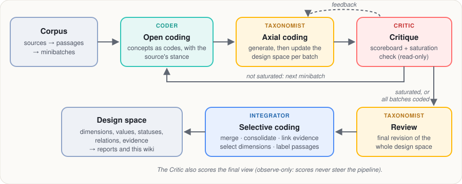
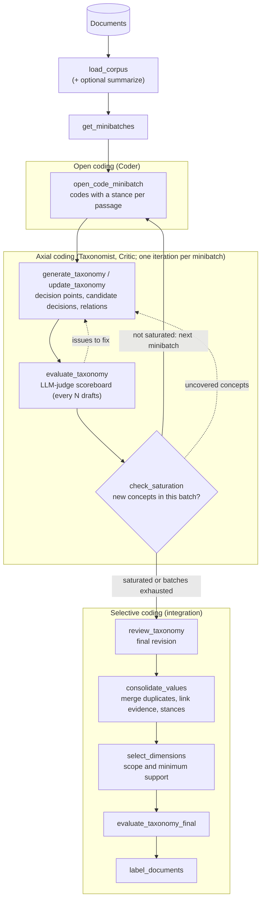

<p align="center">
  
</p>

# DelveDSpace: mining design spaces from text with LLMs

*DelveDSpace: Delve into Design Spaces.*

DelveDSpace reads a collection of documents and builds a **design space** from them. The documents can be
practitioner articles, architecture decision records, design notes, blog posts or interview transcripts. The
design space holds:
- the **decision points** the documents discuss;
- the **candidate decisions** for each one;
- how the sources stand toward each candidate (adopted, rejected or disputed);
- the **outcomes** they report;
- how decision points **relate** to each other.

Every candidate decision keeps links to the passages that support it.

The workflow follows **grounded theory**: open coding, then axial coding until saturation, then selective
coding. It is implemented as a [LangGraph](https://langchain-ai.github.io/langgraph/) workflow of LLM agents,
with deterministic checks in between:
- a **Coder** codes each passage;
- a **Taxonomist** organizes the codes into decision points and candidate decisions through validated, logged editing operations;
- a **Critic** scores each draft and feeds actionable issues back into the next refinement step.

This repository is also the **replication package** of the evaluation: the configurations, the stored runs and
the scripts that rebuild every table. See [Replication package](#replication-package) and
[REPRODUCE.md](REPRODUCE.md).

<p align="center">
  
</p>

## What you get

For a corpus and a short description of what you want to find (the **use case**), DelveDSpace produces:

- **A design space:**
  - decision points (dimensions), each with its candidate decisions and outcomes (values);
  - typed relations between decision points;
  - for every candidate decision, the supporting passages and the stance of each source (`accepted`, `rejected`, `mixed`).
- **The selected view:** the decision points that serve the use case and have enough evidence, plus the ones
  dropped and why.
- **An evaluation scoreboard:** LLM-as-judge scores with actionable reasons, per iteration and for the final
  view.
- **Reports:** a grounded-theory Markdown report and a single-page HTML report.
- **A design-space wiki:** an offline HTML wiki with a page for each dimension, value and source, plus graph
  and tree views.
  - An example, the C3 sample, can be **[browsed online](https://anonymous.4open.science/api/repo/delvedspace-33CC/file/examples/c3-git-at-scale/sample/c3-git-at-scale-sample_taxonomy_20261016_094637_wiki/html/index.html)**. The online viewer blocks scripts, so the
    graph and tree views work only from a download ("Download repository"): open
    `examples/c3-git-at-scale/sample/c3-git-at-scale-sample_taxonomy_20261016_094637_wiki/html/index.html`.
  - How the sample was produced: [examples/c3-git-at-scale/sample/README.md](examples/c3-git-at-scale/sample/README.md).
- **Run history:** every iteration, the edit log, the Critic's feedback, the saturation history and the open
  codes. A run can be audited, compared with other runs, or used as the starting point of a new one.

## How it works



1. **Open coding.** Each passage of a minibatch is coded with short concept labels, each with a rationale and a
   status:
   - `accepted`: the source adopted the decision;
   - `rejected`: it considered and declined it;
   - `outcome`: an effect of decisions, such as a cost or a result.
2. **Axial coding.**
   - The first minibatch's codes produce a draft design space.
   - Each later minibatch updates it by constant comparison: new candidate decisions, new decision points, splits, merges and relations.
   - Every change goes through validated editing operations, which are logged with their reasons.
3. **Feedback inside the loop.**
   - The **saturation check** compares each new minibatch with the design space as it was before that minibatch, and reports concepts it does not cover.
   - The **evaluation** scores the draft and returns issues that name the decision points and values to fix.
   - Both go to the next update. The loop stops once saturation holds for several minibatches in a row, or when the minibatches run out.
4. **Selective coding.**
   - A final **review** revises the design space.
   - **Consolidation** merges duplicate decision points and values, links every open code to the candidate decision it supports, records each source's stance, and drops values with no evidence.
   - **Selection** keeps the decision points that serve the use case and are supported by enough sources and candidate decisions.

## Key concepts

| Term | Meaning |
|---|---|
| **Dimension (decision point)** | A topic phrased as one question that requires a choice, e.g. *Drift detection test: which test detects degradation?* |
| **Value** | Either a **candidate decision** (an alternative answer to the dimension's question) or an **outcome** (an effect of decisions) |
| **Status / stance** | `accepted`, `rejected`, `mixed` (sources disagree) for candidate decisions; `outcome` for effects |
| **Evidence** | The passages whose open codes support a value, counted per value and per dimension (codes, documents, sources) |
| **Relation** | A typed link between two dimensions that reads as a sentence: `requires`, `affects`, `constrains`, `co_occurs_with` (undirected) |
| **Saturation** | New minibatches no longer bring concepts the design space does not cover |
| **Selected dimensions** | The use-case-relevant, sufficiently supported subset of the final design space |

The full vocabulary is in [CONCEPTS.md](CONCEPTS.md).

## Replication package

The evaluation compares DelveDSpace's output with the published models of two architectural decision studies
(C1: ML workflow; C2: monitoring deployed RL systems). It also compares it with a long-context baseline and a
prior-knowledge probe, and with ablations of the Critic's feedback and of validated editing. A third case (C3:
Git hosting at scale) has no expert model.

**Every number in the paper can be recomputed from the stored runs without API calls**, as
[REPRODUCE.md](REPRODUCE.md) explains. It also maps each table to its command.

| Path | What |
|---|---|
| `src/taxonomy_generator/` | The workflow: nodes, prompts (`prompts/`), evaluation and matcher (`evaluation/`), wiki export (`wiki/`) |
| `src/delvedspace/` | The `ddspace` command line and wiki builder |
| `main.py`, `config.yaml` | The pipeline's command line and the default settings |
| `examples/c1-ml-workflow/`, `examples/c2-rl-monitoring/`, `examples/c3-git-at-scale/` | The configuration of each case and variant: full; no Critic feedback; whole-model rewriting; C3 sample and curated |
| `examples/cursor-git-at-scale/` | The 16 curated write-ups behind C3's curated sensitivity corpus |
| `benchmark/c1-ml-workflow/`, `benchmark/c2-rl-monitoring/` | Source inventories (`sources.csv`, manifests with SHA-256), both expert-model views (`gt/gt_paper.json`, `gt/gt_model.json`) and their crosswalk |
| `benchmark/c2-rl-monitoring/replication_package/` | The C2 study's published replication package (Apache-2.0), from which the model view is parsed |
| `benchmark/c3-git-at-scale/` | C3 source inventory, passage-to-system map and stated trade-offs |
| `benchmark/*.py` | Corpus retrieval and building, run matrix, baselines, matcher thresholds, analysis scripts |
| `output/evaluation/` | The stored runs (`runs.csv` lists them) and the analysis outputs (`report/`) |

**Source texts are not redistributed** (copyright). `benchmark/fetch_sources.py` retrieves them from the URLs
and archive snapshots in `sources.csv`. The manifests record the SHA-256 of every retrieved file.

## Installation

Python 3.10 or newer is required.

```bash
python -m venv .venv && source .venv/bin/activate     # or a conda environment
pip install -r requirements.txt
pip install -e .
```

New runs, and the LLM-judged checks, need an OpenAI key in a `.env` file in the repository root (see
[`.env.example`](.env.example)). Recomputing the tables from the stored runs needs none.

```bash
OPENAI_API_KEY=sk-...
```

DelveDSpace uses three LLM roles, set in the `models` section of the YAML configuration:
- **Generation LLM** (`generation_llm`): builds the design space.
- **Evaluation LLM** (`evaluation_llm`): judges it during a run (scoreboard, saturation check).
- **Matching LLM** (`matching_llm`): judges value-option pairs when a run is scored against an expert model.

## Running the pipeline

On a case study, once its corpus is built (see [REPRODUCE.md](REPRODUCE.md), level 3):

```bash
python main.py --corpus examples/c1-ml-workflow/c1-ml-workflow_corpus.json \
               --config examples/c1-ml-workflow/c1_ml_workflow_config.yaml \
               --output results/
python main.py --match-gt results/<run>_taxonomy_<ts>.json --gt benchmark/c1-ml-workflow/gt
```

Or with the `ddspace` command, on your own sources:

```bash
ddspace init my-space && cd my-space && cp ~/Downloads/*.pdf sources/
ddspace sources && ddspace mine && ddspace wiki build && ddspace wiki open
```

Configuration, commands and output files: [USAGE.md](USAGE.md).

## Tests

```bash
OPENAI_API_KEY=dummy python -m pytest tests/unit_tests     # no API calls
```

`test_run_matrix.py::test_matrix_rows_point_at_existing_configs_and_corpora` passes only once the corpora are
built (REPRODUCE.md, level 3, step 1).

## Background

DelveDSpace started from an open-source implementation of TnT-LLM ("Text Mining at Scale with Large Language
Models", Wan et al., [arXiv:2403.12173](https://arxiv.org/abs/2403.12173)), with its minibatch
generate-update-review loop. It builds grounded-theory design spaces instead of flat label taxonomies.

## License

MIT (see [LICENSE](LICENSE)). The C2 replication package keeps its own license.
