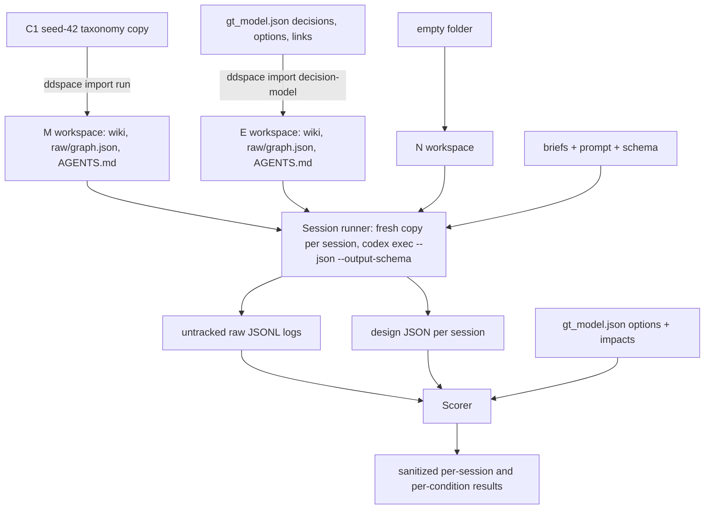

# CAIN Agent Study Tooling - Plan

## Goal Capsule

- **Objective:** ddspace can serve an existing mined run and an imported expert decision model as workspaces a coding agent designs with, and a study harness runs Codex sessions in three conditions and scores them.
- **Authority:** this plan, then the study plan `docs/paper/cain2027/CAIN2027_AGENT_STUDY_PLAN.md` (local, gitignored) for study design, then `CONCEPTS.md` for vocabulary.
- **Execution profile:** feature branch `feat/cain-agent-study` from `main`; merged back when the Definition of Done holds.
- **Stop conditions:** stop and ask if Codex cannot run `ddspace` inside its sandbox at all, or if the matcher judge cannot be pinned to a model different from the Codex model.
- **Tail ownership:** running the 24 sessions, writing the briefs' text with the user, and the paper are outside this plan.

---

## Product Contract

### Summary

Add a `ddspace import` command that turns a mined run or an external decision model into a workspace, teach the AGENTS.md guide a design-sketching workflow, and build a study harness under `study/cain2027/` that prepares the N/M/E workspaces, runs `codex exec` sessions with logging and a fixed output schema, and scores the designs against the C1 expert model.

### Problem Frame

The CAIN 2027 short paper asks whether a coding agent designs ML-enabled systems differently when it has an evidence-linked design space. The study compares no design space (N), the mined C1 space (M), and the C1 expert model (E). Today ddspace only serves spaces it mined itself in a fresh workspace, its agent guide assumes passages exist, and nothing runs or scores agent sessions. The deadline is 2026-10-30, with a go/no-go checkpoint on 2026-10-27, so the tooling must be small and reuse the existing wiki, query, and ground-truth matching layers.

### Requirements

**Tool**

- R1. An existing mining run (taxonomy JSON, corpus, sources) can be loaded as a ddspace workspace in which `query`, `point`, `wiki build`, and `agent setup` work.
- R2. An external decision model in the ground-truth format (`gt_model.json`) can be imported as a design space: decisions become dimensions, options become values, decision links become directed relations; forces and impacts are not imported.
- R3. The AGENTS.md guide written by `ddspace agent setup` includes a design-sketching workflow that uses on-the-fly `ddspace point` combinations, and its citation rules fit spaces without passages.

**Study harness**

- R4. The M and E workspaces and the empty N workspace are built reproducibly from tracked inputs.
- R5. Sessions run headless with Codex: fixed model, web search off, a fresh copy of the workspace per session, the same prompt and output schema in every condition, and a captured event log.
- R6. Each session and each condition is scored on decision coverage, alternatives per decision, design points explored, requirements fit, grounding, consistency, and cost, with the matching judge and thresholds pinned before any session is scored.

**Integration**

- R7. The study folder and its dependencies ship in the anonymous `artifact-tool` branch; the build passes the term scan and commits no third-party source text and no identifying session data.

### Key Decisions

- **Domain C1, mined run seed 42.** (session-settled: user-approved — chosen over seed 44 and over C2: closest to the experts' 28 decisions; C2's 7 expert decisions saturate coverage.) Governs R1, R4.
- **Conditions N, M, E; task T1 only; 4 briefs × 2 repetitions.** (session-settled: user-directed — chosen over 6 briefs and the T2 maintenance task: fits the schedule.) Governs R4, R5, R6.
- **Codex CLI is the agent.** (session-settled: user-directed — chosen over Claude Code.) Governs R5.
- **Design points are composed on the fly with `ddspace point`; no saved designs.** (session-settled: user-directed — chosen over a new `ddspace design` command: already supported, partial unstored combinations work.) Governs R3.
- **`artifact-tool` is rebuilt from `main` by the artifact script, never hand-merged.** (session-settled: user-approved — chosen over cloning the work into the branch: the branch is an orphan built from an allow-list with a rename and a term scan.) Governs R7.

### Success Criteria

- A pilot session per condition runs end to end and produces a scored design by 2026-10-26.
- `ddspace wiki check` passes on the M and E workspaces.
- The dry-run artifact build reports no term-scan hits.

### Scope Boundaries

- No `ddspace design` save/export command, no maintenance experiment with `update --test`, no prompt-injection test, no human ratings, no C2, no MCP server.
- The harness does not write the briefs' content; the user chooses the systems and their forces.

#### Deferred to Follow-Up Work

- A Claude Code replication of the sessions.
- A `docs/solutions/` write-up of the importer and the Codex harness after they land.

---

## Planning Contract

### Key Technical Decisions

- KTD1. **One `ddspace import` command with two input kinds, `run` and `decision-model`.** Both end in a shared helper that adopts a taxonomy JSON as a run under `runs/<id>/`, then the normal `wiki build`. Expert models are instances of the Design-Space Model (`CONCEPTS.md`), so importing them is a tool feature, not study glue. (session-settled: user-approved — chosen over a one-off study script: reportable and reusable.)
- KTD2. **Decision-model import reuses the inverse of `benchmark/evaluation_report.py::taxonomy_to_gt`.** Field mapping mirrors that function; `question` fills the dimension description because C1 decisions have empty descriptions; options marked `unattached` are skipped; an option attached to several decisions becomes one value per dimension with unique ids; all values get status `accepted` and no supporting passages.
- KTD3. **Expert decision links map to `affects` (source → target), then pass through `clean_relations`.** All 40 C1 links carry "Consider If Not Decided Yet", which is advice to consider the target, not a hard requirement; `requires` would make `point` warn about missing dimensions. Every relation path ends in `clean_relations` (`docs/solutions/logic-errors/llm-dimension-relations-reversed-direction-and-split-fan-out.md`).
- KTD4. **Imported runs carry an origin marker that downstream code reads.** `run.json` records `import-run` for input kind `run` and `import-model` for input kind `decision-model`; U2, U3 and U4 use these marker values, never the CLI input kind; the wiki build for `import-model` uses `core_min_sources: 0`, `design_points: none`, and no quotes; `agent setup` reads the marker to drop passage-citation rules and say the space is expert-authored.
- KTD5. **`ddspace point` may generate descriptions in M and E sessions.** The runner enables sandbox network access and passes the OpenAI key through the environment, never as a file inside the agent's workspace. The key is a dedicated study key with a spend cap, revoked after the study, and separate from Codex's own credential and the judge's key. The runner redacts the key value and any `sk-` pattern from logs, designs, and summaries before writing them. It also flags each session whose log shows a network command other than `ddspace` (curl, wget, pip, direct API calls) and restricts egress to the OpenAI host where Codex allows it; flagged sessions are reported. If the pilot shows Codex strips or blocks the key, the guide falls back to `point --no-llm`. (session-settled: user-approved — chosen over offline `--no-llm` only: richer exploration.)
- KTD6. **The design output is constrained by `codex exec --output-schema`.** One JSON Schema for all conditions. Each decision has a name, the alternatives considered, and the chosen alternative kept separate from them; each alternative has a label, a nullable graph value id (`v:` id, filled in M and E, null in N), a rationale, and a list of citation objects (passage ids or space element ids; empty in N). Every property is required, with nullable or empty values, as `--output-schema` needs. One fixture design is validated by both the runner and the scorer. This replaces a free-text template parser.
- KTD7. **Session logs come from `codex exec --json`, and only an allow-listed summary is kept.** For every `ddspace point` call the runner records the combination, success or failure, and warnings; scoring rejects a summary missing them. The summary holds only `ddspace` subcommand names and counts, the point events, input and output token counts, wall time, model ids, and exit status, with any path made relative to the session copy. Raw logs and scratch copies are deleted after summarizing.
- KTD8. **Scoring calls the matcher's pair labelling directly, not `run_match`.** Each design becomes `Item`s scored with `label_pairs` against the attached C1 expert options, reusing `MatcherConfig` and the on-disk `JudgeCache`. `compute_metrics` is skipped because its recall runs over all 121+ expert options. Decision coverage is the share of the 28 expert decisions with at least one matched option.
- KTD9. **Requirements fit is computed from expert impacts.** Each brief lists its forces as force ids from the C1 expert model; the scorer rejects a brief with an unknown force id or with forces that affect none of the 28 decisions. Impact symbols map to numbers (`++`=2, `+`=1, `o` and `+/-`=0, `-`=-1, `--`=-2), and a missing impact counts as 0. For each touched expert decision, sum each option's impacts on the brief's forces; fit = (chosen − worst) / (best − worst) over that decision's attached options. A decision where best equals worst is excluded. A touched decision whose chosen alternative matches no expert option is recorded as "choice unmatched" and excluded, and the matched-choice count is reported next to fit. Session fit is the mean over qualifying decisions, or not applicable when none qualify.
- KTD10. **The judge and thresholds are pinned in a dated frame entry before scoring.** The matching model stays `openai/gpt-5.4-mini` with the frozen thresholds (`docs/solutions/architecture-patterns/embedding-proposes-llm-judge-decides-ground-truth-matching.md`); the Codex model must differ from it, and both are recorded per session.
- KTD11. **The harness lives in a new tracked folder `study/cain2027/`, added to the tool allow-list.** It holds a trimmed copy of the C1 seed-42 taxonomy (selected clusters plus the last iteration), a sanitized copy of its `config.yaml`, an input manifest with content hashes of every input, the briefs, the schema, the prompt, the scripts, and sanitized results. (session-settled: user-approved — chosen over placing it in `benchmark/`: one folder ships with the artifact.)
- KTD12. **Condition E is full expert-model access, not a ceiling.** Its dimensions are the expert decisions that scoring uses, so coverage and fit favour it, but its scores still depend on what each session addresses; the session import and the scoring ground truth both read `benchmark/c1-ml-workflow/gt/gt_model.json`, and the study reports this.

### High-Level Technical Design

### Assumptions

- The C1 seed-42 run's `config.yaml` (not the iCloud duplicate `config 2.yaml`) is the source of the workspace settings.
- Codex's working directory can be a copied workspace outside the repository with `--skip-git-repo-check`.

### Open Questions

- Deferred: the exact Codex configuration keys that disable web search, allow sandbox network, and pass the API key through; verified in the pilot (U5).
- Deferred: the Codex model for the sessions; the user picks one before the pilot, different from the matching model.
- Deferred: the four briefs' systems and forces; written with the user before the sessions run.
- Deferred: prompt injection through imported content (labels, questions, relations) could steer a networked session. All content is the user's own mined space or the published expert model, and injection tests are out of scope, so the paper names it as a threat; revisit if untrusted models are imported.

### Sources

- Repository research: `src/delvedspace/cli.py`, `workspace.py`, `runs.py`, `agent.py`, `point.py`, `wiki_build.py`; `src/taxonomy_generator/wiki/model.py`, `wiki/query.py`; `src/taxonomy_generator/evaluation/gt_match.py`; `benchmark/evaluation_report.py`; `docs/paper/scripts/make_artifact_branch.py`.
- A scratch test confirmed that a taxonomy with no passages builds a wiki and that `query.point` and `query.dims` work on its `raw/graph.json`.
- Local Codex CLI 0.163.0: `codex exec` supports `--json`, `-o`, `--output-schema`, `-C`, `-s`, `-m`, `--skip-git-repo-check`, `--ephemeral`, `--ignore-user-config`, and `-c` overrides.

---

## Implementation Units

### U1. Run adoption and `ddspace import` for runs

- **Goal:** load an existing taxonomy JSON with its corpus and sources as the current run of a workspace.
- **Requirements:** R1; KTD1, KTD4.
- **Dependencies:** none.
- **Files:** `src/delvedspace/importer.py` (new), `src/delvedspace/runs.py`, `src/delvedspace/cli.py`, `tests/unit_tests/test_ddspace_import.py` (new).
- **Approach:**
  1. Add a run-adoption helper in `runs.py` that copies a taxonomy JSON into `runs/<id>/`, writes `run.json` with the given kind, and sets `workspace.current_run`.
  2. Add the `import` command in `cli.py` (function named to avoid the Python keyword), thin, delegating to `importer.py`; it takes the input path, the kind, optional corpus and sources, and `--yes`.
  3. For kind `run`, copy the corpus to the run snapshot and the sources CSV to the workspace.
- **Patterns to follow:** `point.py` and `wiki_build.py` keep logic out of `cli.py`; `current_workspace()`, `fail()`, `ui.header`, `ui.summary`; `_add_run` in `tests/unit_tests/test_ddspace_wiki.py`.
- **Test scenarios:**
  - Importing the toy taxonomy with corpus and sources makes it the current run, and `wiki build --no-llm` then writes `raw/graph.json`.
  - After import, `query dims` lists the toy dimensions and `point` on two values returns their sources in `attested_by`.
  - Importing without a corpus succeeds, and value pages have no quotes.
  - A missing input file fails with a clear message and leaves `current_run` unchanged.
  - Importing into a workspace that already has a current run asks for confirmation unless `--yes` is given.
- **Verification:** the C1 seed-42 run imports and `ddspace wiki check` passes on the result.

### U2. Decision-model import

- **Goal:** convert a ground-truth decision model into a taxonomy JSON and import it through the U1 helper.
- **Requirements:** R2; KTD2, KTD3, KTD4.
- **Dependencies:** U1.
- **Files:** `src/delvedspace/importer.py`, `src/delvedspace/wiki_build.py`, `tests/unit_tests/test_ddspace_import.py`.
- **Approach:**
  1. Read the model with `benchmark/gt_format.py::load_ground_truth` when available, otherwise as JSON.
  2. Map decisions, options, and links per KTD2 and KTD3; give each dimension and value a stable id; leave evidence empty.
  3. Mark the run as `import-model` and make `wiki_build` apply the KTD4 settings for that kind.
- **Patterns to follow:** `benchmark/evaluation_report.py::taxonomy_to_gt` for the inverse mapping; `clean_relations` in `src/taxonomy_generator/relations.py`.
- **Test scenarios:**
  - A small model with two decisions, four options, and one link imports as two dimensions, four values, and one `affects` relation in the source → target direction.
  - An option attached to two decisions appears once under each dimension with distinct value ids.
  - An `unattached` option is not imported.
  - A decision with an empty description takes its `question` as the description.
  - Forces and impacts are absent from the taxonomy and from `raw/graph.json`.
  - A link whose reverse also exists comes out normalized by `clean_relations`, without opposite duplicates.
  - The built graph has no source nodes, `point` returns an empty `attested_by`, and every dimension counts as core.
- **Verification:** the C1 expert model imports as 28 dimensions and the wiki check passes.

### U3. Design workflow in the agent guide

- **Goal:** add a "sketch a design" section to AGENTS.md and an expert-authored variant of the citation rules.
- **Requirements:** R3; KTD4, KTD5.
- **Dependencies:** U2.
- **Files:** `src/delvedspace/agent.py`, `tests/unit_tests/test_ddspace_query_agent.py`.
- **Approach:**
  1. Add the section to `guide()`: identify the dimensions relevant to the brief, consider at least two alternatives for each, try two or three candidate combinations with `ddspace point`, use its warnings and attestations in the rationale, and cite.
  2. Read the run kind; for `import-model`, describe the space as expert-authored and replace "cite passage ids" with "cite dimension and value ids".
  3. Mention `point --no-llm` as the fallback when descriptions are unavailable.
- **Patterns to follow:** the existing `guide()` sections and `_examples()` filled from `graph.json`; the `upsert_block` markers.
- **Test scenarios:**
  - `agent setup` on a mined run writes the design section, with examples that use real dimension names.
  - `agent setup` on an `import-model` run says the space is expert-authored and has no passage-citation rule.
  - Running `agent setup` twice keeps a single ddspace block.
  - The existing assertions on guide text still pass after they are updated for the new section.
- **Verification:** both workspace kinds produce an AGENTS.md a reader can follow without passages where none exist.

### U4. Study workspaces

- **Goal:** build the N, M, and E workspaces from tracked inputs with one script.
- **Requirements:** R4; KTD11, KTD12.
- **Dependencies:** U1, U2, U3.
- **Files:** `study/cain2027/README.md` (new), `study/cain2027/build_workspaces.py` (new), `study/cain2027/inputs/` (trimmed C1 seed-42 taxonomy, sanitized `config.yaml`, sources CSV, `manifest.json`), `tests/unit_tests/test_cain_study.py` (new).
- **Approach:**
  1. Write the trimmed taxonomy copy and a sanitized `config.yaml` (no absolute paths) once from `output/evaluation/c1-ml-workflow/full_s42/`, write a manifest with content hashes of all inputs, and track them.
  2. The script initialises each workspace from the tracked `config.yaml`, imports M (kind `run`, no corpus, so no quotes ship) and E (kind `decision-model`), turns off sampled wiki design points in both, builds wikis with `--no-llm`, runs `agent setup`, and records the manifest in each workspace; N is an empty folder with only the brief.
- **Patterns to follow:** the X1 recipe from the repository research (init from config, adopt run, set current run, build); benchmark scripts loaded in tests with `importlib.util.spec_from_file_location`.
- **Test scenarios:**
  - The trimmed taxonomy keeps the same dimensions and values as the original selected clusters.
  - On the toy inputs, the script produces three folders, and M and E each contain `raw/graph.json` and AGENTS.md.
  - Running the script twice replaces the workspaces without leftovers.
  - From a clean checkout with no `output/` folder, the script builds M and E from tracked inputs only, and each workspace records the manifest.
  - The M and E wikis contain no sampled design points.
- **Verification:** the real M and E workspaces pass `ddspace wiki check`, and `query dims` lists 32 and 28 dimensions.

### U5. Codex session runner

- **Goal:** run one session per brief, condition, and repetition headless, and capture the design and the event log.
- **Requirements:** R5; KTD5, KTD6, KTD7, KTD10.
- **Dependencies:** U4.
- **Files:** `study/cain2027/run_sessions.py` (new), `study/cain2027/design.schema.json` (new), `study/cain2027/prompt.md` (new), `study/cain2027/briefs.yaml` (new; content from the user), `tests/unit_tests/test_cain_study.py`.
- **Approach:**
  1. For each session, copy the condition's workspace into a scratch directory with the brief.
  2. Run `codex exec` with the pinned model, `--json`, `--output-schema`, `-o`, `-C` on the copy, `--skip-git-repo-check`, `--ephemeral`, `--ignore-user-config`, a workspace-write sandbox, web search off, and network plus the API key per KTD5.
  3. Before the session, check the model id, the web-search setting, the workspace origin, and the prompt and schema hashes; after it, check that the event log is complete. A failed check aborts the session and records why.
  4. Write the design JSON and the KTD7 summary under an untracked results folder; skip sessions that already have a design.
- **Execution note:** pilot one session per condition before the full run; the pilot settles the deferred Codex configuration keys.
- **Patterns to follow:** `benchmark/run_matrix.py` for batch orchestration and resumable runs.
- **Test scenarios:**
  - The command built for a session contains the pinned model, the schema, the workspace copy, and the network setting only for M and E.
  - A recorded JSONL fixture yields the right number of `ddspace` and `point` invocations and the token total.
  - A session whose design file exists is skipped on rerun.
  - A Codex exit with no last message is recorded as a failed session, not as an empty design.
  - A JSONL fixture that contains an absolute home path and a username yields a summary with neither.
  - A session whose preflight finds web search enabled, or whose log lacks the completion event, is aborted and recorded as failed.
  - The fixture design validates against the schema in both the runner and the scorer.
- **Verification:** the pilot produces three schema-valid designs and three summaries.

### U6. Scoring

- **Goal:** compute the study metrics per session and per condition.
- **Requirements:** R6; KTD8, KTD9, KTD10, KTD12.
- **Dependencies:** U5 (schema and summaries).
- **Files:** `study/cain2027/score.py` (new), `benchmark/README.md` (dated frame entry), `tests/unit_tests/test_cain_study.py`.
- **Approach:**
  1. Turn each design's considered alternatives into matcher items and label them against the attached C1 expert options with the pinned judge and cache.
  2. Compute decision coverage, alternatives per decision and their match share, requirements fit, grounding (citations present, and the cited ids exist in that condition's graph), consistency for M and E (rejected values or two values on one dimension, via the query layer's point checks), explored points, and cost.
  3. Compute cost as input and output tokens priced in USD from a dated rate table for the recorded model.
  4. Write per-session rows and per-condition means with ranges, plus the matching model and the Codex model.
- **Execution note:** before the full scoring run, hand-check the judge's labels on the three pilot designs (matched and unmatched alternatives) and record the agreement in the dated frame entry.
- **Patterns to follow:** `FakeJudgeModel` and `fake_embedder` in `tests/unit_tests/test_gt_match.py`; the judge factory in `src/taxonomy_generator/evaluation/judge.py`.
- **Test scenarios:**
  - A design whose alternatives match options under 3 expert decisions has a decision coverage of 3/28.
  - Requirements fit is 1.0 when the chosen option has the best impact sum on the brief's forces, 0.0 when it has the worst, and in between otherwise.
  - A decision whose options all have the same impact sum (including all zero) is excluded from requirements fit, without division by zero.
  - A decision whose best sum is 0 and whose other options are negative gives a fit between 0 and 1.
  - A chosen alternative that matches no expert option is counted as "choice unmatched" and left out of the mean.
  - Cost for a fixture summary equals its token counts times the rate table's prices.
  - A JSONL fixture containing a curl command is flagged as a network-using session.
  - A citation to an id missing from the condition's graph counts as ungrounded.
  - An N design with no citations gets grounding not-applicable rather than zero.
  - Rerunning the scorer reuses cached judge labels and gives identical results.
  - A brief with an unknown force id, or with forces that affect none of the 28 decisions, is rejected with an error naming the brief.
  - A summary missing the point events is rejected.
- **Verification:** the pilot designs score end to end, and the frame entry is dated before the first scored session.

### U7. Artifact allow-list

- **Goal:** ship the study folder and its dependencies in `artifact-tool`.
- **Requirements:** R7; KTD11.
- **Dependencies:** U4, U5, U6.
- **Files:** `docs/paper/scripts/make_artifact_branch.py`.
- **Approach:**
  1. Add `study/cain2027`, `benchmark/gt_format.py`, and `benchmark/c1-ml-workflow/gt/` to the tool allow-list.
  2. Check that the tests the study needs are not pruned by the tool exclusions.
  3. Keep raw logs, the corpus, and PDFs out of the tracked study folder.
- **Patterns to follow:** the existing `GIT_PATHS`, `EXCLUDE`, `REPLACE`, and `TERMS` structure.
- **Test expectation:** none -- configuration of a build script; verified by its dry run.
- **Verification:** a dry run of the tool build after the merge into `main` reports no term-scan hits and includes the study folder.

---

## Verification Contract

| Gate | Applies to | Command or check |
|---|---|---|
| Unit tests | U1–U6 | `make test` (or `python -m pytest tests/unit_tests/test_ddspace_import.py tests/unit_tests/test_ddspace_query_agent.py tests/unit_tests/test_cain_study.py -q`) |
| Lint | U1–U6 | `ruff check src study tests` |
| Wiki conformance | U1, U2, U4 | `ddspace wiki check` in the M and E workspaces |
| Pilot | U5, U6 | One session per condition runs and scores |
| Artifact dry run | U7 | `python docs/paper/scripts/make_artifact_branch.py tool` from `main` reports no hits |
| Graph refresh | all | `graphify update .` after code changes (project rule) |

---

## Definition of Done

- All units' test scenarios pass, and lint is clean.
- The M and E workspaces build from tracked inputs and pass the wiki check.
- The pilot produced and scored one design per condition.
- The frame entry pins the judge and thresholds with a date before any scored session.
- The artifact dry run passes the term scan with the study folder included.
- No raw Codex logs, corpus text, or absolute paths are tracked; experimental code from abandoned approaches is removed.
- The branch is merged into `main`.
