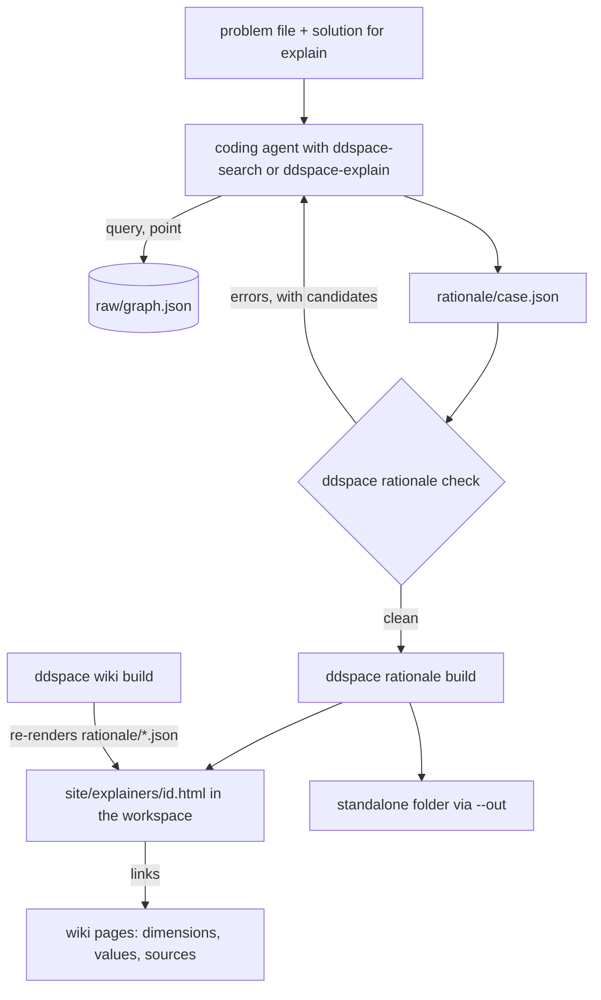

# Rationale search and explain - Plan

## Goal Capsule

- **Objective:** coding agents produce design rationale over a design space with two skills, *search* and *explain*. They write one rationale file that `ddspace rationale check` validates. `ddspace rationale build` renders the file as a browsable explainer page linked to the wiki. The same skills run without a space.
- **Why now:** this is the tool side of the Designing 2027 workshop paper (due 2026-11-13). The study sessions start on 2026-11-08.
- **Minimum by 2026-11-08:** U1, U4, U5 and the U3 core (`rationale build` renders one search or explain page with wiki links, plus `--out`). The rest may land after sessions start, before the paper's figures are fixed:
  - U3 follow-ons: `wiki build` persistence, `rationale list`, the HTML index list, the graph-changed banner, the explainer browser test;
  - U2 (the shared layout script): until it lands, the explainer may carry its own copy of the radial code.
- **Authority:** the Product Contract's requirements win on behavior. KTDs win on mechanism. Units carry only local detail. The paper plan (`docs/paper/designing2027/DESIGNING2027_PAPER_PLAN.md`, local) owns the study design. This plan owns only the runner support for it.
- **Stop conditions:**
  - Stop and ask if Codex cannot load the skills and also cannot take them through the prompt (U5 smoke test).
  - Stop and ask if the explainer cannot survive `ddspace wiki build` without changing the OKF bundle.
- **Revision 2026-11-07 (U7–U10):** after reading the hand-written examples and the skills, the user redirected the design: one skill per mode with a space reference file, design points as the decisions, a capped and recorded agent trajectory, regions in explain, and the trajectory shown on the page. It supersedes R1, R12, KTD1 and KTD11 where they conflict; see the revision blocks below.
- **Revision 2026-11-08 (U11–U12):** the user had the skills rewritten in design-space terms in every condition (without a wiki the agent builds its own space), with a round-based search loop taken from AgentDSE's Algorithm 1 and the design-exploration skill, and approved them. Schema 3 follows. It supersedes R15 and R16 where they conflict.
- **Execution profile:** U1 first. Then U2 and U4 in parallel. U3 needs U1 and U2. U5 needs U1, U3 and U4. U6 last.

---

## Product Contract

### Summary

Two agent skills turn a design space into design rationale.

- **Search** takes a system context with requirements and returns two to four alternatives. Each choice is explained by the space.
- **Explain** takes an already defined solution. It maps each of the solution's decisions onto the space and lists the decisions the space does not cover.

Both skills write a `ddspace-rationale/1` file. `ddspace` checks the file and renders it as an explainer page. The page shows the rationale as a subgraph of the space and links each item to its wiki page.

### Problem Frame

Coding agents make design decisions without leaving rationale behind. The CAIN study measured whether an agent's answers improve with a space. It did not look at what rationale the agent records, and it did not work in the reverse direction, from a solution back to its decisions.

A design space gives rationale a shared vocabulary: decisions, options, evidence and relations. Without one, an agent's rationale names ad hoc decisions that a reader cannot trace. The paper compares the two qualitatively, so both conditions need the same artifact and the same page.

### Key Decisions

- **Search and explain for the paper, not the extend mode** (session-settled: user-directed — chosen over the hybrid extend mode: the paper is about rationale artifacts, and explain is the new reverse direction). Governs R10, R11.
- **The space is not judged.** The skills and the explainer behave the same on a mined space and an expert space. `uncovered` lists the decisions the agent could not map with the available commands: an upper bound on what the space lacks, not a measure of its quality. Governs R2, R6, R14.
- **Without a space, the same artifact and the same page.** This makes the no-space condition comparable. Governs R3, R9.

- **Design points are the decisions** (session-settled: user-directed, 2026-11-07 — chosen over treating each dimension as a decision: a dimension is a design concern, a value one option for it, and a decision is a combination of values, a design point). The skills survey dimensions and values first, then build, compare and propose design points. Governs R15, R16.
- **A capped, recorded trajectory in both modes** (session-settled: user-directed, 2026-11-07). Search follows an exploration/exploitation heuristic; explain looks for the regions of the space (partial design points) that best justify the given solution. Each mode records its steps, and the page shows them, each mode in its own way. Search may investigate at most 20 design points (12 by default); explain at most 12, and fewer when the solution is simple or already grounded. Move distances are not checked. Governs R16–R19.
- **One skill per mode, with a space reference** (session-settled: user-directed, 2026-11-07 — chosen over a with-space and a no-space variant of each skill). The skill text is the same in every condition; a reference file in the skill folder maps its general terms onto the space. Governs R20.

- **Design-space terms in every condition** (session-settled: user-directed, 2026-11-08 — chosen over agent-named concerns and options without a space). Both skills speak of dimensions, values, relations and design points. Without a wiki, the agent builds its own space and records it in the file; the reference only maps the operations onto `ddspace` commands. Governs R21.
- **Search in rounds over approaches** (session-settled: user-approved, 2026-11-08). Each point goes through AgentDSE's loop (hypothesis, check before evaluating, evaluate, observe, rate). Round 1 seeds two to four divergent "what if" approaches; later rounds refine strong points, carry the good values of mixed ones, drop weak approaches with a binding reason, and keep one slot for a new approach in every round but the last. It stops on the budget or after a round with no improvement (at least two rounds). It returns the best point of each live approach that no other point beats on some requirement without being worse on any. Default three rounds of about four points. Governs R22.
- **Explain as hypothesis and contrast** (session-settled: user-approved, 2026-11-08). Regions are hypotheses about which requirements explain which values; a contrast is an ablation that tells forced values from free ones, and each choice records `forced`. Governs R23.

### Requirements

**Rationale file**

- R1. One file shape (`ddspace-rationale/1`) serves both directions. Explain is a single alternative with solution quotes and an `uncovered` list.
- R2. With a space, every choice names the dimension and value ids exactly as `ddspace query` prints them (`d:…`, `v:…`). The file records which space it was written against.
- R3. Without a space (`space: null`), choices name the agent's own `decision` and `option` labels, and an explain file's `uncovered` list is empty.

**Checker**

- R4. `ddspace rationale check FILE` reports every problem in machine-readable form, with a stable code and the location in the file. For each id, it shows the label the id resolves to.
- R5. Without a space, the checker checks only structure: required fields, requirement links, and at most one option per decision in an alternative.

**Explainer**

- R6. The explainer is a browsable HTML page with these parts:
  - the requirements;
  - one tab per alternative, plus a compare view (one column per alternative, one row per dimension involved, differing rows first);
  - a radial subgraph of the dimensions involved;
  - a details panel for the selected item (fields per node kind in U3);
  - for explain, the list of uncovered decisions.
- R7. With a space, every dimension, value and source in the explainer links to its wiki page.
- R8. Explainers in a workspace survive `ddspace wiki build`. A rationale file written against an earlier graph is flagged.
- R9. A no-space rationale renders as a standalone page outside any wiki.

**Skills**

- R10. The `ddspace-search` skill guides an agent from a problem file to a clean rationale file.
- R11. The `ddspace-explain` skill guides an agent from a problem file and a solution description to a clean rationale file.
- R12. `ddspace agent setup --skills` installs both skills for Claude Code and Codex. Each skill comes in a with-space and a no-space variant.
- R13. The agent guide and the allow rules stay consistent with the new commands.

**Revision 2026-11-07**

- R15. The file shape is `ddspace-rationale/2`. Every alternative is a design point: it names the trajectory step it comes from, and its choices are exactly that step's values.
- R16. Both modes record a `trajectory`: numbered steps, each a design point (or a partial one) that the agent investigated with a `move`, an optional `parent` step, its `why`, its `verdict` and what `ddspace point` reported. Search moves are `seed`, `exploit` and `explore`; explain moves are `solution`, `region` and `contrast`.
- R17. The file states its `budget` (`max_points`). The checker reports a `budget` error when the trajectory has more steps than the budget, or the budget exceeds the mode's maximum (search 20, explain 12).
- R18. An explain file names 1–3 `regions`: partial design points of the solution's values, each with the requirements that drive it and the step that probed it.
- R19. The explainer shows the trajectory as text and as a chart. Search: a lineage grid (one column per step, one row per dimension, changed cells marked, parent links, kept points marked). Explain: the solution's dimensions against the probing steps, with the regions as bands. Selecting a step highlights its point in the subgraph.
- R20. Each skill is one `SKILL.md` for every condition. With a space, `agent setup --skills` also writes `references/design-space.md` in the skill folder; `--no-space` leaves it out (and removes one it wrote before).

**Revision 2026-11-08**

- R21. The file shape is `ddspace-rationale/3`. Every value is an id. `space` names a wiki (`{workspace, run, graph_sha256}`) or carries the agent's own space (`{dimensions, relations}`); the checker resolves ids against whichever it is.
- R22. Search steps carry `round`, `approach`, `hypothesis`, `assessment` (meets, partly or misses per requirement), `observation` and `rating` (strong, mixed, weak); moves are `seed`, `exploit`, `explore` and `ablate`. The file lists its `approaches`. Each alternative is the step of its own live approach, one per approach, never a weak step.
- R23. Explain steps carry `hypothesis`, `assessment`, `observation` and `verdict`; each choice of the solution records `forced` (`true`, `false` or `null`).

**Study support**

- R14. A session runner runs the skills on study cases in three conditions: mined space (M), expert space (E) and no space (N). For each session it keeps the rationale file, the final check result and the number of check runs. It also flags ids that no command returned during the session. After each explain session, it looks up every uncovered item in the graph with a broader search and records the ones the space does cover as retrieval misses.

### Scope Boundaries

- No scoring or ranking of alternatives.
- No judging of the space.
- No LLM call in `ddspace rationale`. The only LLM call in the feature is `ddspace point`'s description, which the skills request (KTD9).
- No passage quotes in the explainer (KTD6).

#### Deferred to Follow-Up Work

- A `ddspace query subgraph` command, if the recorded sessions show agents struggling to find relevant dimensions.
- `ddspace rationale check --fix`, which would resolve labels to ids.
- Copilot skills.
- Forces in choices, once improvement 2a lands.

### Success Criteria

- Before the 24 study sessions, these pilots end with a clean `check` and a rendered explainer:
  - a search session and an explain session on the C1 mined space;
  - one session on the C1 expert space;
  - one no-space session, with a clean structural check and a standalone explainer.
- A person reads each pilot rationale and confirms that the alternatives are distinct, that each requirement drives at least one choice and, in explain, that every decision in the solution is mapped or listed as uncovered. If a pilot falls short, the skill text is revised before the study.
- A designer can follow every choice in the explainer to its wiki page and back without a dead link.

### Sources

- The CAIN agent study: `study/cain2027/` (runner, guards, recorded sessions).
- Codex skills: repository skills are read from `.agents/skills/<name>/SKILL.md`, from the working directory up to the repository root. Each `SKILL.md` needs `name` and `description` front matter. Source: OpenAI Codex docs, https://developers.openai.com/codex/skills.
- Product Contract preservation: the earlier draft of this file was restructured into this contract. The behavior changes are:
  - ids are the graph's prefixed ids (R2);
  - workspace explainers live under `site/`;
  - the no-space condition gets a structure-only checker (R5, KTD3);
  - evidence shows passage ids, not quotes (KTD6).

---

## Planning Contract

### Key Technical Decisions

- KTD1. **One schema, two fill patterns.** Search fills `alternatives`, `considered`, `open` and `comparison`. Explain fills one alternative (`id: "S"`) with `solution_quote` on each choice, plus `uncovered`. A relation claim is `{source, target, type, holds, note}`: `source` and `target` are dimension ids, `type` is one of the graph's relation kinds, and direction follows the graph's `directed` flag. One sample file, `tests/unit_tests/fixtures/rationale_search.json`, is shared by the checker tests, the skill text and the explainer tests. The schema lives in `src/delvedspace/rationale.py` as a small validator, following `study/cain2027/design.py`, so no `jsonschema` dependency is added. (Governs R1.)
- KTD2. **Ids are canonical graph ids.**
  - The checker resolves each reference with `q.resolve(graph, ref, kinds)`. That helper also accepts bare ids, slugs and labels, so the checker compares the reference with the returned id: a difference is `not_canonical`, with the returned id as the candidate. `q.NotFound` maps to `unknown_id` with its candidates. `value_not_in_dimension` compares the value's own `dimension_id` with the cited dimension.
  - A bare id, slug or label is an error. The error names the canonical id it resolves to ("did you mean `v:12.3`"). The checker does not rewrite the file.
  - The file records `space: {workspace, run, graph_sha256}`.
  - The explainer reads labels, descriptions and pages from the graph, never from the file, so the file cannot misquote the space. (Governs R2, R4.)
- KTD3. **Structure-only check without a space** (session-settled: user-directed — chosen over no checker for the no-space condition: every condition gets the same feedback loop, so the comparison is about the space alone). With `space: null`, the checker runs the structural rules only, with the same output shape. A file that names a space but whose graph cannot be loaded is a graph error (exit 2); `build` and `list` report it as such. (Governs R5, R14.)
- KTD4. **Check output follows `ddspace query`.**
  - **Format:** JSON by default, `--table` for people.
  - **Result object:** `{ok, graph_sha256, problems: [{code, severity, path, message, candidates}], resolved: [{id, label}]}`, where `path` is a JSON Pointer into the file.
  - **Codes:**
    - `schema` — a required field is missing or has the wrong shape;
    - `unknown_id` — an id is not in the graph;
    - `not_canonical` — a bare id, slug or label is used instead of the canonical id;
    - `value_not_in_dimension` — the value does not belong to the dimension it is cited under;
    - `two_values_one_dimension` — an alternative picks two values of one dimension;
    - `unknown_requirement` — a driver names no requirement;
    - `evidence_not_on_value` — the cited passage is not in that value's `passages`;
    - `relation_mismatch` — a claimed relation is missing from the graph, or has another type or direction;
    - `unmet_requires` — a `requires` relation is not satisfied (from `q.point`);
    - `graph_changed` — `graph_sha256` differs from the current graph.
  - **Severity:** `graph_changed` and `unmet_requires` are warnings; the rest are errors.
  - **Exit codes:** 0 clean (warnings allowed), 1 errors, 2 usage error, unreadable file, or a named space whose graph cannot be loaded. (Governs R4.)
- KTD5. **Where explainers live.**
  - **In a workspace:** `rationale build` copies the file to `<workspace>/rationale/<id>.json` and renders `site/explainers/<id>.html`.
  - **In an export:** `benchmark/export_wiki.py --rationale DIR` renders into `<out>/html/explainers/`.
  - **Rendering inside the export:** explainers are rendered inside `render.write()` before `_remove_stale`, so `raw/exported.json` lists them and a rebuild keeps them. `ddspace wiki build` checks, then re-renders, every file in `<workspace>/rationale/`: a broken file is skipped with a warning, so its old page is removed, and a changed file renders with the banner. `rationale build` writes through the same helper.
  - **Without a space:** `rationale build FILE --out DIR` writes a standalone folder with the page and its assets. (Governs R8, R9.)
- KTD6. **Evidence without quotes.** `raw/graph.json` holds no passage text. Choices show passage ids and stances. Each value links to its wiki page, which shows quotes when the wiki allows them. (Governs R6, R7.)
- KTD7. **Changed graph versus broken file.** A hash mismatch only means the graph changed: the explainer shows a banner and `check` warns. The id checks decide whether the file is broken, and `rationale list` reports `ok`, `changed` or `broken`. (Governs R8.)
- KTD8. **Relations are checked as far as the graph allows.** A claimed relation must exist with the claimed type and direction. Unmet `requires` comes from `q.point`. The checker does not verify a claim that a relation "holds" beyond that. (Governs R4.)
- KTD9. **Design points are generated as the agent requests them** (session-settled: user-directed — chosen over forcing `ddspace point --no-llm`: the point's description is part of the rationale the agent records). Skills call `ddspace point` with its LLM description (or the wiki's own description when the point exists) and record `description` and `attested_by`; `--no-llm` is only a fallback when the call fails. The checks behind it (`q.point`) accept any subset of values, so open dimensions are left out of the point. In the study, M and E sessions get network access and the study key for this call, as in CAIN; N gets neither. (Governs R10, R11, R14.)
- KTD10. **The radial layout becomes a shared script.**
  - `radialTargets`, `orientLabels` and the ring constants move to `src/taxonomy_generator/wiki/templates/graph-layout.js`.
  - The file sits in the templates folder because the current package-data glob already ships that folder. `write_html` copies it to `assets/`.
  - The functions take rotation, rings, kind-to-ring mapping and spacing as parameters, so the explainer can add a requirement ring.
  - The selection reset rules move with the code (see `docs/solutions/ui-bugs/graph-filter-change-kept-stale-selection-fade.md`). (Governs R6.)
- KTD11. **One skill template, two variants.**
  - The templates are `src/delvedspace/templates/skills/<name>/SKILL.md.j2`. The no-space variant drops the `ddspace query` and `ddspace point` steps and keeps `ddspace rationale check`. The no-space explain variant also leaves out the uncovered step.
  - The skills are installed to `.claude/skills/<name>/SKILL.md` (Claude Code) and `.agents/skills/<name>/SKILL.md` (Codex), relative to the setup target.
  - `pyproject.toml` package data gains an explicit `templates/skills/*/*` entry.
  - The skill text tells the agent:
    - to search with single keywords, because `q.search` matches the whole query as one substring;
    - never to name a dimension, value or relation in prose that the file does not reference. (Governs R10–R12.)
- KTD12. **Agent guide and permissions.**
  - Rule 1 of `AGENTS.md` (`agent.guide`) gains one exception: `ddspace rationale build` may write `rationale/` and `site/explainers/`, and `rationale build --out` may write an `explainers/` folder in the working directory.
  - `check` and `list` join the read-only allow rules. `build` gets its own rule.
  - `_ANY_QUERY_PERMISSION` and `disallow_query` in `agent.py`, and `_purge` in `cli.py`, cover the new rules and the skill folders. (Governs R13.)
- KTD13. **The study runner reuses CAIN modules and keeps the CAIN folder unchanged.**
  - `study/designing2027/run_sessions.py` imports from the CAIN runner, as is: the guards (`preflight` network and web checks, `model_mismatch`, `prompt_mismatch`), the event parsing (`_inner`, `_ddspace_calls`, `_ddspace_args`), `design.redact` and `_codex_home`.
  - It defines its own `command()` (no `--output-schema`), its own `_environment()` (`ddspace` on PATH for N too), and its own `summarize`, `postflight` and `pending` (counting `rationale check`, keyed on the kept rationale file).
  - The agent writes `./rationale/<case>.json`. The runner then runs `ddspace rationale check` and builds the explainer from the kept file, after the session.
  - The skill text goes to Codex either through `.agents/skills` in the work copy or, if the runner flags block discovery, through the prompt on stdin. A smoke test decides which, before any session.
  - N sessions get `ddspace` on PATH with no workspace, so only the structural check is available. (Governs R14.)

- KTD14. **Schema 2 replaces schema 1** (the feature is unshipped; the only schema-1 files are the fixture and the examples, which are rewritten). A step's `values` are value ids with a space, `{decision, option}` pairs without one. The `point` record (`description`, `attested_by`) moves from the alternative to each step. The checker runs the existing value rules on every step (`unknown_id`, `not_canonical`, `two_values_one_dimension`, `unmet_requires` as a warning) and adds: `bad_step` (step numbers not 1..n in order, a parent that is not an earlier step, a move not allowed in the mode), `step_mismatch` (an alternative or a region names a missing step, a step of the wrong move or verdict, or a step with other values), `region_not_in_solution` (a region value the solution does not choose), and `budget`. `attested_by` stays recorded as reported; the runner's audit checks it. (Governs R15–R18.)
- KTD15. **Trajectory views are page data, not new graph data.** `explainer.page_data` adds `trajectory` (steps with their values resolved to dimensions, the changed dimensions against the parent, verdicts) and, in explain, `regions`. The template draws search and explain differently but from the same structure. No LLM, no new CLI command. (Governs R19.)
- KTD16. **Skill layout.** Templates: `templates/skills/<name>/SKILL.md.j2` (rendered without a space switch: only the graph option text varies) and `templates/skills/<name>/references/design-space.md.j2`. The installer marks both with the setup marker; a no-space install removes a marked reference left by a with-space install. The runner's prompt fallback inlines the reference when the condition has a space. (Governs R20; supersedes KTD11's variants.)

### High-Level Technical Design

| Mode | Space | Checker rules | Explainer output |
|---|---|---|---|
| search | M or E workspace | structure plus ids, relations, evidence, hash | `site/explainers/<id>.html`, wiki links |
| explain | M or E workspace | the same, plus `solution_quote` on each choice | the same, plus the uncovered list |
| search or explain | none (`space: null`) | structure only | standalone `--out` folder, no wiki links |

### Assumptions

- The four case files are written as study inputs, outside this plan's units, by 2026-11-08.
- The CAIN M and E workspaces can be rebuilt with `study/cain2027/build_workspaces.py`.

### Deferred to Implementation

- Whether the installed setuptools resolves the `templates/skills/*/*` glob as expected. Verify with a wheel build.
- Whether Codex discovers `.agents/skills` under the runner's `--ignore-user-config`, private `CODEX_HOME` and `--disable plugins` flags (the U5 smoke test).
- The explainer's visual details: the requirement ring position and the styling of greyed values.

---

## Implementation Units

### U1. Rationale schema and checker

- **Goal:** load, validate and report on a rationale file. Add `ddspace rationale check`.
- **Requirements:** R1–R5. KTD1–KTD4, KTD8.
- **Dependencies:** none.
- **Files:** `src/delvedspace/rationale.py` (new), `src/delvedspace/rationale_cli.py` (new), `src/delvedspace/cli.py`, `tests/unit_tests/test_ddspace_rationale.py` (new), `tests/unit_tests/fixtures/rationale_search.json` (new).
- **Approach:**
  1. Write the structural validator: required fields per mode, requirement ids, at most one choice per dimension or decision, the `uncovered` shape in explain, and the number of alternatives (2–4 in search; exactly one, with id `S`, in explain).
  2. Add the space rules, using `q.resolve`, `q.load` and `q.point` against the graph found through `query_cli.GraphOpt` or `_graph_path`.
  3. Collect problems with JSON Pointer paths. Echo the `resolved` labels.
  4. Register `rationale_app` in `cli.py`, next to `query`, `wiki` and `agent`.
- **Patterns to follow:** `query_cli._run` and `_table` for output, the `NotFound` candidates, and `study/cain2027/design.py` for the validator. Use `.get(k) or default` for nullable fields (see `docs/solutions/logic-errors/narrative-summary-includes-unscoped-explanation-text.md`).
- **Test scenarios:**
  - A valid search file on the toy space exits 0 with no problems, and `resolved` lists each id with its label.
  - A valid explain file with `solution_quote` and two `uncovered` items is clean.
  - The shared sample file `rationale_search.json` is clean.
  - A `space: null` explain file with a non-empty `uncovered` list gives a `schema` error.
  - Each error code fires on a file built to trigger it, with the expected `path`. The codes are `schema`, `unknown_id`, `not_canonical`, `value_not_in_dimension`, `two_values_one_dimension`, `unknown_requirement`, `evidence_not_on_value` and `relation_mismatch`.
  - A bare `12.3` gives `not_canonical`, with candidate `v:12.3`.
  - An alternative that picks a value whose `requires` relation is not satisfied gives the `unmet_requires` warning and exit 0.
  - A file whose `graph_sha256` differs from the graph gives the `graph_changed` warning and exit 0.
  - A `space: null` file with no workspace runs the structural rules only. The same file with two options for one decision gives `two_values_one_dimension`.
  - A search file with one or five alternatives, and an explain file with two, give `schema` errors.
  - A file that names a space, checked where no graph can be loaded, exits 2 with a graph error.
  - Malformed JSON, or a missing file, exits 2 with an error object.
  - `--table` prints a readable problem table.
- **Verification:** the new tests pass, and `ddspace rationale check` on a hand-written C1 file reports labels that match the wiki.

### U2. Shared radial layout script

- **Goal:** move the radial layout out of the graph page so the explainer can reuse it.
- **Requirements:** R6. KTD10.
- **Dependencies:** none.
- **Files:** `src/taxonomy_generator/wiki/templates/graph-layout.js` (new), `src/taxonomy_generator/wiki/templates/graph.html.j2`, `src/taxonomy_generator/wiki/render.py` (copy the file to assets), `tests/unit_tests/test_wiki_graph_browser.py`, `tests/unit_tests/test_wiki_export.py`.
- **Approach:**
  - Expose a plain global (for example `DelveLayout`). It needs no module loader, so it matches how `d3.min.js` is loaded.
  - Pass in what the closures read today: rotation, the ring list, the kind-to-ring map, spacing, status order and stagger.
  - The page keeps the domain node, selection and filters.
- **Execution note:** this is a refactor that must not change behavior. The existing browser test is the guard, so run it before and after.
- **Patterns to follow:** how `write_html` copies `style.css` and `d3.min.js`.
- **Test scenarios:**
  - The existing browser test passes unchanged: ring radii, status order, the 90-degree rotation, the domain drop, refit on switch, and selection lighting only related dimensions.
  - An export contains `html/assets/graph-layout.js`, and `graph.html` references it.
  - A re-export over an old folder without `graph-layout.js` writes the file, and the graph page loads with no script errors.
- **Verification:** the C1 graph page looks the same as before in both layouts.

### U3. Explainer page and rationale build

- **Goal:** render a rationale file as an explainer page in the wiki or standalone. Keep explainers across rebuilds.
- **Requirements:** R6–R9. KTD5–KTD7.
- **Dependencies:** U1, U2.
- **Files:** `src/taxonomy_generator/wiki/templates/explainer.html.j2` (new), `src/taxonomy_generator/wiki/render.py`, `src/delvedspace/wiki_build.py`, `src/delvedspace/rationale.py`, `src/delvedspace/rationale_cli.py`, `benchmark/export_wiki.py`, `tests/unit_tests/test_ddspace_rationale.py`, `tests/unit_tests/test_wiki_export.py`, `tests/unit_tests/test_explainer_browser.py` (new).
- **Approach:**
  1. Write a render function. It takes the checked file and the graph and builds the page data: the touched dimensions, chosen and other values, requirement nodes, relations, and hrefs made relative to `explainers/` (the `rel()` pattern in `render.py`). The data is inlined as JSON, as in `graph.html`.
  2. Give `render.write()` an `explainers` argument and render explainers before `_remove_stale`, so the manifest lists them. `wiki_build.build_wiki` passes `<workspace>/rationale/*.json`. `export_wiki.py` passes `--rationale DIR`.
  3. `rationale build` checks the file. On errors it stops with exit 1. Otherwise it copies the file into `rationale/`, renders through the same helper and updates `raw/exported.json`.
  4. `rationale build --out DIR` writes the page and its assets for a no-space file, or for a file outside a workspace.
  5. `rationale list` reports each file's id, mode, number of alternatives and status (`ok`, `changed`, `broken`).
  6. The HTML index (not `wiki/index.md`, to keep the OKF bundle unchanged) gets an "Explainers" list when any exist.
- **Explainer states:**
  - one alternative: the compare tab is hidden;
  - an empty uncovered list: the section reads "every decision mapped";
  - a value with no wiki page: shown without a link;
  - a changed graph: the banner sits at the top of the page;
  - nothing selected: the details panel shows a hint.
- **Details panel fields:**
  - dimension: its question, its choice in each alternative, its relations;
  - value: description, status, drivers, reason, passage ids with stances, wiki link;
  - requirement: its text and the choices it drives;
  - explain choice: its solution quote as well.
- **Patterns to follow:** `graph.html.j2` for the page shell, theme and phone layout. The headless probe pattern in `test_wiki_graph_browser.py`.
- **Test scenarios:**
  - Search with two alternatives on the toy space:
    - the page has two tabs and a compare table that lists the differing dimensions first;
    - every wiki link points to an existing page.
  - Explain:
    - the page shows the uncovered list and a solution quote for each choice;
    - the other values of a mapped dimension are labelled "offered by the space", not "considered".
  - With `space: null` and `--out`:
    - a standalone folder with the page and its assets is written;
    - it has no wiki links.
  - Rebuilds:
    - after `rationale build`, running `ddspace wiki build` twice keeps `site/explainers/<id>.html`;
    - `raw/exported.json` lists the page.
  - A rationale file with an unknown id:
    - `rationale build` exits 1 and writes nothing;
    - `rationale list` marks the file `broken`.
  - A broken rationale file in `rationale/` during `ddspace wiki build`:
    - the build succeeds with a warning;
    - the file's old page is removed.
  - Change the graph (a rebuild with a changed run) after building:
    - the page shows the "graph changed" banner;
    - `list` marks the file `changed`.
  - Browser test:
    - the explainer loads with no script errors;
    - selecting a choice lights its value and drivers;
    - switching tabs keeps the subgraph consistent;
    - a filter change clears the selection fade.
- **Verification:** an explainer built from a hand-written C1 rationale opens in Chrome, and every link lands on a wiki page.

### U4. Skills and agent setup

- **Goal:** write and install the two skills, each in a with-space and a no-space variant. Keep the guide and the allow rules consistent.
- **Requirements:** R10–R13. KTD9, KTD11, KTD12.
- **Dependencies:** U1 for the command names. It can proceed in parallel with U2.
- **Files:** `src/delvedspace/templates/skills/ddspace-search/SKILL.md.j2` (new), `src/delvedspace/templates/skills/ddspace-explain/SKILL.md.j2` (new), `src/delvedspace/agent.py`, `src/delvedspace/cli.py` (`agent setup --skills`, purge cleanup), `pyproject.toml`, `tests/unit_tests/test_ddspace_skills.py` (new), `tests/unit_tests/test_ddspace_query_agent.py`.
- **Approach:**
  - Each skill's front matter has `name` and `description`.
  - The steps follow the earlier draft: requirement ids, keyword search, values and evidence, relations, `point` (with its description, KTD9), writing the file, `check` until clean, and `build` in interactive use.
  - The fixed output path is `./rationale/<id>.json`.
  - `--skills --no-space` renders the no-space variant.
  - Setup prints the paths it wrote. Purge removes the skill folders it wrote.
- **Test scenarios:**
  - `agent setup --skills --yes` writes both skills under `.claude/skills/` and `.agents/skills/`, with valid front matter.
  - The no-space variant contains no `ddspace query` or `ddspace point` step, but still contains `ddspace rationale check`. Apart from those steps, it equals the with-space variant.
  - The `AGENTS.md` rule allows `ddspace rationale build` to write `rationale/` and `site/explainers/`, and still forbids other writes.
  - The allow rules include `rationale check` and `rationale list` as read-only and `rationale build` separately, and purge removes them.
  - Rerunning setup updates the skills in place without duplicating them.
  - A wheel or sdist build includes the skill templates.
- **Verification:** a manual Claude Code session in a C1 workspace lists both skills.

### U5. Study runner support

- **Goal:** run the skills on the study cases for M, E and N, with the checks the paper needs.
- **Requirements:** R14. KTD13.
- **Dependencies:** U1, U3, U4. U3 builds the explainers after each session.
- **Files:** `study/designing2027/run_sessions.py` (new), `study/designing2027/cases/README.md` (new), `study/designing2027/prompt.md` (new), `tests/unit_tests/test_designing_study.py` (new).
- **Approach:**
  1. Run a smoke test first: one `codex exec` with the study flags in a C1 work copy, to see whether the skill is discovered. If it is not, use the prompt fallback.
  2. Plan sessions as case × condition × repetition, reusing the CAIN pieces KTD13 lists.
  3. Write the runner's own command, environment, summary, postflight and pending steps (KTD13); the summary counts `rationale` as a two-word command.
  4. In postflight, keep `rationale/<case>.json`, run `check`, and record the result, the number of check runs and the explainer path. N explainers are built with `--out` under the study results folder.
  5. Add the fabrication audit: every `d:`, `v:` or passage id in the final file must appear in some command output in the session's event log. Report the ones that do not.
  6. Add the retrieval-miss lookup: for each uncovered item in an explain file, search the graph with each word of the item and record matching dimensions as possible retrieval misses.
- **Patterns to follow:** `study/cain2027/run_sessions.py`. `tests/unit_tests/test_cain_study.py` for the event fixtures.
- **Test scenarios:**
  - The plan for 4 cases × 3 conditions × 2 repetitions has 24 sessions, and resuming skips finished ones.
  - The summary counts `ddspace rationale check` as `rationale check`.
  - The fabrication audit flags an id present in the file but absent from every command output, and passes an id that `query values` returned.
  - The retrieval-miss lookup flags an uncovered item whose words match a dimension label in the graph.
  - An N session's argv has no workspace, but `ddspace` is on PATH.
  - The prompt or model guard refuses a session whose prompt hash differs from the recorded one.
- **Verification:** the smoke test result is recorded. The pilots in the Success Criteria run end to end and pass the human read.

### U6. Documentation

- **Goal:** document the new commands and options.
- **Requirements:** R4, R8, R12.
- **Dependencies:** U1, U3, U4.
- **Files:** `USAGE.md`, `docs/plans/improvements.md`.
- **Approach:**
  - Add a "Rationale" section to `USAGE.md` describing `ddspace rationale check`, `build` and `list`, and `agent setup --skills`. `test_usage_md_describes_every_command` requires this.
  - Mark row 7 of `improvements.md` as built.
- **Test expectation:** the USAGE coverage test passes with the new subcommands.
- **Verification:** the docs describe every new option.

---

### U7. Schema 2: design points, trajectory, regions and budget

- **Goal:** the file records design points and the trajectory; the checker validates them.
- **Requirements:** R15–R18. KTD14.
- **Dependencies:** U1.
- **Files:** `src/delvedspace/rationale.py`, `tests/unit_tests/test_ddspace_rationale.py`, `tests/unit_tests/fixtures/rationale_search.json`, `tests/unit_tests/test_rationale_build.py` (sample builders).
- **Test scenarios:** the schema-2 fixture is clean; each new code fires with its path (`bad_step` for a gap, a later parent, an explain move in search; `step_mismatch`; `region_not_in_solution`; `budget` over the file budget and over the mode maximum); value rules fire inside a step; a no-space file with `{decision, option}` steps is clean; explain with zero or four regions is a `schema` error.

### U8. Skills: one per mode, with a space reference

- **Goal:** rewrite both skills around design points and the trajectory; move the space mapping to the reference file.
- **Requirements:** R16, R17, R20. KTD9, KTD16.
- **Dependencies:** U7.
- **Files:** `src/delvedspace/templates/skills/*/SKILL.md.j2`, `src/delvedspace/templates/skills/*/references/design-space.md.j2` (new), `src/delvedspace/agent.py`, `pyproject.toml`, `study/designing2027/run_sessions.py`, `tests/unit_tests/test_ddspace_skills.py`, `tests/unit_tests/test_designing_study.py`.
- **Approach:** search: survey concerns and options, seed points from the most constraining requirements, then alternate exploit (vary one or two values of the best point) and explore (a point unlike any visited), at least one explore in three moves, stop at the budget or when two more steps change nothing; propose 2–4 kept points. Explain: map the solution to its point, then probe partial points (regions) of its values with `ddspace point` to find the ones requirements and sources support best, and contrast a value or two to separate forced from free choices; stop early when grounded.
- **Test scenarios:** the installed `SKILL.md` is identical with and without a space; the reference exists only with a space and names `ddspace query` and `ddspace point`; a no-space reinstall removes a marked reference and keeps a user's own file; the runner's prompt fallback includes the reference for M and E, not N; the wheel contains the reference templates.

### U9. Trajectory on the explainer page

- **Goal:** show the agent's trajectory as a chart and as text, per mode.
- **Requirements:** R19. KTD15.
- **Dependencies:** U7.
- **Files:** `src/taxonomy_generator/wiki/explainer.py`, `src/taxonomy_generator/wiki/templates/explainer.html.j2`, `tests/unit_tests/test_rationale_build.py`, `tests/unit_tests/test_explainer_browser.py`.
- **Test scenarios:** search page data marks changed dimensions against the parent and the kept steps; explain page data lists regions with their rows; the page renders the grid and the numbered step list; selecting a step lights its values in the subgraph (browser); a no-space file renders its trajectory with the agent's decision labels.

### U10. Examples and docs

- **Goal:** rewrite the hand-written fraud examples in schema 2 and update the docs.
- **Requirements:** R15–R20.
- **Dependencies:** U7–U9.
- **Files:** `tmp/rationale_examples/` (local, not committed), `USAGE.md`, `study/designing2027/cases/README.md`.
- **Verification:** both examples check clean against the C1 graph and render with their trajectories; the user reads them before any pilot.

### U11. Skills in design-space terms, with rounds

- **Goal:** rewrite both skills and their references per the 2026-11-08 decisions.
- **Requirements:** R21–R23.
- **Files:** `src/delvedspace/templates/skills/*/SKILL.md.j2`, `src/delvedspace/templates/skills/*/references/design-space.md.j2`, `tests/unit_tests/test_ddspace_skills.py`.
- **Verification:** the `SKILL.md` skeleton checks clean with its own space, and with the reference's `space` and `point` as a file that names a wiki; the user approved the rendered skills in `tmp/skills`.

### U12. Schema 3 in the checker, the page and the study runner

- **Goal:** check, render and collect schema 3 files.
- **Requirements:** R21–R23.
- **Dependencies:** U11.
- **Files:** `src/delvedspace/rationale.py`, `src/delvedspace/rationale_cli.py`, `src/taxonomy_generator/wiki/explainer.py`, `src/taxonomy_generator/wiki/templates/explainer.html.j2`, `study/designing2027/run_sessions.py`, `study/designing2027/prompt.md`, `USAGE.md`, the rationale, build, skill and study tests and the shared fixture.
- **Test scenarios:** own-space ids resolve, with candidates for unknown ones; rounds go up one at a time; exploit and ablate stay in the parent's approach; approaches and their drop reasons; one alternative per live approach, never weak; assessments name known requirements; explain choices carry `forced`; the page reads own spaces and the new step fields; an N file's ids are not counted as wiki ids. The page redesign for rounds and assessments is the next step, after the user's review.

### U13. ADRs (schema 4) and the explainer's ADR tab

- **Goal:** the user asked (2026-11-08) for the solution(s) to be described as ADRs, shown first, with the trajectory second, and for the graph to show design points and to light a node's lineage down to the requirements.
- **Requirements:** R24. The file carries `adrs`: each with `drivers`, `context` and `options` (partial design points, `chosen` in named alternatives or `discarded`, with `pros`, `cons`, `reason` and an optional `step`). The checker requires every alternative value in a chosen option (`not_in_adr`) and chosen options inside the alternatives they name (`adr_mismatch`; in explain, one chosen option per ADR, in `S`). The page opens on an ADRs tab (alternatives, ADRs, requirements no ADR or decision addresses), then the trajectory, then compare; the per-alternative tabs are gone (their choices show when an alternative is selected). The graph has one design-point node per step, linked to its values and to the requirements its assessment judges; requirements no point is judged against are drawn hollow; selecting a node lights its lineage up to the centre and down through points to requirements; unexplored values are hidden behind a toggle.
- **Files:** `src/delvedspace/rationale.py`, the skill templates, `src/taxonomy_generator/wiki/explainer.py`, `src/taxonomy_generator/wiki/templates/explainer.html.j2`, `src/taxonomy_generator/wiki/templates/graph-layout.js`, `USAGE.md`, the rationale, build, browser, skill and study tests.

### U14. The list of design points (schema 5) and the page's mode icon

- **Goal:** the user asked (2026-11-08) that the agent keep the design points it generates in one list, reused instead of generated again, and updated in one place; and for an icon that tells search from explain.
- **Requirements:** R25. The file records every evaluated point once in `points` (`P1`, …: values, description, `attested_by`); a step names its point by id. The checker reports `unknown_point`, `point_mismatch`, `duplicate_point` (naming the point to reuse) and warns `unused_point`. The skills look a point up before evaluating it and change a description only in the list. The page shows a reused point as "same point as #N" and a search or explain icon atop.

### U15. Gaps in the space, recorded and never closed by changing the space

- **Goal:** the user asked (2026-11-08) what happens when requirements (search) or parts of a solution (explain) fit no dimension or value, as with an incomplete space. The space is used as provided: the agent never changes a wiki, never adds its own dimensions to it (no hybrid), and without a wiki its own space is fixed once written. Gaps are recorded instead of forced, and shown at the bottom of the page.
- **Requirements:** R26. Every requirement is a driver of some ADR or listed in `unaddressed` (`reason`: `no_dimension`, `traded_off`, `budget`, or `not_in_solution` in explain; optional `nearest_dimension_id`; `note`), never both: the checker reports `unaccounted_requirement` and `unaddressed_mismatch`. A choice or ADR option whose value only roughly matches carries `fit: "approximate"` and a `fit_note`. The skills say the space is fixed and how to record each gap. The page ends with "Gaps in the space": counts, the uncovered decisions (explain), the unaddressed requirements with reason and nearest dimension, and the approximate fits, each selecting its option; ADR options carry an "approximate fit" badge.

## Verification Contract

| Gate | Command or check | Applies to |
|---|---|---|
| Unit tests | `python -m pytest tests/unit_tests -q`, with the taxonomy conda environment's Python | all units |
| Browser tests | `test_wiki_graph_browser.py` and `test_explainer_browser.py`; Chrome is required, and they are skipped without it | U2, U3 |
| Packaging | a wheel build that contains `graph-layout.js` and the skill templates | U2, U4 |
| Real data | `check` and `build` on a hand-written C1 rationale, with every link checked in Chrome | U1, U3 |
| Codex smoke | the result of the skill-discovery smoke test, recorded | U5 |
| Pilot | the Success Criteria pilots (M search, M explain, E, N), each with a clean check, an explainer and a human read | U5 |
| Graph | `graphify update .` after code changes | all units |

## Definition of Done

- All units' test scenarios exist and pass, and the full unit suite passes.
- The pilots in the Success Criteria pass, before the study sessions start on 2026-11-08.
- `ddspace wiki build` keeps explainers, and the HTML index lists them.
- `USAGE.md` covers every new command and option.
- No code from abandoned approaches is left in the diff.
