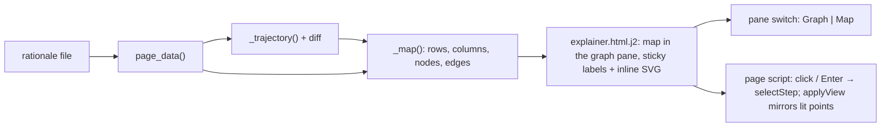

# feat: An experimental Map view in the explainer's graph pane

## Goal Capsule

- **Objective:** add a "Map (experimental)" view to the explainer's graph pane, as an alternative to the radial graph. The view draws one diagram of the run, in the style of the trajectory figures of the Designing 2027 paper. It is offered only on explainers backed by a design space.
- **Authority:** this plan's Product Contract, then its Key Technical Decisions, then existing explainer conventions. The rationale schema, the skills and the checker do not change.
- **Stop conditions:** stop and ask if the map needs data that is not in the rationale file, or if adding it changes the behaviour of the tabs or of the radial graph.
- **Execution profile:** one branch from `main`, created with `--no-track`. Local commits only; the user pushes and opens the PR.
- **Tail ownership:** the published arch-design-wiki artifact is not rebuilt.

---

## Product Contract

### Summary

A switch at the top of the graph pane lets the reader show either the radial graph (the default) or a map: one diagram per explainer. A search map shows approaches by row and rounds by column. An explain map shows candidate regions by row and solution → regions → contrasts by column. Each node shows its step, its verdict, its change and its main trade-off. Clicking a node selects that step, as clicking a design point in the graph does. The tabs on the left are unchanged.

### Problem Frame

The explainer shows a run through several views: decisions, a comparison, and a trajectory tab with lanes, a heatmap, a story and a grid. None of them shows the shape of a run and its trade-offs at a glance. The search lanes show steps but no trade-offs and no changes. Explain has no overview diagram at all. For the Designing 2027 paper, hand-drawn figures of the toy runs did show that shape: Fig. 3 for search and Fig. 4 for explain, whose expected content is recorded in U4. The user wants to try the same diagram in the explainer. It ships as an experimental alternative to the radial graph, in the same pane. The user can then judge whether it improves clarity, next to the story and the details, before it replaces or changes anything.

### Requirements

- **R1.** The graph pane has a "Graph | Map (experimental)" switch when the rationale was checked against a design space: the file names a space and its graph was loaded.
  - The radial graph is shown by default. The browser remembers the reader's last choice as a convenience, and the page works without storage.
  - Zero-shot explainers (`space: null`) have no switch and no map.
- **R2.** For search, the map has one row per approach, in the lanes' order, and one column per round. Each step sits in the cell for its approach and round. Several steps in one cell stack, and the row grows to fit.
- **R3.** For explain, the map has three columns: solution, regions, contrasts.
  - It has one row per region step. If any contrast's ancestor is the solution itself, there is one more row, labelled "solution", for those contrasts.
  - The solution node sits in the first column, vertically centred across the rows.
  - Each contrast sits in the row of its nearest region ancestor.
- **R4.** Every node has two text lines.
  - **Line 1:** the step number, its verdict (search rating or explain verdict), and its change.
  - **The change:** the dimensions on which both the parent and the step set a value, and the two differ (`before → after`). Seeds, explorations without a parent, the explain solution and explain regions show no change. A region narrows the solution rather than changing it, and its row label already names its dimensions. At most two pairs are shown, then `+N more`.
  - **Line 2:** the step's main trade-off (`+gains −costs`). If the step recorded no trade-off, line 2 shows its assessment summary (`meets …`, `misses …`).
  - **Overflow:** a line longer than the node is cut with an ellipsis. The node's tooltip and accessible label carry both lines in full.
- **R5.** The main trade-off is the first trade-off whose cause includes a value from the step's change (R4). When no trade-off has such a cause, or the step has no change, it is the step's first trade-off.
- **R6.** Line styles:
  - **Arrows:** they run from each step's parent to the step.
  - **Search:** steps that became alternatives have a thick border and a small badge with the alternative id (`A1`) in the node's top-right corner. The badge sits outside the two text lines. Steps of dropped approaches have a dashed border, which takes precedence over the alternative style.
  - **Explain:** a region step has a thick border when the file lists it in its `regions` (the regions that justify the solution). A contrast with verdict `ungrounded` has a dashed border; other contrasts have the normal border.
- **R7.** In explain, a contrast node marks the solution value it tests as **forced** or **free**.
  - **Tested value:** the solution's value on each dimension where the contrast's point differs from the solution's point. This compares with the solution, not with the contrast's parent, as `_qoc()` does.
  - **Mark:** it comes from the `forced` flag the file records on that solution choice. When the file records no flag, the node marks nothing.
- **R8.** Below the diagram, an explain map lists the uncovered decisions and the unaddressed requirements, and a search map lists the unaddressed requirements. An empty list is left out, and the box is omitted when both are empty.
- **R9.** Map nodes interact like design points in the graph.
  - **Selecting a node:** click it, or focus it and press Enter or Space. This selects that step exactly as clicking its design point in the graph does: the left side moves to the Trajectory tab and the details pane shows the step. The map stays shown.
  - **Mirroring:** the map lights the same points the graph would light. That covers the selected step, or the points of an alternative or option selected on the Decisions or Comparison tabs.
  - **Switching:** moving between graph and map keeps the current selection.
- **R10.** The map follows the page's light and dark themes and fits the graph pane at any size the splitters allow.
  - It scrolls inside the pane in both directions instead of shrinking past legibility.
  - Row labels and column headers stay visible while it scrolls.
  - Nodes are focusable and expose an accessible label.
  - The graph's own controls (the "Show every value" checkbox, zoom) are hidden while the map is shown.
- **R11.** While the map is shown, the key under the pane (`graph-key`) is replaced by the map's key. It says the map is experimental and explains how to read it: rows, columns, line styles, the badge and the `+`/`−` notation. The key can be collapsed to save room.

### Key Decisions

- **The map is an experimental alternative to the radial graph, in the graph pane.** (session-settled: user-directed — chosen over a separate fourth tab, and over enriching or replacing the lanes and the grid now. The map sits where the reader looks for the picture of the run, beside the story and the details, and compares directly with the graph.) Governs R1, R9, R10, R11.
- **Only explainers backed by a design space get the map.** (session-settled: user-directed — chosen over showing it on every explainer: zero-shot runs have no value ids, so the change labels would be long ad-hoc names.) Governs R1.
- **Main trade-off rule.** (session-settled: user-approved — chosen over showing every trade-off on the node: one line per node keeps the diagram readable.) Governs R4, R5.
- **The map is a diagram like the paper figures.** (session-settled: user-directed — chosen over an HTML table like the lanes: a diagram matches Figs. 3–4. The user may switch to a table later if the diagram does not work.) Governs R2, R3, R6, R10.

### Scope Boundaries

- No change to the rationale schema, the checker, the search and explain skills, or `ddspace` commands.
- The tabs (Decisions, Comparison, Trajectory) and the radial graph keep their content and behaviour.
- No map for zero-shot explainers.
- The arch-design-wiki artifact and its submission tag stay as published. Its explainers are not rebuilt.

#### Deferred to Follow-Up Work

- Folding the map's ideas into the lanes, retiring the lanes or the grid, or making the map the default view, once the user has assessed it.
- A table rendering of the map, if the diagram does not read well.
- Collapsing consecutive dimension ids into ranges in explain row labels (for example `d1–d3`). The first version lists the ids.
- Routing arrows around intervening nodes. The first version accepts that an arrow may cross a node in a busy layout.
- Documenting the map in the artifact's `EXPLAINERS.md` (in the local overlay), if it stays.

### Success Criteria

- Rendered from the toy runs (`examples/toy-git-hosting/runs/M/hosting-search.json` and `spokes-explain.json`), the map matches the expected maps listed in U4.
- A C1 expert-space explainer of each mode renders legibly in the pane at its default size: it scrolls where needed, keeps its row labels and column headers in view, and cuts long lines instead of overlapping.

---

## Planning Contract

### Key Technical Decisions

- **KTD1. The layout is computed in Python; the template draws it as inline SVG.** A new `_map()` in `src/taxonomy_generator/wiki/explainer.py` returns rows, columns and nodes, each node with its grid cell, label lines, style class and badge, plus the edges. `explainer.html.j2` draws the SVG at render time from that data. Chosen over drawing in the browser (as `drawLanes` and the QOC links do): the layout is deterministic, so it can be tested without a browser, and the diagram appears without JavaScript. Implements the user-directed diagram decision (governs R2, R3, R6).
- **KTD2. Fixed node size, positions from row and column, simple arrows.**
  - **Nodes:** every node has the same width and height. Each line has a character budget derived from the width, and longer text is cut per R4.
  - **Layout:** a cell holding several steps stacks them, and its row grows. Column x and row y follow from those counts, so the SVG's size is known when it is rendered.
  - **Arrows:** they attach at node side midpoints. Between adjacent columns of one row they are straight. Arrows that skip columns arc through the gutter above the row. Arrows across rows are curves between column gutters.
  - **Labels:** arrows are not labelled. The change sits on the target node's first line (R4).
- **KTD3. The change and the main trade-off come from one definition.**
  - **Change:** a step's change is the set of its `diff` entries whose `before` and `after` are both set. A step without a parent has no change, and explain region steps show none.
  - **Main trade-off:** the first trade-off whose `causes` intersects the change's `after` values, else the first trade-off.
  - **No trade-offs:** the assessment summary lists `meets …` and `misses …`; requirements judged `partly` are left out.

  Governs R4, R5.
- **KTD4. The map is gated on `space.wiki`, not `with_space`.** `_Space.with_space` is also true for zero-shot files: their label graph has aliases. `space.wiki` is true only when the file names a space and its graph was loaded. Both `page_data` and the template use that flag. Governs R1.
- **KTD5. Map nodes reuse the graph's selection unchanged.**
  - **Clicks:** step clicks are bound through a class list (`.step-h, .region, .node-chip, …`) that calls `selectStep()`. Map nodes get a `map-node` class, which joins that list, plus a key handler for Enter and Space. `selectStep()` stays as it is, so a map click behaves exactly like a click on a design point in the graph.
  - **Mirroring:** `applyView()` computes the lit set with `shownPoint()` (design points `p:<step>` plus values). It also toggles a `lit` class on each map node whose `p:<step>` is in that set, and the existing `sel` class on the selected step. The map therefore mirrors the graph in every tab.
  - **Switching views:** switching between graph and map hides one and shows the other. It does not touch the selection state. Only tab switches clear the selection, as now: that rule exists because of the stale-selection bug in `docs/solutions/ui-bugs/graph-filter-change-kept-stale-selection-fade.md`. When the reader returns to the graph, it re-runs its layout fit, because its size may have changed while it was hidden.

  Governs R9.
- **KTD6. Styling through classes and the existing CSS variables; sticky labels inside the pane.**
  - **Classes:** nodes and arrows carry `map-node`, `map-alt`, `map-dropped`, `map-justifying`, `map-ungrounded` and `lit`, coloured with the page's CSS variables. They follow both themes without new colours.
  - **Container:** the map sits in a container inside `#canvas`, beside `#svg`, which scrolls in both directions. The row labels are a sticky left column and the column headers a sticky top row. Both use the same row heights and column widths as the SVG, so they stay aligned.
  - **Switch:** a small "Graph | Map" segmented switch at the top of the pane. Its state lives in a page variable and, best effort, in `localStorage` (wrapped in try/catch, as the splitter state already is).

  Governs R1, R10.
- **KTD7. Explain rows come from the trajectory.** Each `move: region` step makes a row, in trajectory order, so regions judged only partial still get one ("candidate regions"). A region is thick only when it is listed in the file's `regions` (R6). Chosen over thick-by-verdict because the C1 runs list partial regions as justifying ones, and the `regions` list is what the explainer elsewhere calls "the regions that justify the solution". Governs R3, R6.

### High-Level Technical Design

The data flows from the rationale file to the graph pane as follows:



The map data is shaped as follows (a sketch of the content, not exact field names):

```text
map = {
  mode, rows: [{key, label, sublabel, title, height}], columns: [label],
  nodes: [{step, row, col, slot, lines: [line1, line2], full: [line1, line2], badge, cls}],
  edges: [{from_step, to_step, kind: straight|arc|cross}],
  footer: {uncovered: [...], unaddressed: [...]},
  size: {width, height}
}
```

### Assumptions

- `diff`, `verdict`, `tradeoffs` (with `causes`) and `assessment` from `_trajectory()` and `page_data()`, and the solution alternative's choices with their `forced` flags, are enough for every node.
- Row labels for search use the approach id and its idea, truncated, with the full idea in a tooltip. Explain row labels use the region's dimension ids and its drivers.
- Changes show value ids (`2.2 → 2.4`), with labels in the tooltip.
- A search step with no integer `round` has no map cell and is left off the map, as it is from the lanes.

---

## Implementation Units

### U1. The map data in `page_data`

- **Goal:** compute the map for explainers backed by a space; return nothing otherwise.
- **Requirements:** R1–R8; KTD1, KTD2, KTD3, KTD4, KTD7.
- **Dependencies:** none.
- **Files:** `src/taxonomy_generator/wiki/explainer.py`, `tests/unit_tests/test_rationale_build.py`, `tests/unit_tests/test_ddspace_rationale.py` (fixtures `_sample`, `_explain`, `_zero`; read only).
- **Approach:**
  1. Add a helper for a step's change (KTD3), the main trade-off, the assessment summary, and a line cutter that keeps the full text.
  2. Add `_map(...)`.
     - For search, it builds rows in `_lanes()`' approach order and columns from rounds.
     - For explain, it builds rows per R3 and KTD7, finds each contrast's tested solution values against the solution's point, and reads `forced` from the solution's choices, as `_qoc()` does.
     - Every node gets its cell, slot, lines, badge and class. Edges come from the `parent` links.
  3. In `page_data`, set `"map"` to `_map(...)` when `space.wiki`, else `None`.
- **Patterns to follow:** `_lanes()` and `_qoc()` in the same module: small pure functions over the built `trajectory`.
- **Test scenarios:**
  - **Search fixture:** `rationale_search.json` gets one row per approach and one column per round, and each step sits in its approach's row and its round's column.
  - **Explain fixture** (`_explain()`): the solution is in column 0, each region step gets a row, and each contrast sits in its region's row.
  - **Change line:**
    - A seed shows no change.
    - A region shows no change, even though its `diff` lists `before → None` entries.
    - A refine that swaps one value shows `before → after`.
    - A step that swaps four values shows two pairs and `+2 more`, with all four in the full text.
  - **Main trade-off:**
    - A step whose second trade-off's cause includes the changed value shows that trade-off.
    - A step whose trade-offs name no changed value shows its first one.
  - **Assessment summary:** a step with no trade-offs shows `meets …`/`misses …`, without `partly` requirements.
  - **Forced/free:**
    - A contrast on a value whose choice has `forced: true` is marked forced, `forced: false` free, and no flag neither.
    - A contrast that adds a dimension its parent region does not include still names the solution's value on that dimension.
  - **Styles:**
    - An alternative step carries the alternative class and badge.
    - A step of a dropped approach carries the dropped class, even if it is also an alternative.
    - A region listed in `regions` carries the justifying class; a partial region not listed does not.
    - An `ungrounded` contrast carries the ungrounded class.
  - **Gating:** a zero-shot file (`_zero()`) gets `map: None`, although its `with_space` is true.
  - **Edge cases:**
    - Two steps of one approach in one round stack in one cell, and the row height grows.
    - A contrast whose parent is the solution goes to a "solution" row.
    - An explain run with no contrasts has an empty contrasts column.
    - An over-long line is cut, and the full text is kept.
- **Verification:** the unit tests pass. `page_data` on the two toy runs returns the maps listed in U4.

### U2. The map in the graph pane

- **Goal:** draw the map inside the graph pane, behind a Graph | Map switch, with its key, sticky labels and footer.
- **Requirements:** R1, R6, R8, R10, R11; KTD1, KTD2, KTD6.
- **Dependencies:** U1.
- **Files:** `src/taxonomy_generator/wiki/templates/explainer.html.j2`, `tests/unit_tests/test_rationale_build.py`.
- **Approach:**
  1. When `d.map`, render the switch at the top of `#canvas` and a hidden map container beside `#svg`, holding:
     - the sticky column headers and row labels;
     - the SVG;
     - the footer lists (R8).
  2. Render a map key, collapsible, next to the existing `graph-key`; only one of the two is shown at a time.
  3. Wire the switch to show the graph or the map. Hide the "Show every value" checkbox and the zoom buttons while the map is shown. Remember the choice best effort.
  4. Each node is a `<g class="map-node">` with `data-step`, `tabindex="0"`, `role="button"`, an `aria-label` built from the full lines, and a `<title>`. The alternative badge is a small corner element. Arrows carry a marker.
  5. Style everything with classes and the page's CSS variables, including a visible focus outline.
- **Patterns to follow:** the pane's existing overlays (`graph-toggle`, `zoom-ctl`), `graph-key`, the splitter's guarded `localStorage` use, and the CSS variables used by `.vb-*` and `.j-*`.
- **Test scenarios:**
  - A search explainer with a space has the Graph | Map switch and a hidden map container with one `map-node` per step; the radial graph is shown first.
  - An explain explainer with a space lists its uncovered decisions and unaddressed requirements in the map's footer. One with neither has no footer box.
  - A zero-shot explainer has no switch and no map container.
  - Every node carries `data-step`, `tabindex`, `role="button"`, an `aria-label` and a tooltip.
  - The row labels and column headers are sticky elements of the map container.
- **Verification:** the tests pass. Opened from disk, the toy explainers switch between graph and map in light and dark themes.

### U3. Switching and selection

- **Goal:** the switch shows the graph or the map. Map nodes select their step like design points in the graph, and they mirror what the graph lights.
- **Requirements:** R9; KTD5.
- **Dependencies:** U2.
- **Files:** `src/taxonomy_generator/wiki/templates/explainer.html.j2`, `tests/unit_tests/test_explainer_browser.py`.
- **Approach:**
  1. Add `.map-node` to the step click selector, and handle Enter and Space on focused map nodes.
  2. In `applyView()`, toggle `lit` on map nodes whose `p:<step>` is in the lit set (the `sel` toggle already covers `[data-step]`).
  3. On switching back to the graph, re-run its fit, since the pane may have been resized while it was hidden.
- **Execution note:** start with the browser test that switches to the map, clicks a node, and expects the map to stay shown with that step selected.
- **Patterns to follow:** `selectStep()` and the graph's existing fit/zoom handling.
- **Test scenarios:**
  - With the map shown, clicking a map node keeps the map shown, moves the left side to the Trajectory tab, marks the node `sel`, and shows the step in the details pane.
  - Focusing a map node and pressing Enter does the same.
  - Selecting an alternative on the Decisions tab while the map is shown marks that alternative's step `lit` on the map.
  - Switching to the graph keeps the selection, and the selected point is lit there.
  - Switching tabs clears the selection on the map too.
  - Clicking a trajectory chip or a graph point still behaves as before (no regression).
  - The page loads with no console errors (the suite's `ERRORS` check), including when `localStorage` is unavailable.
- **Verification:** the browser tests pass where Chrome is available.

### U4. A check against the expected toy maps and C1 runs

- **Goal:** confirm the map on real runs before handing it to the user.
- **Requirements:** Success Criteria; R10.
- **Dependencies:** U1, U2, U3.
- **Files:** none committed (renders go to a scratch folder).
- **Approach:**
  1. **Toy runs:**
     - Build the toy space with `python examples/toy-git-hosting/build.py workspace --out <scratch>/toy/M`.
     - From a scratch folder, render each toy run with `ddspace rationale build <repo>/examples/toy-git-hosting/runs/M/<file>.json --graph <scratch>/toy/M --out .`. The `--out` folder must be inside the current folder.
  2. **C1 runs:**
     - Build the expert space with `python study/designing2027/build_workspace.py --out <scratch>/c1`.
     - Render `documents-search-E-r2` and `fraud-explain-E-r1` from `study/designing2027/results-v2/rationale/` with `--graph <scratch>/c1/E`. Expect the `graph_changed` banner, since the published space renames dimensions.
     - In documents-search-E-r2, steps 5 and 9 are where R5 picks a trade-off other than the first; check them.
  3. Compare the toy maps with the expected maps below. Check that the C1 maps fit the pane at its default split: they scroll, keep their row labels and headers, and cut long lines instead of overlapping.
- **Expected search map** (`hosting-search`; rows A, B, C, D; columns rounds 1–3):

  | Step | Cell | Line 1 | Line 2 | Style |
  |---|---|---|---|---|
  | 1 | A, round 1 | 1 strong | +Q1 Q4 −Q2 Q3 | normal |
  | 2 | B, round 1 | 2 strong | +Q1 Q2 −Q3 | normal |
  | 3 | C, round 1 | 3 weak | +Q4 C1 −Q1 Q2 | dashed (C dropped) |
  | 4 | A, round 2 | 4 mixed: 4.2 → 4.3 | +R2 −C2 | normal |
  | 5 | B, round 2 | 5 mixed: 4.2 → 4.3 | +R2 −C2 | normal |
  | 6 | D, round 2 | 6 weak | +Q1 Q3 −Q4 C1 | dashed (D dropped) |
  | 7 | A, round 3 | 7 strong: 5.1 → 5.3 | +Q2 Q3 −Q4 | thick, badge A1 |
  | 8 | B, round 3 | 8 strong: 5.3 → 5.1 | +Q3 Q4 −Q2 | thick, badge B1 |

  Arrows: 1→4, 2→5 (straight); 1→7, 2→8 (arcs). Footer: unaddressed R1, Q2, C1.
- **Expected explain map** (`spokes-explain`; rows: region steps 2, 4, 6; columns solution, regions, contrasts):

  | Step | Cell | Line 1 | Line 2 | Style |
  |---|---|---|---|---|
  | 1 | solution, centred | 1 partial | +R1 C2 −R2 | normal |
  | 2 | row 2, regions | 2 grounded | meets Q1 Q4 | thick (listed in `regions`) |
  | 3 | row 2, contrasts | 3 ungrounded: 2.2 → 2.4 | misses Q1 · 2.2 forced | dashed |
  | 4 | row 4, regions | 4 partial | +R1 C2 −R2 | normal |
  | 5 | row 4, contrasts | 5 grounded: 4.1 → 4.2 | meets R2 C2 · 4.1 free | normal |
  | 6 | row 6, regions | 6 partial | +Q4 −Q3 | normal |

  Arrows: 1→2, 1→4, 1→6, 2→3, 4→5. Footer: uncovered (replica repair and re-replication; packfiles and repacking), unaddressed Q2, C1.
- **Test expectation:** none — a visual check of rendered pages. The behaviour is covered by U1–U3, and U1's tests can assert these toy maps directly.
- **Verification:** the toy maps match the tables, and differences are fixed or reported. The C1 maps scroll in the pane and cut text rather than overlap.

---

## Verification Contract

- `pytest -q tests/unit_tests` passes with the project's `taxonomy` environment. That includes `test_rationale_build.py` and, where Chrome is present, `test_explainer_browser.py`.
- `study/cain2027/` and the rationale fixtures are unchanged.
- `graphify update .` runs after the code changes, as the project instructions ask.

## Definition of Done

- U1–U3 are committed on the feature branch, with their tests passing. The user pushes and merges.
- U4's renders were checked against the expected maps, and differences are fixed or reported to the user.
- No tab and no behaviour of the radial graph changed.
- No experimental or dead-end code is left in the diff.
- The arch-design-wiki artifact is untouched.

## Sources

- The expected toy maps in U4, taken from the paper's trajectory figures (Figs. 3–4) and the toy rationale files.
- `src/taxonomy_generator/wiki/explainer.py`: `_Space` (`with_space`, `wiki`), `_trajectory`, `_diff`, `_lanes`, `_qoc`, `page_data`.
- `src/taxonomy_generator/wiki/templates/explainer.html.j2`: the graph pane (`#canvas`, `graph-toggle`, `zoom-ctl`, `graph-key`), the step click selector, `selectStep`, `shownPoint`, `applyView`, the splitters' storage.
- `docs/solutions/ui-bugs/graph-filter-change-kept-stale-selection-fade.md`.
