# Grounded Theory Report

## Narrative Summary

This taxonomy identifies the architectural design decisions involved in making Git repositories operate at scale: across very many repositories, very large repositories, and very many users, on hosting servers and clients. Each dimension names one decision, while its values represent alternative approaches that teams adopted, considered, or rejected. Together, the dimensions describe the quality attributes, constraints, and practical concerns that shape repository storage, replication, routing, maintenance, transfers, and client experience.

The server-side dimensions cover how repositories are physically stored, replicated, routed, coordinated, monitored, repaired, and maintained without disrupting access. They also address durable writes, transaction ordering, failure detection, replica roles, checksums, compaction, consistency, availability, and the distribution boundaries used to serve repository operations. The client-side dimensions describe how much content is materialized, how source trees and build outputs are laid out, how large repositories are accessed, and how filesystem monitoring, metadata, pack storage, commit graphs, cleanup, and automatic maintenance are implemented and controlled. Other dimensions connect the two sides through network transfer formats, hosting application architecture, collaboration models, and the ownership and delivery of large-repository capabilities.

The diagram also shows where decisions constrain or depend on one another. For example, Replica Consistency and Availability Policy requires Read Replica Routing to be decided first; Repository Replication Granularity limits the options for that policy and affects Durable Repository Write Storage; Durable Repository Write Storage affects the resulting consistency and availability behavior; Replication layer affects the same policy; and Large-repository data acquisition strategy both limits Repository Replication Granularity and affects consistency and availability outcomes. These relationships show that the catalog is not a list of isolated choices: storage and acquisition decisions shape replication possibilities, replication and write decisions shape consistency outcomes, and those outcomes in turn guide how reads are routed. The taxonomy explanation reports 33 dimensions and 194 distinct values after two near-duplicate values were merged, with evidence linking 328 of 337 open codes to values and all 48 documents supporting at least one value.

## Dimension Relationship Diagram

```mermaid
flowchart TB
    dim_7["7. Read Replica Routing"]
    dim_9["9. Repository Cache Deployment"]
    dim_11["11. Repository Physical Storage"]
    dim_13["13. Git Hosting Collaboration Model"]
    dim_14["14. Server Maintenance Operations"]
    dim_15["15. Client Working-Tree Scope"]
    dim_17["17. Client Repository Directory Layout"]
    dim_20["20. Client Commit-Graph Maintenance"]
    dim_21["21. Client Repository Setup"]
    dim_22["22. Repository Replication Granularity"]
    dim_23["23. Git Network Transfer Format"]
    dim_25["25. Durable Repository Write Storage"]
    dim_26["26. Repository Write Coordination"]
    dim_28["28. Replica Transaction Coordination"]
    dim_31["31. Replica Failure Detection"]
    dim_32["32. Client Materialization and Metadata"]
    dim_33["33. Hosting Application Architecture"]
    dim_34["34. Client Pack Rewrite Strategy"]
    dim_35["35. Client Pack Indexing and Compression"]
    dim_38["38. Replica Allocation and Lifecycle"]
    dim_40["40. Replica Roles and Failure Eligibility"]
    dim_41["41. Replication Factor and Write Quorum"]
    dim_42["42. Client Maintenance Execution Mode"]
    dim_43["43. Client Maintenance Control"]
    dim_44["44. Replica checksum maintenance strategy"]
    dim_45["45. Corruption response and replica repair"]
    dim_46["46. Replica authority and operational treatment"]
    dim_47["47. Replication layer"]
    dim_48["48. Replica propagation and repair method"]
    dim_49["49. Repository-serving distribution boundary"]
    dim_50["50. Large-repository data acquisition strategy"]
    dim_51["51. Client-side large-repository access implementation"]
    dim_52["52. Client capability ownership and migration"]
    dim_53["53. Capability improvement and delivery approach"]
    dim_54["54. Client Object-Cleanup Pipeline"]
    dim_55["55. Replica Compaction Strategy"]
    dim_57["57. Repository Routing Model"]
    dim_58["58. Replica Placement and Repair Policy"]
    dim_59["59. Filesystem-monitor implementation"]
    dim_60["60. Git-specific watcher awareness"]
    dim_61["61. Replica Consistency and Availability Policy"]
    dim_62["62. Consistency Enforcement and Degradation Strategy"]
    dim_7 -->|requires| dim_61
    dim_22 -->|constrains| dim_61
    dim_22 -->|affects| dim_25
    dim_25 -->|affects| dim_61
    dim_47 -->|affects| dim_61
    dim_50 -->|constrains| dim_22
    dim_50 -->|affects| dim_61
    dim_61 -->|affects| dim_7
```

## Dimension Catalog

### 7. Read Replica Routing

How Git reads are assigned across geographically distributed replicas and how write-side reference work is prioritized.

**Values:**

- **Closest synchronized replica routing** — Fetches and clones are sent to the geographically closest replica known to be up to date.
- **Spokes geo-replication** — Spokes distributes repositories across geographic locations to support nearby Git reads.
- **Coalesced bookkeeping reference updates** — Non-user-critical bookkeeping updates are combined into fewer transactions.
- **Priority scheduling for user reference updates** — Latency-sensitive user updates are processed ahead of bookkeeping work.
- **Reduced Git transfer latency** — Nearby synchronized replicas reduce fetch and clone latency.
- **Protection against user-request delays** — Prioritization prevents bookkeeping cascades from delaying or timing out user requests.

**Outgoing relations:**

- Read Replica Routing requires Replica Consistency and Availability Policy to be decided first (#61): A router must know which replicas are synchronized and eligible before selecting a geographically close read target.

### 9. Repository Cache Deployment

Whether and how a dedicated cache server supports large-repository access.

**Values:**

- **GVFS with co-located cache server** — Large repositories use nearby cache infrastructure to serve GVFS requests for large user populations.
- **GVFS without cache-server infrastructure** — GVFS is used without the infrastructure needed to handle its serving demands.
- **Cache-assisted transfer performance** — Co-located cache proxying reduces transfer latency and central-server load while increasing throughput.

**Outgoing relations:**

_No outgoing relations._

### 11. Repository Physical Storage

Where and in what native storage form are repository copies physically kept?

**Values:**

- **Native Git repository storage** — Replicas retain actual Git repositories so clients receive the native format without transformation.
- **Local NVMe repository storage** — Repositories are stored on local NVMe because packfile access requires fast random reads.
- **Blob storage for Git packfiles** — Git packfiles are physically stored as objects in blob storage.
- **Repository disks as warm caches** — Treat local repository copies as reconstructible caches rather than authoritative repository storage.
- **Networked-filesystem repository storage** — Keep repositories on networked filesystems rather than local repository fileservers or object storage.
- **Dedicated repository fileservers** — Place repositories on dedicated fileservers accessed remotely by the application.
- **Single-machine repository co-location** — Keep application and repository copies together on one physical machine.
- **Single-machine repository placement** — Keep each repository copy on one physical machine rather than distributing that repository across multiple machines.
- **Git filesystem-semantics mismatch** — Local-filesystem assumptions about locking, tearing, reading, and syncing conflict with networked storage behavior.
- **Distributed-filesystem performance and correctness failure** — Distributed filesystem approaches remain slow and unreliable for Git repository access.

**Outgoing relations:**

_No outgoing relations._

### 13. Git Hosting Collaboration Model

Whether repository collaboration is organized around decentralized copies or centralized hosting.

**Values:**

- **Decentralized maintainer workflow** — Many subsystem maintainers collaborate through decentralized repository ownership and exchange.
- **Centralized repository hosting** — Teams use a central host while retaining distributed-client capabilities.
- **Offline local work** — Developers can continue repository work without network connectivity.
- **Delayed push workflow** — Developers can postpone transmitting local changes to the host.
- **Distributed version-control architecture** — Repository collaboration preserves distributed copies and decentralized exchange.
- **Distributed architecture as a hindrance for centralized workflows** — Distributed design can hinder projects whose collaboration is primarily centralized.
- **Large-scale Git hosting difficulty** — Hosting Git repositories at scale creates exceptional operational difficulty.

**Outgoing relations:**

_No outgoing relations._

### 14. Server Maintenance Operations

How hosting servers are tested, quiesced, rebooted, and retired without disrupting repository reads.

**Values:**

- **Rolling reboot testing** — Servers are rebooted in controlled sequence after quiescing outstanding reads.
- **Chaos-monkey testing on file servers** — Random server reboots are used as a failure-testing approach.
- **Unplanned server unplugging for retirement** — A server is abruptly disconnected without quiescence or redundancy planning.
- **Crash-like mechanisms for planned maintenance** — Planned reboots and retirement reuse crash or permanent-failure handling for transparent replica failover.
- **Server quiescing before reboot** — Withdraw a server from new reads, drain existing reads, and keep replication active before shutdown.
- **Direct server reboot for planned maintenance** — Reboot a server directly without quiescing or draining work first.
- **Two-copy repository state after sudden server loss** — Sudden server loss temporarily leaves repositories with two readable but less resilient copies.
- **Increased same-day write-rejection risk** — Sudden server removal increases the likelihood that later writes will be rejected.
- **Lost progress from interrupted long-running reads** — Abrupt maintenance interrupts lengthy reads and forces them to restart elsewhere.
- **Replica catch-up load from withheld writes** — Stopping writes during quiescing creates replica lag and catch-up work after return.

**Outgoing relations:**

_No outgoing relations._

### 15. Client Working-Tree Scope

How much repository content is materialized in the client working tree.

**Values:**

- **Sparse working-tree population** — Materialize only selected repository paths by default, expanding populated directories on demand.
- **Full working-tree population** — Materialize all tracked repository files through an explicit full-clone override.
- **Populated-file modification-detection cost** — Reduced populated-file scope lowers the cost of detecting modifications in client working trees.

**Outgoing relations:**

_No outgoing relations._

### 17. Client Repository Directory Layout

How client repository source trees and generated build outputs are arranged on disk.

**Values:**

- **Nested source working directory** — Place the working directory below the repository root to leave room for sibling build outputs.
- **Sibling build-output directories** — Keep generated build artifacts outside the Git-managed working directory in sibling directories.

**Outgoing relations:**

_No outgoing relations._

### 20. Client Commit-Graph Maintenance

How commit-graph data is generated and validated during client repository maintenance.

**Values:**

- **Commit-graph generation maintenance** — Generating commit-graph files during background repository maintenance for large-repository performance.
- **Commit-graph verification** — Verifying generated commit-graph data as part of repository maintenance.

**Outgoing relations:**

_No outgoing relations._

### 21. Client Repository Setup

How existing repositories are registered and configured for large-repository client operation.

**Values:**

- **Existing-repository registration workflow** — Enabling client performance management by registering an existing repository.
- **Local Git configuration setup** — Applying local Git configuration during client repository registration.
- **Background repository configuration updates** — Newly supported client settings are applied asynchronously to registered repositories.

**Outgoing relations:**

_No outgoing relations._

### 22. Repository Replication Granularity

What unit of repository state is replicated or stored across infrastructure.

**Values:**

- **Packfile-level replication** — Replication operates on packfiles while preserving Git repositories and avoiding a modified Git implementation.
- **Git implementation distribution** — Git itself is distributed or modified as the replication unit for unusual repositories.
- **Object-level distributed key-value storage** — Content-addressed objects are mapped individually into a distributed key-value store.
- **DHT-backed Git object storage** — A custom Git implementation stores objects through a distributed hash table instead of ordinary packfiles.
- **Filesystem block-level replication** — Repository replication operates on filesystem blocks rather than Git application updates.

**Outgoing relations:**

- Choices on Repository Replication Granularity limit the options available on Replica Consistency and Availability Policy (#61): Distribution at object, packfile, or repository level changes replication coordination requirements and the consistency surface exposed to clients.
- Choices on Repository Replication Granularity affect the outcomes of Durable Repository Write Storage (#25): The chosen storage representation determines local I/O behavior, compaction needs, and the cost of propagating repository changes.

### 23. Git Network Transfer Format

Which Git transfer representation serves repository data between clients and infrastructure.

**Values:**

- **Packfile-based Git network transfer** — Git transfers repository data as packfiles regardless of the server-side storage layout.
- **Partial clone for demand-driven file transfer** — Only content required by the current checkout is transferred initially.

**Outgoing relations:**

_No outgoing relations._

### 25. Durable Repository Write Storage

How repository writes are durably logged, batched, acknowledged, and materialized in storage.

**Values:**

- **WAL-first storage architecture** — A write-ahead log provides the basis for horizontal scaling and repository-change propagation.
- **S3-backed write-ahead log** — S3 supplies durable WAL updates and determines cluster push-ingest latency.
- **S3 Express One Zone** — Lower-latency S3 storage is used to increase push throughput in high-performance clusters.
- **One-object-storage-write-per-push** — Issuing an independent object-storage write for every push.
- **Batched object-storage writes** — Batching durable object-storage writes so busy repositories avoid one storage operation per push.
- **Durability-gated push acknowledgement** — Acknowledging pushes only after their write-ahead-log data is durably persisted.
- **WAL-index-gated push publication** — Publishing a push only after local reference preparation and WAL-index recording establish visibility.
- **Minimum-copy durability gate** — Require a minimum number of durable copies before acknowledging a repository write.
- **Synchronous replication to at least two replicas** — Acknowledge a write only after synchronous commitment to at least two repository replicas.
- **Periodic write-ahead-log compaction** — Compact accumulated WAL state periodically so restoration cost does not grow without bound.

**Outgoing relations:**

- Choices on Durable Repository Write Storage affect the outcomes of Replica Consistency and Availability Policy (#61): WAL propagation and replicated compaction establish how replicas receive writes and preserve consistent repository state.

### 26. Repository Write Coordination

How repository writes are ordered, replicated, attributed, and coordinated across repository-serving infrastructure.

**Values:**

- **Arbitrary replica horizontal scaling** — The architecture supports deploying an arbitrary number of read-capable replicas.
- **Replicated compaction output** — Compacted results are replicated so nodes share the same compacted representation.
- **External relational database for repository references** — Repository references are stored in an external relational database rather than the WAL-centered design.
- **Globally linearized pushes** — All concurrent pushes receive one globally consistent ordering.
- **Operation-level repository provenance** — Fundamental repository operations are recorded so prior states and corruption causes can be inspected.
- **Orchestrator-coordinated push fan-out** — Distribute pushed packs and reference transactions to repository replicas through an orchestrator.
- **Reference-transaction synchronization unit** — Synchronize compact Git reference transactions rather than large packfiles during consensus coordination.
- **Consensus-free arbitrary repository primary** — Allow any server to act as repository primary without elections or a fixed per-repository primary.
- **S3 compare-and-swap write synchronization** — Synchronize concurrent write-ahead-log updates with atomic S3 compare-and-swap rather than consensus.
- **Cloud-agnostic object-storage deployment** — Designing durable object-storage use to deploy across cloud providers rather than depend on one provider.
- **Single-local-repository reference synchronization** — Synchronizing reference transactions with one local repository instead of a replica quorum.
- **Optimistic UDP replica gossip** — Use lossy metadata gossip for replica notifications while replicas independently verify state and recover from durable storage.
- **Git compaction throughput bottleneck** — After storage latency is reduced, Git compaction becomes the practical ingest limit.

**Outgoing relations:**

_No outgoing relations._

### 28. Replica Transaction Coordination

How transactions are synchronized and ordered across repository replicas during replicated updates.

**Values:**

- **Three-copy quorum failure condition** — Losing two of three repository copies removes quorum and blocks pushes.
- **Four-round-trip replica coordination** — Coordinating distant replica commit and locking through four network round trips.
- **Three-phase commit replica synchronization** — Coordinate reference updates with prepare, commit, and rollback phases across replicas.
- **Replica locking for update ordering** — Using replicas as distributed locks to serialize database updates across the repository system.
- **Advanced consensus coordination** — Adopting a more advanced consensus protocol to reduce distant-replica coordination round trips.
- **Primaryless per-write ordering** — Determine each write's winning order through voting rather than following a designated primary.
- **Single-primary replication protocol** — Use one primary replica to dictate replicated write order.
- **Majority-vote rollback** — Revert updates on replicas where a write was applied but failed to achieve majority agreement.

**Outgoing relations:**

_No outgoing relations._

### 31. Replica Failure Detection

How infrastructure observes, attributes, and responds to replica or server failures and determines offline status.

**Values:**

- **Real-traffic failure detection** — Detecting replica or server failure through failures observed during real application requests.
- **Heartbeat-assisted failure detection** — Using heartbeats as a complementary signal alongside real application traffic for failure detection and recovery.
- **Three-consecutive-failure offline threshold** — Demoting or marking a node offline after three consecutive failed requests.
- **Advisory replica demotion** — Demoting suspected failed replicas in preference order without removing them from fallback availability.
- **RPC failover graph failure detection** — Inferring server faults from the pattern of RPC operations failing over between servers.
- **Application-server-specific failure views** — Maintaining failure observations separately at each application server rather than using one global view.
- **Cross-observer fault attribution** — Comparing failure reports across application servers to distinguish file-server from application-server faults.
- **Heartbeat load polling and recovery confirmation** — Using heartbeats to poll load and restore a node's online preference after failure recovery.
- **Heartbeat-only primary failure detection** — Relying on heartbeats as the primary mechanism for detecting failed nodes.
- **MxN failure-detector topology** — Have each application server independently monitor each repository server through RPCs and heartbeats.
- **Heartbeat detection delay** — Delayed awareness of failures when periodic heartbeats lag behind failures observed in live traffic.
- **Synthetic health-check functional blind spots** — No-op health checks can miss failures in Git execution, disks, or authenticated operations.
- **False offline marking from consecutive request failures** — A healthy node can be temporarily marked offline after unrelated request failures happen consecutively.
- **Localized failure-detector errors** — Keep an observer's mistaken offline view local rather than allowing it to determine system-wide server status.

**Outgoing relations:**

_No outgoing relations._

### 32. Client Materialization and Metadata

Which client-side materialization and metadata mechanisms scale operations for very large repositories and working trees.

**Values:**

- **Updated Git index format** — Use a more compact index representation for repositories with millions of tracked paths.
- **Untracked cache** — Maintain cached untracked-path metadata to reduce repeated working-directory scans in large repositories.
- **Complete tracked-path index** — Represent every tracked path at the current HEAD in the client index.
- **Single-file index storage** — Store the client index as one file read and written by core Git commands.
- **Disabled ahead-behind calculation** — Status avoids repeated ahead-behind comparison work during routine status operations.
- **Sparse checkout for reduced working trees** — Only selected paths are materialized in the working directory.
- **Compressed client index size** — Reduce the physical size and I/O volume of the client index file.
- **Low average index-entry processing time** — Keep average per-entry processing inexpensive through streaming-oriented index access despite large index size.

**Outgoing relations:**

_No outgoing relations._

### 33. Hosting Application Architecture

Which application deployment structure hosts repository operations while scaling access across users and repository-serving infrastructure.

**Values:**

- **Rails monolith application architecture** — Retain a monolithic Rails application while scaling repository access around it.
- **Horizontal Rails instance scaling** — Scale the hosting application by deploying additional Rails instances.
- **Hosted version-control platform** — Host source repositories as a managed platform providing reliable Git access for users at scale.
- **Continual hosting-platform evolution** — Continuously evolve engineering and operational architecture as version-control workloads and requirements change.
- **Reliability, performance, and scale optimization** — Optimize hosting architecture explicitly for repository reliability, performance, and growth in service scale.
- **Low-friction hosting-platform migration** — Provide an off-ramp that makes migration to a more reliable and scalable hosting platform painless.
- **Agent-driven repository workload growth** — Increased code, pull-request, and CI activity raises the workload imposed on hosting infrastructure.
- **Repository unavailability productivity cost** — Push, pull, or CI unavailability can halt development and impose substantial productivity loss.

**Outgoing relations:**

_No outgoing relations._

### 34. Client Pack Rewrite Strategy

Which pack-rewrite strategy controls client repository storage and pack growth?

**Values:**

- **Incremental pack-file repacking** — Rewrite manageable batches of packs incrementally instead of rewriting all repository data at once.
- **Single-pack full repacking** — Rewrite all repository data into one packfile in a single conventional repack operation. _(consolidated with 1 similar value judged the same decision: "Full repository repacking")_
- **Pack-count and storage reduction** — Reduce pack counts and repository storage footprint through incremental maintenance.
- **File-handle pressure from unbounded pack growth** — Unbounded pack accumulation creates file-handle scalability pressure during Git operations.

**Outgoing relations:**

_No outgoing relations._

### 35. Client Pack Indexing and Compression

Which indexing and compression mechanisms reduce client pack access or storage costs?

**Values:**

- **Multi-pack-index maintenance** — Maintain an index spanning multiple packs and use it to coordinate pack replacement and lookup.
- **Pack-file delta compression** — Store Git objects in delta-compressed packfiles for space-efficient repository storage.

**Outgoing relations:**

_No outgoing relations._

### 38. Replica Allocation and Lifecycle

How are repository replicas allocated, retired, reclaimed, and rematerialized across infrastructure?

**Values:**

- **Multi-disk and multi-machine repository distribution** — Distributing repositories across many disks and machines to increase parallelism and preserve availability after crashes.
- **Remote-fileserver horizontal scalability** — Scale repository-serving capacity by adding remote fileservers behind application-level repository operations.
- **Elastic per-repository replica allocation** — Adjust replica counts independently per repository, scaling hot repositories up and relying on durable storage for small repositories.
- **Idle-replica garbage collection and rematerialization** — Remove inactive repository replicas from node disks and reconstruct them from durable log state when traffic returns.

**Outgoing relations:**

_No outgoing relations._

### 40. Replica Roles and Failure Eligibility

Which replica roles, catch-up rules, and failure-eligibility policies govern repository participation?

**Values:**

- **Non-voting geo-replicated replicas** — Geo-replicated Enterprise hosts serve reads without participating as voting push targets.
- **Replica rewind and fast-forward through WAL history** — Replicas rewind or advance by replaying retained WAL history without an external object database.
- **Network-wait work overlap** — Overlapping computation and local work with remote replica lock, checksum, and database operations.
- **Direct durable-log catch-up before reads** — Replicas catch up from the authoritative WAL before serving reads when freshness metadata has advanced.
- **Write refusal during replication shortfall** — Refuse writes when the required durable replica count cannot be reached.
- **Isolation of losing replicas** — Remove replicas that lose a write vote from read and write eligibility until repair completes.
- **Temporary write unavailability under insufficient replication** — Remain durable but temporarily unavailable for writes while required replica copies are missing.

**Outgoing relations:**

_No outgoing relations._

### 41. Replication Factor and Write Quorum

Which replica count and write-quorum requirements govern durable repository updates?

**Values:**

- **Three-copy repository replication** — Maintaining at least three repository replicas for availability and durability across server failures. _(consolidated with 1 similar value judged the same decision: "Fixed three-replica minimum")_
- **Majority-write replica quorum** — Acknowledging writes only after a majority, including at least two replicas, commits the same state.
- **Distant-replica latency budget** — Continental network latency consumes the available time budget for replica coordination.
- **Slowest-replica latency bound** — Bound coordinated operation latency by the slowest participating replica.
- **Replica-count-induced push-throughput degradation** — Adding replicas reduces push throughput when each update coordinates across the full replica set.
- **Monorepo traffic capacity shortfall** — A fixed small replica set cannot provide sufficient serving capacity for massive monorepo traffic.
- **Replication overhead for repository proliferation** — A mandatory replica floor creates excessive mostly idle storage and coordination for numerous small repositories.

**Outgoing relations:**

_No outgoing relations._

### 42. Client Maintenance Execution Mode

Which execution mode runs automatic repository maintenance on clients?

**Values:**

- **Foreground automatic garbage collection** — Threshold-triggered garbage collection runs during user-facing Git commands. _(consolidated with 2 similar values judged the same decision: "Foreground automatic garbage collection as interactive execution", "Foreground garbage collection for very large repositories")_
- **Background incremental repository maintenance** — Maintenance runs asynchronously and incrementally to avoid interactive pauses and reduce client resource spikes.

**Outgoing relations:**

- Choices on Client Maintenance Execution Mode affect the outcomes of #2 _(target excluded from this view)_: Moving cleanup and graph generation out of foreground commands changes which command-time optimizations are necessary for responsiveness.

### 43. Client Maintenance Control

Which client controls enable, disable, or suspend automatic repository maintenance?

**Values:**

- **Disabled automatic garbage collection** — Automatic foreground garbage collection is disabled so cleanup is delegated to background maintenance.
- **User-controlled maintenance suspension** — Allowing users to pause or unregister automatic client maintenance.

**Outgoing relations:**

_No outgoing relations._

### 44. Replica checksum maintenance strategy

How is replica state summarized and kept comparable, and what scalability trade-offs does that impose?

**Values:**

- **Per-repository checksum tracking** — Continuously updated checksums validate the health of on-disk repository copies.
- **Incremental replica checksum maintenance** — Update replica consistency checksums from reference changes instead of rescanning all references.
- **Full replica checksum recomputation** — Recompute the complete replica checksum after every update by scanning all reference state.
- **Reference-update checksum throughput constraint** — Checksum computation cost limits the maximum sustainable rate of reference updates.

**Outgoing relations:**

_No outgoing relations._

### 45. Corruption response and replica repair

How are unhealthy replicas detected, scheduled for recovery, and repaired?

**Values:**

- **Rapid corruption detection and repair scheduling** — Unhealthy repositories trigger rapid detection and scheduled repair jobs.
- **Automatic replica repair** — Repair unhealthy replicas automatically while surviving replicas continue serving repository operations.

**Outgoing relations:**

_No outgoing relations._

### 46. Replica authority and operational treatment

What status do on-disk copies have in consistency decisions, and how are individual repository copies operationally managed?

**Values:**

- **On-disk repositories as consensus source of truth** — On-disk repository copies provide the authoritative basis for replica consensus.
- **Pet-style repository operations** — Each repository copy receives individualized operational care because it is valuable.

**Outgoing relations:**

_No outgoing relations._

### 47. Replication layer

At which layer is repository state copied between replicas?

**Values:**

- **Git application-level replication** — Repository replication operates on Git application updates rather than filesystem blocks.
- **Filesystem-level repository distribution** — Distribute repository storage at the filesystem layer while leaving the application and Git implementation unchanged.

**Outgoing relations:**

- Choices on Replication layer affect the outcomes of Replica Consistency and Availability Policy (#61): Replica allocation, rematerialization, and propagation architecture change replica availability and consistency behavior.

### 48. Replica propagation and repair method

How are repository contents propagated, repaired, or rebalanced between repository copies?

**Values:**

- **Unsynchronized packfile distribution** — Fan out packfiles without consensus because unreachable objects need not yet be synchronized.
- **Git-and-rsync replication stack** — Combining Git and rsync to replicate, repair, and rebalance repository content across file servers.

**Outgoing relations:**

_No outgoing relations._

### 49. Repository-serving distribution boundary

What intermediary or communication boundary distributes repository operations across repository-serving infrastructure?

**Values:**

- **Proxy-mediated multi-fileserver replication** — A proxy replicates each push across multiple repository fileservers.
- **RPC-based remote repository operations** — Access repository storage through RPC so application instances can scale independently of repository-serving machines.

**Outgoing relations:**

_No outgoing relations._

### 50. Large-repository data acquisition strategy

Which server-to-client strategy supplies repository objects and history for large-repository operations?

**Values:**

- **Git protocol without GVFS infrastructure** — Repositories lacking suitable GVFS infrastructure use the ordinary Git protocol instead.
- **GVFS-protocol cloning** — Use the GVFS protocol for cloning very large repositories when the hosting service supports it.
- **Centralized missing-object delivery** — Rely on a central authority to deliver objects absent from clients rather than preserving fully distributed object availability.

**Outgoing relations:**

- Choices on Large-repository data acquisition strategy limit the options available on Repository Replication Granularity (#22): Git network transfer requires packfiles, limiting which server-side distribution units can provide efficient cloning and fetching.
- Choices on Large-repository data acquisition strategy affect the outcomes of Replica Consistency and Availability Policy (#61): Protocol reads and cache-server placement determine where repository data must be available and how consistently replicas must serve it.

### 51. Client-side large-repository access implementation

Which client-side mechanism and capability-integration approach presents or manages very large repositories?

**Values:**

- **Virtualized filesystem access** — Use a virtualized filesystem layer to present very large repository contents to clients without materializing everything.
- **GVFS Protocol in standard Git** — Bring Scalar's service-specific GVFS Protocol support into the standard Git client.
- **Virtualized filesystem for object and working-tree access** — Use a virtualized filesystem to defer object and populated-working-tree costs from clients.

**Outgoing relations:**

_No outgoing relations._

### 52. Client capability ownership and migration

Where should large-repository performance capabilities reside, and what migration relationship should exist between a management layer and core Git?

**Values:**

- **Scalar performance layer** — A management layer temporarily supplies large-repository performance capabilities.
- **Core Git capability investment** — Performance capabilities are implemented directly in the core Git client.
- **Transition from Scalar to core Git** — Clients progressively eliminate the management layer as core Git gains equivalent capabilities.

**Outgoing relations:**

_No outgoing relations._

### 53. Capability improvement and delivery approach

How should large-repository capabilities be identified, improved, and distributed to clients?

**Values:**

- **Feedback-driven performance optimization** — Use tracing and user feedback to identify and address client Git performance bottlenecks.
- **Custom Git distribution** — Ship large-repository capabilities in a customized Git distribution while extending availability to other Git forks.

**Outgoing relations:**

_No outgoing relations._

### 54. Client Object-Cleanup Pipeline

Which object types and storage structures are cleaned or rewritten during client repository maintenance?

**Values:**

- **Loose-object cleanup** — Remove accumulated loose-object overhead during repository maintenance.
- **Two-phase repack and pack expiration** — Create replacement packs and redirect references before deleting unreferenced old packs.

**Outgoing relations:**

_No outgoing relations._

### 55. Replica Compaction Strategy

How are compacted repository representations produced and made available to replicas?

**Values:**

- **Primary-only repository compaction** — Compact repositories on the primary and propagate the resulting compaction to replicas.
- **Replica-side repository repacking** — Independently repack repository copies on replicas rather than consuming propagated compacted output.
- **S3-distributed compacted packs** — Distribute already-compacted packfiles through S3 so replicas avoid local repacking.
- **Loose-object storage overhead** — Accumulated loose objects increase disk usage and impair repository performance.

**Outgoing relations:**

_No outgoing relations._

### 57. Repository Routing Model

Which authority and routing behavior determine where a repository is expected to be served, including how routing state handles failure or staleness?

**Values:**

- **External repository routing database** — An external database maps each repository to every machine hosting a replica.
- **Rendezvous-hashed repository routing** — Derive expected repository placement from repository identity and currently healthy nodes without durable placement state.
- **Tolerance of stale routing state** — Allow placement hints to become stale because correctness survives by rematerializing repositories elsewhere.
- **Rendezvous-ranked primary selection** — Normally choose the highest-ranked healthy rendezvous node to reduce retries while retaining arbitrary-primary correctness.
- **External database availability dependency** — Replica management availability depends on the external routing database.

**Outgoing relations:**

_No outgoing relations._

### 58. Replica Placement and Repair Policy

How are replicas distributed, counted, retired, restored, and reconstructed after infrastructure changes or failures?

**Values:**

- **Rack-diverse replica placement** — Placing repository replicas in different racks to tolerate rack-wide power or networking failures.
- **Retiring-server removal from active replica counts** — Removing retiring servers from active redundancy counts while temporarily allowing service during replacement repair.
- **Desired-replica-count reconciliation** — Continuously restore each repository to its configured replica count after server or disk failures.
- **N-to-N replica reconstruction** — Rebuild failed repository replicas across arbitrary surviving sources and destinations in the server cluster.

**Outgoing relations:**

_No outgoing relations._

### 59. Filesystem-monitor implementation

Which component provides the filesystem change-monitoring mechanism?

**Values:**

- **Watchman-backed filesystem monitoring** — A filesystem-monitoring hook supplies change information without repeated broad filesystem scans.
- **Built-in Git filesystem monitor** — Git's integrated monitor detects changed paths without an external Watchman service.

**Outgoing relations:**

_No outgoing relations._

### 60. Git-specific watcher awareness

Does the watcher understand Git-specific directory exclusions and repository semantics?

**Values:**

- **Git-aware custom filesystem watcher** — A watcher integrated with Git applies repository-specific exclusions while detecting working-tree changes.
- **Watchman-based filesystem watching** — Use general-purpose Watchman to detect working-tree changes despite lacking Git-specific exclusion awareness.

**Outgoing relations:**

_No outgoing relations._

### 61. Replica Consistency and Availability Policy

Which consistency semantics and partition-tolerance versus availability priority govern replicated repository state?

**Values:**

- **Fully consistent repository replicas** — All repository copies are synchronized so reads immediately observe pushed commits.
- **Eventually consistent repository replicas** — Replicas may temporarily disagree about recently pushed commits.
- **Consistency and partition-tolerance priority** — Prioritize consistency and partition tolerance over maximizing availability in replicated repository service.

**Outgoing relations:**

- Choices on Replica Consistency and Availability Policy affect the outcomes of Read Replica Routing (#7): Routing can select a nearby replica only when its synchronization state and voting role satisfy the consistency policy.

### 62. Consistency Enforcement and Degradation Strategy

How is the selected consistency policy implemented and maintained during normal operation and replication or network degradation, including its operational cost?

**Values:**

- **ETag-based replica freshness verification** — Check a replica's processed WAL version through conditional object-storage reads before serving repository operations.
- **Consistency-preserving degradation** — Preserve repository correctness during replication or network degradation while using lightweight checks for healthy fast paths.
- **Consistency-enforcement complexity** — Strong synchronization imposes substantial operational and implementation complexity.

**Outgoing relations:**

_No outgoing relations._

## Discarded Dimensions

Dimensions considered during taxonomy generation but excluded from this view during dimension selection, judged not relevant to the stated use case:

- **2. Client Ahead-Behind Computation** — Insufficient evidence: supported by 0 source(s) (0 document(s)); at least 1 required.
- **56. Client Maintenance Performance Effects** — Not a decision point: 0 candidate decision(s) (accepted/rejected/mixed values) besides outcomes; at least 2 required.

## Evaluation

_Observe-only LLM-as-judge scoreboard (judge: openai/gpt-5.6-luna). Pass flags are display-only — nothing gates on them._

| Criterion | Score | Pass | Reason |
|---|---|---|---|
| Orthogonality | 0.30 | ✗ | Several dimensions ask substantially overlapping questions. Dimension 22, "Repository Replication Granularity," and dimension 47, "Replication layer," both decide the layer or unit at which repository state is replicated; merge them and retain their alternatives under one question. Dimensions 34, "Client Pack Rewrite Strategy," and 54, "Client Object-Cleanup Pipeline," also overlap around repacking, replacement packs, and pack expiration; merge or reorganize them so one dimension asks about rewrite strategy and the other, if retained, asks only about object-cleanup scope. Dimensions 38, "Replica Allocation and Lifecycle," and 58, "Replica Placement and Repair Policy," both cover replica counts, retirement, reconstruction, and recovery; merge them or move the shared lifecycle values into one dimension. Dimension 15, "Client Working-Tree Scope," duplicates the "Sparse checkout for reduced working trees" value in dimension 32; move value 32.6 to dimension 15 because it answers the materialization-scope question. Dimension 55, "Replica Compaction Strategy," overlaps with dimension 34's compaction/repacking alternatives and should be narrowed or reorganized so compaction location/distribution is distinct from pack-rewrite mechanics. Other pairs such as 61/62 and 25/26 ask different policy versus implementation questions and should not be merged. |
| Clarity | 0.70 | ✓ | Most dimensions state explicit questions and most values have concrete, distinguishable descriptions, such as 42's foreground versus background maintenance and 57's database versus rendezvous routing. However, value 51.1 and rejected value 51.3 both describe essentially the same virtualized-filesystem approach; merge them or rewrite them to identify a concrete alternative. Value 40.3, "Network-wait work overlap," does not match dimension 40's replica-role, catch-up, and failure-eligibility question; move it to a coordination or performance dimension. Dimension 33 also contains broad, non-alternative entries such as 33.3 "Hosted version-control platform" and 33.4 "Continual hosting-platform evolution" whose descriptions do not clearly identify architectural choices; rename or reorganize that dimension so each value answers the same hosting-architecture question. |
| Completeness | 1.00 | ✓ | The taxonomy covers the main decision areas for scaling Git across servers and clients, with multiple candidate decisions in each: client maintenance and large-repository access (42, 50, 51), client storage and metadata (34, 35, 32), server storage and durable writes (11, 25), replication and coordination (22, 26, 28, 41), consistency and routing (61, 62, 7, 57), and failure recovery and placement (31, 40, 45, 58). These dimensions generally provide accepted, rejected, or mixed alternatives rather than only single candidates, so no major coverage shortcoming is evident under the stated criterion. |
| Use case alignment | 0.80 | ✓ | Most dimensions directly address scaling Git repositories across clients, hosting servers, replicas, storage, consistency, routing, maintenance, and large-repository access, matching the use case's server/client and repository/user scale scope. The main tangential dimensions are 13, "Git Hosting Collaboration Model," which focuses on collaboration philosophy and offline workflows rather than scaling architecture; 17, "Client Repository Directory Layout," which concerns source/build-directory organization rather than repository scalability; and 53, "Capability improvement and delivery approach," which concerns feedback and distribution processes rather than architectural decisions. Drop those dimensions, or move their architecture-relevant content into existing client or hosting dimensions. |
| No catch-alls | 0.70 | ✓ | Most dimensions and values are specific decisions or outcomes, with no literal 'Other' or 'Miscellaneous' buckets. The main catch-all is dimension 33, "Hosting Application Architecture", which bundles deployment structure, platform identity, evolution, optimization, and migration; split it into existing-content questions for application deployment/scaling (33.1–33.2) and platform evolution/migration (33.3–33.4, 33.6), and drop or reclassify the generic value 33.5, "Reliability, performance, and scale optimization." Value 13.5, "Distributed version-control architecture," is also a broad summary rather than a distinct alternative; drop it or merge its content into 13.1, "Decentralized maintainer workflow." |
| Axis vs. value | 0.30 | ✗ | The output contains some valid single decisions, such as 42 (Client Maintenance Execution Mode), but many dimensions bundle multiple independent decisions. Dimension 25 (Durable Repository Write Storage) mixes WAL architecture, object-storage backend, batching, acknowledgement gates, replication durability, and compaction; reorganize its existing values into separate one-question dimensions. Dimension 26 (Repository Write Coordination) similarly combines scaling, ordering, provenance, fan-out, primary selection, synchronization, and gossip; split or relocate those value groups so each dimension represents one decision. Dimension 31 (Replica Failure Detection) combines detection signals, thresholds, observer topology, fault attribution, and recovery behavior; separate these decision questions using its existing values. Dimension 32 (Client Materialization and Metadata) mixes index representation, untracked-cache behavior, status calculation, sparse checkout, and outcomes; separate the mechanisms into appropriate existing client-maintenance decisions. Dimension 57 (Repository Routing Model) combines routing authority, hashing algorithm, stale-state tolerance, primary selection, and an availability outcome; split these into distinct decisions and move 57.5 out as an outcome rather than treating all of them as alternatives to one question. |
| One decision point | 0.30 | ✗ | Many dimensions have at least two candidate decisions, but numerous broad topics combine different decision questions, substantially violating the taxonomy requirement. Dimension 25 (Durable Repository Write Storage) mixes WAL backend, batching, acknowledgement/quorum, and compaction choices; split these into separate decision points and move each value to the question it answers. Dimension 26 (Repository Write Coordination) similarly combines ordering, dissemination, consensus, primary selection, synchronization, and deployment concerns and should be split. Dimension 11 (Repository Physical Storage) mixes physical medium, hosting location, co-location, and cache/authority semantics; separate those questions. Dimension 31 (Replica Failure Detection) combines detection signals, thresholds, observer scope, attribution, and failover treatment; split the mechanisms from policy and response. Dimension 32 (Client Materialization and Metadata) mixes index representation, metadata caching, status behavior, and working-tree materialization; move value 32.6 to dimension 15 and split the remaining index/metadata choices. These broad groupings are especially problematic for the use case's separate client, server, repository-scale, and user-scale decisions, even though several smaller dimensions such as 42, 47, 59, 60, and 15 are well formed. |
| Rejected-alternative handling | 0.60 | ✓ | Most values use valid statuses and generally distinguish candidates from outcomes, but several status/description violations remain. In dimension 51, accepted value 51.1 and rejected value 51.3 both describe virtualized-filesystem access; merge them into one candidate with a status reflecting the disagreement, and do not describe the rejected value as something clients use. In dimension 11, value 11.8 is marked as an outcome but is phrased as the alternative decision 'Keep each repository copy on one physical machine'; drop it because its content duplicates accepted value 11.7, or rewrite it as an actual effect. Values 38.1 and 38.2 are also marked outcomes while describing deployment strategies ('distributing repositories' and 'adding remote fileservers'); reorganize them as candidate decisions or drop them if they are intended only as consequences. Mixed values 42.1 and 20.1 state their mechanisms declaratively as if adopted; revise their descriptions to make the source disagreement explicit. |
| Dimensional coverage | 1.00 | ✓ | All decision-bearing passages can be placed under existing dimensions. Client maintenance choices in s05_p09 and s05_p11 map to 42, 43, 34, and 20; Scalar’s GVFS/partial-clone, core-Git, sparse-checkout, filesystem-monitor, and directory-layout decisions in s04_p01, s04_p02, and s05_p04 map to 50, 23, 52, 59, 15, and 17. Spokes replication, quorum, routing, repair, and maintenance decisions across s01_p03, s01_p05, s01_p11, s02_p01–p06, and s03_p01–p09 map to the replication, consistency, routing, repair, and server-maintenance dimensions. No passage ids remain unplaced, so no taxonomy change is required. |
| Candidate-decision coverage | 0.80 | ✓ | The taxonomy covers most adopted and rejected options, including background incremental maintenance and disabled auto-GC (42), pack/index and loose-object maintenance (34, 35, 54), replication layers and granularity (22, 47), quorum and three-phase coordination (28, 41), geo-routing and bookkeeping prioritization (7), and quiesced rolling maintenance (14). The main missing option is the hourly background fetch explicitly adopted in s04_p02 and s05_p11; add a value for scheduled background fetch to the client maintenance dimension (42 or a new fetch-maintenance dimension). Also add the specific custom refspec/hidden-reference namespace used by background fetch in s05_p11, and consider naming the explicit index-compression configuration from s04_p02 rather than only the broader updated-index value in 32.1. |
| Value exclusivity (computed, no judge) | 0.38 | ✗ | - Dimension 7 'Read Replica Routing': 3 of 3 sources adopt several of its values (up to 4); e.g. values 7.1 'Closest synchronized replica routing' and 7.2 'Spokes geo-replication' are adopted together by s01, s02, s03. Values used together are not alternatives: split the dimension into the questions they answer, move a value that answers a sub-question to its own dimension, or merge two values that are one option. - Dimension 35 'Client Pack Indexing and Compression': 3 of 3 sources adopt several of its values (up to 2); e.g. values 35.1 'Multi-pack-index maintenance' and 35.2 'Pack-file delta compression' are adopted together by s01, s04, s05. Values used together are not alternatives: split the dimension into the questions they answer, move a value that answers a sub-question to its own dimension, or merge two values that are one option. - Dimension 40 'Replica Roles and Failure Eligibility': 3 of 3 sources adopt several of its values (up to 3); e.g. values 40.1 'Non-voting geo-replicated replicas' and 40.3 'Network-wait work overlap' are adopted together by s02. Values used together are not alternatives: split the dimension into the questions they answer, move a value that answers a sub-question to its own dimension, or merge two values that are one option. - Dimension 22 'Repository Replication Granularity': 2 of 2 sources adopt several of its values (up to 2); e.g. values 22.1 'Packfile-level replication' and 22.2 'Git implementation distribution' are adopted together by s01. Values used together are not alternatives: split the dimension into the questions they answer, move a value that answers a sub-question to its own dimension, or merge two values that are one option. - Dimension 25 'Durable Repository Write Storage': 2 of 2 sources adopt several of its values (up to 7); e.g. values 25.1 'WAL-first storage architecture' and 25.2 'S3-backed write-ahead log' are adopted together by s01. Values used together are not alternatives: split the dimension into the questions they answer, move a value that answers a sub-question to its own dimension, or merge two values that are one option. |

**Overall score:** 0.63 (mean of evaluated criteria)