# Grounded Theory Report

## Narrative Summary

This taxonomy examines the architectural design decisions involved in making Git repositories work at scale: across hosting servers and clients, for very many repositories, very large repositories, and very many users. It organizes the alternatives considered or adopted by engineering teams around concerns such as application scaling, repository placement and access, replication, update publication, durability, client performance, compatibility, and failure isolation.

The 25 dimensions describe how these choices vary. On the hosting side, they cover workflow distribution; application scaling; repository placement, read routing, storage access, and object representation; replication and replica counts; compaction; commit coordination; write durability; reference-update scheduling; integrity verification; and lifecycle, repair, reboot, and failure isolation. On the client side, they cover index management, working-tree change detection and materialization, object materialization, background synchronization, maintenance execution, and the boundary and integration of Git performance capabilities. Each dimension names one architectural design decision, while its values capture the alternative options and the practical trade-offs among throughput, consistency, durability, capacity, user-visible performance, compatibility, and operational resilience.

The dimensions also show how decisions constrain one another. Choices on Server Reboot and Failure Isolation affect the outcomes of Repository Replica Count; choices on Repository Replica Count affect the outcomes of Replica Commit Coordination; and choices on Replica Commit Coordination affect the outcomes of Reference-State Integrity Verification. Similarly, choices on Client Object Materialization affect the outcomes of Git Performance Capability Boundary. The catalog consolidates 186 draft values into 180 distinct values after merging three near-duplicates, with 317 of 328 open codes assigned to a value and all 48 documents supporting at least one value.

## Dimension Relationship Diagram

```mermaid
flowchart TB
    dim_3["3. Reference-State Integrity Verification"]
    dim_9["9. Hosting Application Scaling"]
    dim_10["10. Repository Placement Management"]
    dim_11["11. Repository Read Routing"]
    dim_12["12. Repository Workflow Distribution"]
    dim_13["13. Client Index Management"]
    dim_14["14. Working-Tree Change Detection"]
    dim_15["15. Client Background Synchronization"]
    dim_16["16. Client Repository Maintenance Execution"]
    dim_17["17. Server Reboot and Failure Isolation"]
    dim_18["18. Replica Lifecycle and Repair"]
    dim_19["19. Client Object Materialization"]
    dim_20["20. Working-Tree Materialization"]
    dim_21["21. Git Performance Capability Boundary"]
    dim_22["22. Git Performance Integration and Compatibility"]
    dim_24["24. Object Storage and Transfer Representation"]
    dim_25["25. Repository Storage Placement"]
    dim_26["26. Repository Storage Access and Representation"]
    dim_28["28. Repository Replication Mechanism"]
    dim_29["29. Reference-Update Publication Scheduling"]
    dim_30["30. Repository Replica Count"]
    dim_32["32. Object Replication Representation"]
    dim_33["33. Repository Compaction Strategy"]
    dim_34["34. Replica Commit Coordination"]
    dim_35["35. Replica Write Durability"]
    dim_17 -->|affects| dim_30
    dim_19 -->|affects| dim_21
    dim_30 -->|affects| dim_34
    dim_34 -->|affects| dim_3
```

## Dimension Catalog

### 3. Reference-State Integrity Verification

The axis of variation is how systems detect divergence in logical Git references and sustain verification throughput for busy repositories.

**Values:**

- **Incremental XOR reference checksum** — Reference-pair hashes are XOR-aggregated and updated in constant time when a reference changes.
- **From-scratch checksum recomputation** — Recomputing checksums from every reference is rejected because its cost limits update throughput for repositories with many references.
- **Per-update checksum verification** — A checksum is computed after each update to verify that replicas retain matching logical state.
- **Checksum-limited update throughput** — Checksum computation cost constrains the maximum reference-update rate, especially for repositories with many references.

**Outgoing relations:**

_No outgoing relations._

### 9. Hosting Application Scaling

How the hosting application itself is deployed and scaled as usage grows.

**Values:**

- **Rails monolith deployment** — Running the hosting application as one co-located Rails instance.
- **Horizontal Rails application scaling** — Deploying additional Rails instances to scale application demand.
- **Integrated version-control hosting platform** — A dedicated hosting platform combines reliability, performance, and scale capabilities for repository service operation.
- **Agent-driven repository workload growth** — Software agents increase code, pull-request, and CI workloads that hosting must scale to serve.
- **Repository-service downtime productivity loss** — Push, pull, or CI outages impose substantial developer and organizational productivity costs.

**Outgoing relations:**

_No outgoing relations._

### 10. Repository Placement Management

How repository location and materialization are managed across hosting nodes.

**Values:**

- **Authoritative repository-location database** — An external routing database records each repository and every hosting machine containing it. _(consolidated with 1 similar value judged the same decision: "Centralized repository-location database")_
- **Stateless repository placement** — Repositories may reside on any eligible node without durable server-side placement state.
- **On-demand repository materialization** — Recreating a missing local repository from the authoritative log when needed.
- **Rendezvous-hashed repository routing** — Deriving expected repository nodes from repository identity and the current healthy-node set.
- **Repository copies as individually managed pets** — Tracking and caring for each repository copy individually rather than treating copies as interchangeable capacity.
- **Tolerance for stale routing state** — Allowing repository-to-node routing information to become stale because correctness survives rematerialization elsewhere.
- **Repository-location database availability dependency** — Repository access depends on availability of the external location-routing service.

**Outgoing relations:**

_No outgoing relations._

### 11. Repository Read Routing

How Git reads are routed among healthy, synchronized, and geographically distributed replicas.

**Values:**

- **Health-aware replica failover routing** — Routing requests away from failed or degraded servers using application-level health signals.
- **Geographically closest synchronized replica routing** — Serving reads from the nearest replica known to be synchronized.
- **Geo-replicated Git read serving** — Using geographically distributed replicas to serve Git reads near users.
- **Combined heartbeat and application-traffic failure detection** — Using both heartbeats and real Git requests to detect server failure.
- **Application-level health validation** — Validating server health through real authenticated Git operations rather than no-op checks alone.
- **Three-consecutive-failure offline threshold** — Marking a node offline only after three consecutive failed requests.
- **Non-voting geo-replicated hosts** — Keeping geographically replicated read hosts outside the push-voting quorum.
- **Live-traffic-based failure detection** — Using live application traffic to determine server availability for routing decisions.
- **Operation-failure-based node detection** — Failed repository operations, rather than heartbeat failure, identify unavailable or overloaded nodes.
- **Advisory replica offline marking** — Repeated failures lower a replica's preference without removing its fallback availability.
- **Heartbeat-based primary failure detection** — Heartbeats serve as the primary mechanism for detecting failed nodes.
- **Per-application-server failure views** — Each application server independently records which file servers appear offline.
- **Cross-server failure-correlation diagnosis** — Correlated offline reports distinguish file-server faults from application-server faults.
- **RPC failover-pattern monitoring** — Aggregate RPC redirection patterns expose misbehaving servers operationally.
- **Faster geographically local Git transfers** — Reduced transfer distance and faster Git reads for users near synchronized replicas.
- **False-positive node isolation** — Healthy nodes can be incorrectly isolated after random consecutive request failures.

**Outgoing relations:**

_No outgoing relations._

### 12. Repository Workflow Distribution

Whether repository hosting and development follow distributed or centralized workflow and hosting models.

**Values:**

- **Distributed version-control architecture** — Retaining distributed repository capabilities as the architectural model.
- **Decentralized maintainer workflow** — Supporting many maintainers and decentralized development through distributed repositories.
- **Centralized repository hosting model** — Using a centralized host for ordinary projects and company workflows.
- **Distributed-model operational hindrance** — Operational friction arising when distributed capabilities serve predominantly centralized workflows.
- **Large-scale Git hosting difficulty** — Operational difficulty of hosting Git repositories at large scale.

**Outgoing relations:**

_No outgoing relations._

### 13. Client Index Management

How clients represent and optimize tracked-path metadata for large repositories.

**Values:**

- **Complete tracked-path index** — Maintaining an index entry for every tracked path to support core Git operations.
- **Single-file index storage** — Reading and writing the client index as one filesystem file using streaming I/O.
- **Updated index format** — Using a newer index representation to reduce large-index storage and I/O costs.
- **Untracked cache** — Enabling cached untracked-file information to reduce large working-directory processing.
- **Index-format size reduction** — Reduced index storage and I/O resulting from the updated index representation.
- **Low per-entry index processing time** — Low average processing cost per index entry despite a large absolute index.

**Outgoing relations:**

_No outgoing relations._

### 14. Working-Tree Change Detection

How clients identify changed working-tree paths without scanning all populated files.

**Values:**

- **Filesystem event monitoring** — Using Git fsmonitor and an event-monitoring tool to identify changed paths.
- **Modified-path-only inspection** — Restricting index and cache work to paths reported as modified.
- **Watchman-based filesystem watching** — Uses the general Watchman watcher rather than a Git-aware watcher for working-tree change detection.
- **Modified-size-dependent command work** — Command work scales with the number of differing, untracked, or ignored paths.
- **Reduced Git status latency** — Lower status-command latency when filesystem monitoring avoids scanning unchanged populated files.

**Outgoing relations:**

_No outgoing relations._

### 15. Client Background Synchronization

How clients synchronize remote objects and references while preserving foreground user-visible state.

**Values:**

- **Background object fetch with hidden refs** — Fetching remote objects periodically into a hidden reference namespace without changing normal tracking refs.
- **Foreground user-visible ref updates** — Applying remote-tracking and local reference updates through explicit foreground fetches.

**Outgoing relations:**

_No outgoing relations._

### 16. Client Repository Maintenance Execution

How client repository maintenance is activated, scheduled, executed, and paused.

**Values:**

- **Explicit repository registration** — Users explicitly register repositories to activate client configuration and maintenance.
- **Scheduled background maintenance** — Registered repositories receive automatic background maintenance without foreground user execution.
- **Foreground maintenance execution** — Users explicitly run unified or individual maintenance tasks on demand.
- **Maintenance pause and unregister controls** — Users can pause or unregister repositories to stop future automatic maintenance.
- **Automatic clone enlistment registration** — Cloning automatically registers the new enlistment for recommended configuration and maintenance.
- **Synchronous end-of-command maintenance** — Repository maintenance runs synchronously at interactive command completion.
- **Disabled foreground automatic garbage collection** — Disables command-triggered automatic garbage collection so routine Git commands avoid expensive maintenance pauses.
- **Foreground periodic garbage collection** — Runs periodic garbage collection in the foreground during ordinary repository work.
- **Asynchronous incremental commit-graph maintenance** — Updating reachable commit-graph data asynchronously with split incremental files.
- **Interactive maintenance blocking** — Expensive maintenance blocks foreground Git commands and user interaction.
- **Client resource exhaustion during maintenance** — Large maintenance rewrites consume enough CPU and memory to stall the client system.
- **Performance decay after maintenance suppression** — Suppressing automatic maintenance allows accumulated objects to degrade Git performance over time.

**Outgoing relations:**

_No outgoing relations._

### 17. Server Reboot and Failure Isolation

How are servers quiesced, rebooted, retired, and isolated to preserve service redundancy?

**Values:**

- **Controlled rolling reboots with quiescence and rack domains** — Planned maintenance uses rolling, rack-scoped reboots, quiesces servers, excludes new reads, and preserves active work and redundancy.
- **Random chaos-monkey reboots** — Random server reboots are rejected because they interrupt long-running reads.
- **Unplanned server unplugging** — Unplugging servers without controlled retirement is rejected because it disrupts reads and unexpectedly reduces repository redundancy.
- **Continued write replication during quiescence** — Continuing writes to a quiescing replica so it does not fall arbitrarily behind.
- **Temporary two-copy repository state** — Sudden server loss leaves repositories with two copies, preserving immediate reads and writes but eliminating tolerance for another failure.
- **Rack-failure isolation** — Preserving repository availability and durability when an entire rack fails.

**Outgoing relations:**

- Choices on Server Reboot and Failure Isolation affect the outcomes of Repository Replica Count (#30): Unexpected server loss temporarily reduces repository redundancy, while controlled maintenance limits simultaneous capacity and failure-domain reduction.

### 18. Replica Lifecycle and Repair

How are idle replicas removed and damaged or incomplete repositories repaired and caught up?

**Values:**

- **Idle replica garbage collection** — Removing inactive replicas from disk and rematerializing them from durable state reduces storage consumption without losing repository data.
- **Rapid repository repair scheduling** — Quickly scheduling repair work after detecting a corrupted repository copy.
- **Replica quarantine after write disagreement** — Removes replicas that lose a write vote from service until repair restores agreement.
- **Replica catch-up load after withheld writes** — Additional catch-up work caused when writes are withheld from a quiescing replica.
- **Lost progress from interrupted large-repository reads** — Breaking a long read forces a restart and loses clone progress.

**Outgoing relations:**

_No outgoing relations._

### 19. Client Object Materialization

How much repository object data is transferred and verified on the client?

**Values:**

- **Complete-object clone** — The conventional approach transfers current and historical objects and requires extensive client-side hash verification. _(consolidated with 1 similar value judged the same decision: "Client-side complete-object verification burden")_
- **GVFS partial object transfer** — GVFS transfers commits and trees initially and retrieves missing objects on demand, accepting greater central-server coupling.
- **Full-clone client materialization** — Materializing the complete repository working tree instead of using a sparse working directory.

**Outgoing relations:**

- Choices on Client Object Materialization affect the outcomes of Git Performance Capability Boundary (#21): Partial transfer and sparse working directories reduce client processing demands, shaping whether performance requires an external layer or core Git capabilities.

### 20. Working-Tree Materialization

Which tracked files and working-directory content are materialized on the client?

**Values:**

- **Cone-mode sparse checkout** — Clients initially materialize only repository-root files and explicitly expand directories needed for a task.
- **Virtualized filesystem materialization** — Defers populated working-tree materialization through filesystem virtualization instead of sparse-checkout.
- **Populated-file change detection cost** — The high operational cost of detecting changes among populated working-directory files.

**Outgoing relations:**

_No outgoing relations._

### 21. Git Performance Capability Boundary

Are large-repository performance capabilities supplied by external tooling or standard Git?

**Values:**

- **Scalar performance layer** — Scalar supplies the performance capabilities currently needed by large repositories as an interim layer above core Git.
- **Core Git performance capabilities** — Performance features are added directly to Git so repositories can eventually rely on the core client alone.
- **GVFS Protocol outside standard Git** — Keeping the GVFS Protocol as a specialized Scalar or hosting extension rather than standard Git functionality.
- **Filesystem virtualization for large repositories** — A virtualized filesystem supplies large-repository performance outside standard Git behavior.
- **Client and build-machine cache proxies** — Caches colocated with users and build machines reduce latency, increase throughput, and relieve central-server load.

**Outgoing relations:**

_No outgoing relations._

### 22. Git Performance Integration and Compatibility

How are performance tooling dependencies, defaults, versions, and diagnosis integrated with Git workflows?

**Values:**

- **Removal of Git management layers** — The intended outcome is eliminating separate management layers by incorporating their useful capabilities into Git itself.
- **Compatibility-driven default deactivation** — Leaving advanced Git performance features disabled by default to preserve compatibility, with automated or manual configuration required.
- **Custom Git version dependency** — Client acceleration depends on a custom Git release rather than only the standard Git client.
- **Performance tracing and user-feedback diagnosis** — Custom tracing combined with user feedback identifies client performance bottlenecks for subsequent engineering changes.
- **Disabled ahead-behind status calculation** — Disables nonessential ahead-behind comparison during status inspection to reduce interactive command latency.

**Outgoing relations:**

_No outgoing relations._

### 24. Object Storage and Transfer Representation

Which physical representation and traversal strategy serves Git objects to clients and hosting operations?

**Values:**

- **Packfile network interchange** — Using packfiles as the protocol-level format for Git object transfer.
- **Size-minimizing packfile layout** — Packfiles organize compressed objects by size minimization rather than DAG locality.
- **DAG-dependent Git object traversal** — Git objects are retrieved through sequential commit, tree, parent, and file-pointer traversal.
- **Round-trip-intensive distributed object retrieval** — Distributed storage requires a network round trip for each successive object in a DAG walk.
- **Poor clone performance** — Distributed object storage combined with packfile transfer produces unacceptable clone performance.
- **Adequate normal Git-operation performance** — The distributed object implementation performs adequately for ordinary Git operations.

**Outgoing relations:**

_No outgoing relations._

### 25. Repository Storage Placement

Where are complete repositories placed across machines, disks, and local or remote fileservers?

**Values:**

- **Co-located local repository storage** — Repositories reside on the same machine and local filesystem as the hosting application.
- **Distributed filesystem for Git data** — Distributing repository storage through a filesystem layer while preserving ordinary Git access.
- **Centralized NFS repository storage** — Storing all repositories on a centralized network filesystem.
- **Single on-disk repository behind an HTTP daemon** — Serving one filesystem repository through an HTTP daemon as the simple hosting architecture.
- **Multi-disk multi-machine repository placement** — Distributing repository data across disks and machines for parallel operations and failure tolerance.
- **Fast local NVMe Git repository** — Complete Git repositories use local NVMe storage for fast random-read operations at scale.
- **Spokes repository replication** — A hosting application architecture replaces filesystem-block duplication with application-level repository replication.
- **Distant replica placement** — Replica copies are intentionally placed across physical or geographic distance to avoid co-location constraints. _(consolidated with 1 similar value judged the same decision: "Co-located fileserver replica placement")_
- **Single-machine repository placement** — Each repository resides on only one machine, leaving availability and busiest-repository performance unresolved.

**Outgoing relations:**

_No outgoing relations._

### 26. Repository Storage Access and Representation

How do hosting applications access repository data through filesystems, RPC, caching, and storage abstractions?

**Values:**

- **Network-filesystem performance degradation** — Slow Git behavior caused by network-filesystem access characteristics.
- **Network-filesystem correctness bugs** — Git locking, tearing, reading, or syncing failures caused by network-filesystem semantics.
- **Packfile storage scalability limitation** — Availability and scalability limits caused by large binary packfiles requiring filesystem management.
- **Filesystem-accessible packfile storage** — Keeping compressed repository objects in packfiles accessible through a filesystem for Git operations.
- **RPC access to dedicated fileserver repositories** — Applications access repositories on dedicated fileservers through remote procedure calls.
- **Whole-packfile local caching** — A complete packfile is cached locally to make random Git object access performant.
- **JGit repository-storage abstraction** — JGit abstracts normal repository storage so alternate object backends can replace on-disk packfiles.
- **Untransformed Git repository representation** — Repositories remain in Git's native format rather than being transformed into an alternate storage representation.

**Outgoing relations:**

_No outgoing relations._

### 28. Repository Replication Mechanism

How are repository data and mutation history propagated among hosting replicas?

**Values:**

- **Application-level repository replication** — The hosting application replicates repository data without distributing or modifying Git itself.
- **Proxy-mediated multi-fileserver replication** — Using a proxy as the coordination point that transparently replicates each push to multiple fileservers.
- **All-replica update replication** — Replicating a Git update to every repository replica when possible.
- **Filesystem block-level replication** — Replicating repository state through filesystem block-level mechanisms.
- **Combined Git and rsync replication** — Repository copies are replicated, repaired, and rebalanced using both Git and rsync mechanisms.
- **External relational reference database** — Repository references are stored in an external relational database alongside blob-stored packfiles.
- **WAL provenance for repository mutations** — Pushes and repacks retain complete write-ahead-log history for diagnosing storage and Git failures.
- **Replica rewind and fast-forward from WAL history** — Replicas rewind or fast-forward from recorded WAL history without external reference or object-database synchronization.
- **WAL-propagated compaction events** — Records compaction results in the WAL so replicas apply the same repository and WAL compaction history.

**Outgoing relations:**

_No outgoing relations._

### 29. Reference-Update Publication Scheduling

How are logical reference updates scheduled, batched, prioritized, and published to users?

**Values:**

- **Coalesced bookkeeping-update transactions** — Combining cascaded bookkeeping reference updates into fewer transactions.
- **Priority scheduling for user reference updates** — Prioritizing user-initiated reference updates over non-critical bookkeeping work.
- **WAL-indexed linearizable publication** — Repository reference visibility follows successful reference preparation and WAL-index update.
- **Batched WAL ingestion** — WAL entries are ingested in tuned batches rather than one object-storage write per push.
- **Read-preserving reference-update optimization** — Reference-update optimizations improve write handling without degrading the much larger read workload.
- **Git reference-operation speedups** — Optimizes individual Git reference operations to reduce coordinated update time.
- **Reduced user-request blocking** — Fewer delays and timeouts caused by cascaded reference-update bookkeeping.
- **Distributed reference-update performance optimization** — Optimized distributed reference updates support long-distance replication with improved robustness and speed.
- **Reference-update latency budget** — Each reference update completes within a few hundred milliseconds to sustain practical per-repository update rates.
- **Reference-update workload amplification** — One user action expands into many internal reference updates that the publication system must process.
- **Latency-limited reference-update throughput** — Replica distance limits the sustainable rate of logical reference updates.

**Outgoing relations:**

_No outgoing relations._

### 30. Repository Replica Count

How many repository replicas are maintained and how their count scales with demand, capacity, or coordination constraints.

**Values:**

- **Three-replica repository allocation** — Maintaining three repository replicas for availability and durability.
- **Demand-scaled replica elasticity** — Assigning replica counts according to repository demand supports hundreds of replicas for busy monorepos and fewer replicas for small repositories.
- **Replica-count expansion for capacity** — Increasing replicas as the primary way to scale massive repositories is rejected because synchronization latency and push throughput degrade.
- **Arbitrary replica expansion for read scaling** — Deploying an arbitrary number of replicas to scale read throughput with replica count.
- **Linear read-throughput scaling** — Read throughput increases linearly as replicas are added.

**Outgoing relations:**

- Choices on Repository Replica Count affect the outcomes of Replica Commit Coordination (#34): Replica counts determine synchronization fan-out, latency exposure, serving capacity, and whether coordination remains practical at scale.

### 32. Object Replication Representation

Which Git object representation and distribution level are used when replicating objects across hosting infrastructure.

**Values:**

- **Unsynchronized packfile fan-out** — Large packfiles are distributed without consensus because objects remain unreachable until the smaller reference transaction commits.
- **Compacted-data replication** — Incoming Git data is compacted once and the compacted representation is replicated across nodes.
- **Distributed key-value Git object storage** — Git objects are stored in a distributed key-value system, including DHT-backed implementations replacing normal packfiles.
- **Packfile-level object replication** — Repository data is replicated using Git packfiles without distributing the Git implementation itself.
- **Git-level object distribution** — The replication system distributes or modifies Git itself as the repository propagation mechanism.

**Outgoing relations:**

_No outgoing relations._

### 33. Repository Compaction Strategy

How and where Git object data is compacted, repacked, and resource-managed across replicas.

**Values:**

- **Git compaction throughput bottleneck** — At low WAL latency, local Git-data compaction becomes the throughput limiting factor.
- **Replica-wide concurrent compaction** — Runs compaction concurrently for the same repository on multiple replicas.
- **Compaction resource concentration** — Concentrates compaction CPU on the primary while increasing replica bandwidth consumption for compacted-pack distribution.
- **Pack-file handle pressure** — Unbounded pack-file accumulation exhausts client file-handle capacity and harms repository operation.
- **Reduced pack count and storage footprint** — Incremental maintenance reduces the number and total storage footprint of repository pack-files.
- **Periodic incremental repository compaction** — Compacts accumulated loose objects and pack-files incrementally or periodically to control storage and lookup costs.
- **Multi-pack-index guided compaction** — Uses multi-pack indexes to preserve lookup and safely replace or expire packs without full repository repacking.
- **Primary-only repository compaction** — Assigns repository compaction to the primary replica while other replicas consume the resulting compacted data.
- **Replica-local repository repacking** — Performs independent repository repacking on each replica rather than consuming a primary-produced compaction result.
- **Single-pack-file repacking** — Rewrites all repository objects into one pack-file as a consolidated garbage-collection operation.

**Outgoing relations:**

_No outgoing relations._

### 34. Replica Commit Coordination

Which coordination, locking, validation, and commit protocol establishes ordered and consistent updates across replicas.

**Values:**

- **Three-phase coordinated commit** — Reference transactions use three-phase commit so replicas agree before a push is accepted.
- **Fully consistent replica cluster** — Replicas remain mutually consistent for horizontally scalable reads and repository operations.
- **On-disk repository consensus source** — Using healthy on-disk repository copies as the authoritative basis for consensus and push acceptance.
- **Atomic compare-and-swap WAL updates** — Synchronizing concurrent WAL updates with atomic compare-and-swap.
- **Consensus-based repository primary election** — Electing a repository primary through consensus before accepting updates.
- **Majority-replica exclusive write locking** — Writes acquire exclusive locks on a replica majority to prevent conflicting concurrent updates.
- **Overlapped replica network waits** — Useful locking, checksum, or database work runs while remote replica operations are pending.
- **Leaderless per-write voting** — Selects each write’s winning order and outcome through replica voting without electing a single write-ordering primary.
- **Synchronous replica commitment** — Acknowledges a write only after the required replicas have synchronously committed it durably.
- **Reference-value precondition validation** — Validates expected old reference values and proposed new values before committing a coordinated reference transaction.
- **Pre-transaction local reference locking** — Acquires all required local reference locks before validating and committing a coordinated update.
- **Deterministic cross-replica transaction results** — Ensures coordinated reference transactions produce the same result on every participating replica.
- **Git reference update transactions** — Represents Git reference changes as coordinated transactions that can commit or roll back across replicas.
- **Replica-count scaling under three-phase commit** — Expanding the synchronized replica set is rejected because every coordination step waits for the slowest server.
- **S3-backed WAL synchronization and source of truth** — Using S3-backed write-ahead logging for durable synchronization, validation, and authoritative repository state.
- **WAL-first replica synchronization** — Repository updates enter a write-ahead log before replica synchronization, preserving durability while enabling horizontal scale.
- **Single-local-repository reference synchronization** — Reference transactions synchronize with one local repository instead of coordinating a replica quorum.

**Outgoing relations:**

- Choices on Replica Commit Coordination affect the outcomes of Reference-State Integrity Verification (#3): The propagation and commit model determines when replicas can be compared and how much additional verification is needed to detect divergence.

### 35. Replica Write Durability

Which write-acceptance and durability guarantees determine when updates are acknowledged, refused, or preserved.

**Values:**

- **Globally consistent replica reads** — S3 validation and catch-up produce a consistent repository view even when replication notifications are delayed or lost.
- **Low-latency replica communication requirement** — Requiring nearby, low-latency proxy-to-replica communication to sustain high update rates.
- **Replica-consistency complexity cost** — Fully synchronized replicas impose substantial architectural and operational complexity.
- **Push unavailability after quorum loss** — Pushes cannot be accepted after too many healthy repository copies are lost.
- **Sub-three replica allocation** — Reducing replicas below three for small repositories is rejected because it would weaken consistency and risk data loss.
- **Weaker durability and consistency guarantees** — Relaxing hard durability or consistency guarantees to improve scaling or throughput.
- **Quorum-based push acceptance** — Accepting pushes only while enough healthy replicas remain to form a quorum.
- **Durable push acknowledgement** — A push is acknowledged only after its write-ahead-log entry is fully persisted.
- **Single-object-storage-write-per-push** — Every push performs one object-storage write as its limiting persistence operation.
- **Single-extra-copy durability strategy** — Keeping one extra copy provides single-node durability without majority coordination for conflicting writes.
- **All-or-nothing failed-write rollback** — Reverts tentative or non-majority updates everywhere they were applied when validation or quorum agreement fails.
- **Write refusal during replica shortfall** — Refuses writes when the minimum safe number of replica commitments cannot be achieved.
- **Consistency-and-partition-tolerance priority** — Prioritizes consistency and partition tolerance over unrestricted availability in replica coordination.
- **Minimum two-replica write commitment** — Requires every accepted write to be committed to at least two repository replicas.

**Outgoing relations:**

_No outgoing relations._

## Evaluation

_Observe-only LLM-as-judge scoreboard (judge: openai/gpt-5.6-luna). Pass flags are display-only — nothing gates on them._

| Criterion | Score | Pass | Reason |
|---|---|---|---|
| Orthogonality | 0.30 | ✗ | Several dimensions are not cleanly separated for the large-scale hosting use case. Repository Replica Count (30) overlaps Replica Write Durability (35): values 35.5 "Sub-three replica allocation" and 35.14 "Minimum two-replica write commitment" answer how many replicas are required, so move them to 30 while retaining quorum and acknowledgement guarantees in 35. Replica Commit Coordination (34) also overlaps both durability and replication mechanism: move 34.9 "Synchronous replica commitment" to 35 and move 34.15 "S3-backed WAL synchronization and source of truth" and 34.16 "WAL-first replica synchronization" to Repository Replication Mechanism (28). Repository Storage Placement (25) and Repository Placement Management (10) partially ask the same placement question; keep physical location alternatives such as 25.5 and 25.8 in 25, and keep routing/materialization policies such as 10.3 and 10.4 in 10. Most client dimensions, such as object materialization (19) versus working-tree materialization (20), and index management (13) versus change detection (14), do ask distinct questions, but the replica-related overlap is substantial. |
| Clarity | 0.80 | ✓ | Most dimensions have explicit decision questions and specific, distinguishable values relevant to scaling very large repositories and many users across servers and clients. The main revisions are: rename dimension 3, "Reference-State Integrity Verification," and replace its vague "axis of variation" description with a direct question about how reference divergence is detected and verification throughput is sustained; move value 19.3, "Full-clone client materialization," to dimension 20, "Working-Tree Materialization," because it describes the working tree rather than how much object data is transferred; move value 21.5, "Client and build-machine cache proxies," out of dimension 21, "Git Performance Capability Boundary," because it describes caching placement rather than whether capabilities belong in external tooling or core Git; and revise value 22.1, "Removal of Git management layers," so its label and description state an architectural option rather than an intended outcome. These changes would remove the clearest dimension/value mismatches without requiring additional content. |
| Completeness | 0.90 | ✓ | The taxonomy covers the major decision areas for scaling Git hosting and clients: application scaling (9), storage placement and access (25, 26), replication and durability (28, 30, 34, 35), routing and failure handling (11, 17, 18), large-repository object and compaction strategies (24, 32, 33), and client materialization and performance (13–16, 19–22). Nearly every dimension has multiple accepted, rejected, or mixed candidate decisions rather than only outcomes. The main residual weakness is that some narrow dimensions, especially Client Background Synchronization (15), Client Object Materialization (19), and Working-Tree Materialization (20), have only two candidate decisions; consolidate these with adjacent client dimensions where appropriate, such as merging 19 and 20 or 15 and 16, while retaining at least two candidates in each resulting dimension. |
| Use case alignment | 0.90 | ✓ | The taxonomy is strongly aligned with the use case: dimensions cover server-side replication, coordination, durability, storage, routing, repair, compaction, and failure handling for many repositories and users, plus client-side materialization, indexing, change detection, caching, and maintenance for very large repositories. Dimension 12, "Repository Workflow Distribution," is tangential because distributed versus centralized development workflow is an operating-model choice rather than an architectural decision for scaling hosting servers or clients; drop dimension 12. The remaining dimensions are within the requested subject, lifecycle, and decision scope. |
| No catch-alls | 0.70 | ✓ | Most dimensions use specific architectural decisions and alternatives, but several values act as generic catch-all outcomes or optimizations. In dimension 12, values 12.4 "Distributed-model operational hindrance" and 12.5 "Large-scale Git hosting difficulty" broadly bundle unspecified problems; drop them or reorganize them into the concrete hosting and workflow decisions already represented elsewhere. In dimension 29, 29.5 "Read-preserving reference-update optimization" and 29.8 "Distributed reference-update performance optimization" are similarly nonspecific; drop these broad buckets and retain the concrete scheduling, batching, and latency values such as 29.1–29.4 and 29.9–29.11. |
| Axis vs. value | 0.50 | ✓ | The taxonomy broadly represents server- and client-side scaling decisions and uses accepted, rejected, mixed, and outcome statuses appropriately. However, several structural issues violate the one-decision-point rule: dimension 34, "Replica Commit Coordination," bundles commit protocol, locking, reference transactions, WAL synchronization, and repository-primary choices; split it into separate commit-protocol and reference/WAL-coordination dimensions using the existing values. Dimension 16, "Client Repository Maintenance Execution," combines activation, scheduling, execution, and pause/unregister decisions; split those into separate questions. Value 19.3, "Full-clone client materialization," answers the working-tree materialization decision rather than object transfer and should move to dimension 20. Value 21.5, "Client and build-machine cache proxies," is a caching/placement decision rather than an answer to the external-tooling-versus-core-Git boundary; move it to the existing storage/access dimension 26. Dimensions 28 and 34 also duplicate WAL-related replication content: move 28.7–28.9 into the WAL/coordination decision rather than treating provenance and compaction events as alternatives to the replication mechanism. |
| One decision point | 0.40 | ✗ | The taxonomy has substantial relevant coverage for scaling Git across hosting servers and clients, and many dimensions have at least two candidate decisions with outcomes separated, such as 3 Reference-State Integrity Verification, 20 Working-Tree Materialization, and 30 Repository Replica Count. However, several dimensions combine distinct decision questions, which is a major violation of the design-space format. Split 34 Replica Commit Coordination into commit/locking protocol versus WAL/source-of-truth persistence, and move 34.14 to 30 Repository Replica Count. Split 35 Replica Write Durability into write admission/acknowledgement versus durability and rollback guarantees. Split 11 Repository Read Routing into replica-selection policy versus failure detection and operational diagnosis. Split 16 Client Repository Maintenance Execution into registration/lifecycle control versus scheduling and execution policy. Split 21 Git Performance Capability Boundary into capability ownership (21.1-21.3) versus client mechanisms such as virtualization and caching (21.4-21.5). These changes preserve existing values while ensuring each resulting decision point has at least two candidate decisions; otherwise, the current broad groupings answer multiple questions despite the use case's distinct server-scale and client-scale concerns. |
| Rejected-alternative handling | 0.30 | ✗ | Although all values use valid status labels, several values violate the status semantics. In dimension 19, "Complete-object clone" (19.1) is an alternative but is marked outcome, while "Full-clone client materialization" (19.3) overlaps it with accepted status; consolidate or distinguish them and classify the alternative consistently. In dimension 25, "Single-machine repository placement" (25.9) is a rejected placement option, not an outcome; reclassify it. In dimension 33, "Replica-wide concurrent compaction" (33.2) describes a compaction alternative but is marked outcome; reclassify it as a candidate decision. Multiple mixed values are described as settled choices, including 30.3, 17.3, and 3.2 as rejected, and 19.2, 25.7, 25.8, and 16.7 as adopted; revise their descriptions to explicitly reflect disagreement or change their status. Dimension 34 also has mixed 34.3 described as an adopted authoritative source, requiring the same correction. |
| Dimensional coverage | 1.00 | ✓ | All decision-bearing passages can be placed under at least one taxonomy dimension; no passage ids are unplaceable. Examples include Scalar configuration and Git-versus-Scalar integration in dimensions 21–22 (s04_p01), partial and sparse checkout in dimensions 19–20 (s04_p02, s05_p04), background maintenance and fetch in dimensions 15–16 (s05_p09, s05_p11), replication and quorum decisions in dimensions 28, 30, 34, and 35 (s02_p01, s02_p03, s03_p02), and quiesced rolling maintenance in dimension 17 (s03_p07, s03_p08). Background-only material such as introductions is correctly irrelevant under the evaluation steps. |
| Candidate-decision coverage | 0.90 | ✓ | Most adopted and rejected options are named, including sparse checkout (20.1), background fetch and hidden refs (15.1), commit-graph and incremental maintenance (16.9), multi-pack indexes (33.7), quiesced rolling reboots (17.1), quorum writes (35.7), and the replication and transaction mechanisms in s01–s03. Missing options are: add a value for standard Git partial clone to dimension 19, supported by s04_p01 and s04_p02; add a value for placing the clone under a src subdirectory to dimension 20 or a new repository-layout dimension, supported by s04_p02 and s05_p04; add a controlled server-retirement option that keeps the retiring server available while replica repairs run to dimension 17 or 18, supported by s03_p09; and add rendezvous-ranked primary selection/fallback to dimension 34, supported by s01_p11. |
| Value exclusivity (computed, no judge) | 0.33 | ✗ | - Dimension 28 'Repository Replication Mechanism': 3 of 3 sources adopt several of its values. Values 28.1 'Application-level repository replication' and 28.3 'All-replica update replication' are adopted together by s01, s02 (passages s01_p02, s01_p06, s01_p07). - Dimension 35 'Replica Write Durability': 3 of 3 sources adopt several of its values. Values 35.7 'Quorum-based push acceptance' and 35.8 'Durable push acknowledgement' are adopted together by s01, s03 (passages s01_p09, s01_p10, s01_p15). - Dimension 3 'Reference-State Integrity Verification': 2 of 2 sources adopt several of its values. Values 3.1 'Incremental XOR reference checksum' and 3.3 'Per-update checksum verification' are adopted together by s01, s02 (passages s01_p09, s02_p05). - Dimension 18 'Replica Lifecycle and Repair': 2 of 2 sources adopt several of its values. Values 18.1 'Idle replica garbage collection' and 18.2 'Rapid repository repair scheduling' are adopted together by s01, s03 (passages s01_p09, s01_p12, s03_p01). Values one source uses together are not alternatives. Split such a dimension into the questions its values answer (every part keeps at least two candidate decisions), move a value to the existing dimension whose question it answers, or merge two values that are the same option. |

**Overall score:** 0.64 (mean of evaluated criteria)