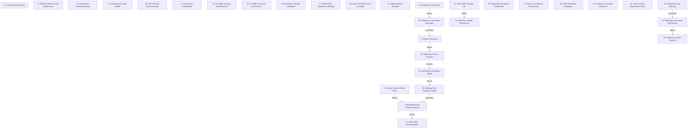

# Grounded Theory Report

## Narrative Summary

This taxonomy describes the architectural design decisions involved in making Git repositories operate at scale across hosting servers and client machines: supporting very many repositories, very large repositories, and very many users. Each dimension names one decision, while its values represent the alternative approaches adopted, considered, or rejected; the diagram shows the explicit relationships among those decisions.

The dimensions cover the full path from client behavior to server-side durability and operations. On clients, they address Working-Directory Change Detection, Client Index Representation, Client Feature Default Policy, Working-Tree Population Mode, Client Remote Synchronization, Client Repository Integration, and Repository and Build Placement. On hosting infrastructure, they cover Repository Hosting Model, Repository Distribution Architecture, Repository Placement and Routing, Replica Placement, Replica Read Routing, Replication Mechanism, Repository Consistency Guarantee, Replica Consistency Enforcement, Write Commitment and Durability, Repository State Authority, and Repository Failure Transition. Git data handling is represented through Git Object Storage Representation, Git Object Traversal and Transfer, Repository Integrity Verification, Reference Update Ordering, and Reference Update Performance. Operational concerns include Compaction Coordination, Maintenance Scheduling Policy, Maintenance Execution Mode, Maintenance Compaction Strategy, Server Reboot Maintenance Policy, and the WAL Object-Storage Tier.

The relationships highlight important dependencies without reducing the choices to a single design. Working-Directory Change Detection affects the outcomes of Client Index Representation, while Client Feature Default Policy also affects Working-Directory Change Detection; Working-Tree Population Mode limits the options available on Working-Directory Change Detection. Replication Mechanism affects the outcomes of Repository Consistency Guarantee, whose choices limit the options available on Replica Placement; Replica Placement in turn affects Repository Failure Transition. Repository State Authority limits the options available on Repository Placement and Routing, which affects Reference Update Ordering. Maintenance Execution Mode affects Working-Tree Population Mode, and Repository Failure Transition requires Maintenance Execution Mode to be decided first. Across 31 dimensions, 192 draft values were consolidated: one near-duplicate was merged, leaving 190 distinct values, with evidence linking 331 of 339 open codes to values and all 48 documents supporting at least one value.

## Dimension Relationship Diagram

## Dimension Catalog

### 7. Working-Directory Change Detection

Captures how clients detect filesystem changes efficiently, distinguishing Git-aware monitoring from general-purpose filesystem watching.

**Values:**

- **Custom Git-aware filesystem watcher** — Git-integrated watching understands ignore rules and avoids scanning directories that cannot contain relevant changes.
- **Watchman filesystem watcher** — A general-purpose watcher lacks the Git-specific behavior and efficiency required by Scalar.
- **Reduced large-checkout status latency** — Git status becomes substantially faster when monitoring narrows inspection to modified paths.

**Outgoing relations:**

- Choices on Working-Directory Change Detection affect the outcomes of Client Index Representation (#21): The amount and selectivity of detected filesystem work influence how often the index is inspected and rewritten.

### 9. Replica Placement

Where are repository replicas deployed relative to geography and network proximity?

**Values:**

- **Geographically dispersed replica placement** — Replicas span separated datacenters or geographic areas for disaster survivability and closer user access.
- **Low-latency replica proximity** — Replicas remain relatively close to the proxy to satisfy communication-latency requirements.
- **Co-located fileserver replicas** — Replicas are kept adjacent to one another to satisfy latency-sensitive block replication.
- **Rack-separated replica placement** — Place repository replicas in distinct racks treated as availability zones to withstand rack-wide failures.

**Outgoing relations:**

- Choices on Replica Placement affect the outcomes of Repository Failure Transition (#41): Distributing reads across replicas and excluding unavailable hosts enables maintenance without interrupting new reads or losing service capacity.

### 10. Replica Read Routing

How are replicas selected for reads and assigned voting or non-voting participation?

**Values:**

- **Freshness-aware nearest-replica routing** — Reads use the nearest replica that has been assessed as up to date.
- **Non-voting geographic replicas** — Geographic replicas serve reads without being required for push quorum, preserving write availability during reachability failures.
- **Single-replica read routing** — Reads route to any one up-to-date replica without cross-replica read coordination.
- **Improved geographic transfer speed** — Users near replicas experience faster Git transfers as a result of geographic, freshness-aware read serving.
- **Linear read scaling through replication** — Adding replicas increases read throughput approximately linearly without reducing push throughput.

**Outgoing relations:**

_No outgoing relations._

### 12. Write Continuity During Maintenance

How do replication and quorum choices preserve writes during server maintenance?

**Values:**

- **Continued write replication during quiescing** — Writes continue reaching the quiescing replica so it does not fall arbitrarily behind.
- **Replica-tolerant write quorum** — Remaining replicas can continue an in-progress write when one rebooting replica drops out.

**Outgoing relations:**

_No outgoing relations._

### 14. Maintenance Scheduling Policy

How are bookkeeping and user updates prioritized, coalesced, and delayed during maintenance?

**Values:**

- **Bookkeeping-update coalescing** — Cascading bookkeeping reference changes are combined into fewer transactions.
- **User-update priority scheduling** — User-initiated reference updates receive priority over non-time-critical bookkeeping work.
- **Bookkeeping-update processing delay** — Large bookkeeping cascades can keep repositories busy and delay or time out user updates.

**Outgoing relations:**

_No outgoing relations._

### 15. Repository Hosting Model

Is repository hosting organized centrally or through a distributed repository model?

**Values:**

- **Centralized repository hosting** — A central host stores and serves repositories for users and organizations.
- **Distributed repository model** — Repositories remain distributed across developers or maintainers rather than relying solely on a central host.
- **Offline distributed workflow** — The distributed model permits offline work and delayed pushes even when users also rely on centralized hosting.
- **Centralized-workflow mismatch** — Git's distributed model can hinder workflows organized around a centralized host.
- **Large-scale hosting difficulty** — Operating Git repository hosting at large scale creates substantial engineering and operational complexity.

**Outgoing relations:**

_No outgoing relations._

### 16. Client Remote Synchronization

How are remote objects, references, and commit metadata synchronized between clients and hosted repositories?

**Values:**

- **Background object prefetch with foreground reference updates** — Clients prefetch objects in the background while users explicitly control when remote-reference updates become visible.
- **Hidden remote-reference namespace** — Fetched remote references are stored separately from normal remote-tracking refs to support metadata generation without changing user-visible refs.
- **Background split commit-graph maintenance** — Clients update reachable-commit graph metadata incrementally in background work rather than coupling it to foreground fetches.
- **Fetch-time commit-graph writing** — Writing the commit-graph synchronously during fetch adds foreground work.
- **Foreground fetch commit-graph overhead** — Writing commit-graph data during foreground fetches adds user-visible fetch overhead.

**Outgoing relations:**

_No outgoing relations._

### 17. Compaction Coordination

Which repository replica performs compaction and how are its results propagated to other replicas?

**Values:**

- **Primary-only compaction** — Only the primary replica performs compaction, avoiding concurrent CPU-intensive maintenance on replicas.
- **Replica-side repacking** — Each replica independently performs repacking as part of repository maintenance.
- **WAL-recorded compaction propagation** — Compaction results are recorded in the write-ahead log so replicas reproduce the result through normal log following.
- **Pre-compacted pack distribution** — Replicas receive already-compacted packfiles from shared object storage instead of consuming replica CPU to repack.
- **Unbounded WAL growth** — Without periodic compaction, restoration must replay an increasingly long write-ahead log.
- **Replica repacking availability burden** — Independent repacking across replicas consumes CPU and can overlap maintenance, creating availability and failover risk.

**Outgoing relations:**

_No outgoing relations._

### 19. Repository Placement and Routing

How are repository instances assigned, located, and rematerialized across hosting nodes?

**Values:**

- **Stateless repository placement** — Repositories may reside on any healthy node without persistent authoritative placement state.
- **External repository-routing database** — A centralized database maps each repository to every machine hosting its replicas. _(consolidated with 1 similar value judged the same decision: "Relational database for repository-location tracking")_
- **Rendezvous-hashing routing** — Repository IDs are mapped to expected healthy nodes using rendezvous hashing without authoritative routing tables.
- **WAL-based repository rematerialization** — Missing or misplaced local copies are recreated on an available node from durable WAL state.
- **Single-machine repository storage** — Each repository is hosted on one server behind a conventional filesystem-backed service.
- **Elastic per-repository replica sizing** — Replica counts vary with repository demand, from one replica to hundreds.
- **Dedicated fileserver repository placement** — Repositories reside on dedicated fileservers while applications access them remotely.
- **Pet-style repository management** — Each repository is individually located, monitored, validated, and repaired rather than treated as interchangeable.
- **Multi-disk multi-machine repository placement** — A repository is distributed across multiple disks and machines for parallel operation and crash availability.
- **Single-machine repository placement** — Each repository resides on one machine, leaving availability and hot-repository performance exposed.
- **Horizontal scalability from remote repository operations** — Remote repository operations allow application-side horizontal scaling without filesystem replication.
- **Repository-location metadata dependency** — External placement metadata becomes an availability dependency for locating replicated repositories.

**Outgoing relations:**

- Choices on Repository Placement and Routing affect the outcomes of Reference Update Ordering (#28): Replica distance and placement directly affect reference-update latency, throughput, and availability.

### 21. Client Index Representation

Which client-side index representation and caching approach supports scalable tracked-path lookup and status operations?

**Values:**

- **Complete tracked-path index** — The index records every tracked path at the current HEAD.
- **Updated compact index format** — A newer index representation reduces storage required for millions of entries.
- **Untracked-file cache** — Cached untracked-file information reduces repeated work in repositories containing very many files.
- **Single-file index stream I/O** — Core commands read and write the index as one streamed file.
- **Index compression from 400 MB to 250 MB** — The updated index format reduces a very large repository index from approximately 400 MB to 250 MB.
- **Low index-entry processing time** — Streaming one index file keeps average processing time per entry low despite the index size.

**Outgoing relations:**

_No outgoing relations._

### 22. Git Object Storage Representation

Which representation stores Git objects for scalable lookup, maintenance, and repository hosting?

**Values:**

- **Multi-pack index representation** — An index maps objects across multiple accumulated packfiles without rewriting all repository data into one pack.
- **Pack-based object storage** — Git objects are stored in delta-compressed packfiles rather than as individual loose-object files.
- **Server-side non-packfile representation** — Hosting internals may use representations other than client-facing packfiles while preserving Git network interoperability.
- **Distributed key-value Git-object storage** — Store content-addressed Git objects in a distributed key-value system instead of conventional packfiles.
- **JGit repository-storage abstraction** — Use a custom Git implementation abstraction to replace ordinary on-disk packfiles with another object store.
- **Filesystem-resident packfile authority** — Repository state is maintained in filesystem-resident packfiles on hosting machines.
- **Blob-storage Git packfiles** — Store large Git packfiles in scalable blob storage rather than requiring them on replica disks.
- **Standard on-disk Git repository operations** — Keep Git operations on a normal on-disk repository using established Git tooling.
- **Simple storage system** — The storage architecture prioritizes operational simplicity as an overarching repository-storage design direction.
- **Full repository repacking cost** — Rewriting all repository data into one pack becomes inefficient as repository size grows.
- **Loose-object storage overhead** — Accumulated loose objects consume extra disk space and degrade performance relative to packed storage.
- **Pack-index accumulation lookup cost** — Object lookup slows as the number of pack indexes grows without multi-pack indexing.

**Outgoing relations:**

_No outgoing relations._

### 23. Git Object Traversal and Transfer

Which traversal and network-transfer mechanism provides scalable access to Git history and objects?

**Values:**

- **Sequential Git DAG traversal** — Traverse commit, tree, parent, and file pointers sequentially to locate dependent Git objects.
- **Packfile Git network transfer** — Transfer Git data over the network as packfiles regardless of server-side object storage.
- **Commit-and-tree-only initial clone** — Initial cloning transfers commits and trees while omitting other Git objects.
- **On-demand Git object retrieval** — Missing Git objects are fetched only when client operations require them.
- **Distributed-store DAG round-trip cost** — Incur a network round trip for each sequential distributed-store object lookup during Git DAG traversal.
- **Unacceptable distributed-object clone performance** — Experience clone performance poor enough to discard distributed object storage.
- **Complete-object clone and verification burden** — Complete cloning requires transferring and verifying all repository objects, creating substantial cost.

**Outgoing relations:**

_No outgoing relations._

### 25. Repository Integrity Verification

Which checksum strategy verifies repository integrity efficiently during operation and recovery?

**Values:**

- **Continuous repository checksumming** — Repository copies are continually checksummed to detect corruption and unhealthy on-disk state.
- **Incremental repository checksum maintenance** — Maintain replica-state checksums incrementally from prior state and changed references.
- **From-scratch repository checksum recomputation** — Recompute a replica checksum from the complete reference list after each update.
- **XOR reference-pair checksum aggregation** — Aggregate reference-name/value hashes with XOR so changed references can be removed and replaced incrementally.
- **Localized failure-detection false positives** — Confine an incorrect server-level failure conclusion to the detecting application server without disrupting production traffic.
- **Rapid corruption-recovery requirement** — Corruption detection and repair must be rapid to preserve push availability when replicas are authoritative.

**Outgoing relations:**

_No outgoing relations._

### 26. Maintenance Execution Mode

How and when is repository maintenance initiated, run, blocked, or disabled by operators?

**Values:**

- **Background maintenance through registration** — Registered repositories receive automatic configuration, fetching, commit-graph, and cleanup operations.
- **Foreground operator-controlled maintenance** — Operators invoke maintenance on demand or according to their own schedule.
- **Single-command maintenance execution** — One command runs the repository’s configuration, fetching, commit-graph, and cleanup tasks together.
- **Periodic foreground garbage collection** — The client periodically performs foreground garbage collection despite the impracticality for very large repositories.
- **Command-triggered synchronous garbage collection** — User-facing Git commands synchronously invoke complete automatic object-data rewrites.
- **Maintenance opt-out controls** — Allow operators to pause or unregister repositories from background maintenance.
- **Pack-count and storage reduction** — Incremental maintenance reduces thousands of packs and large storage footprints to substantially smaller repositories.
- **Foreground command blocking** — Large synchronous maintenance operations delay simple interactive Git commands.
- **Maintenance resource exhaustion** — Complete repository rewrites can consume CPU and memory and stall the client system.
- **Performance decay without automatic collection** — Disabling automatic collection avoids synchronous cost but allows accumulated objects to degrade Git performance.
- **Git command acceleration** — Improve interactive Git command performance as the result of repository registration and maintenance.

**Outgoing relations:**

- Choices on Maintenance Execution Mode affect the outcomes of Working-Tree Population Mode (#38): Maintenance choices such as background cleanup and fetch scheduling change client-side repository performance and the practicality of large working trees.

### 27. Maintenance Compaction Strategy

Which compaction and obsolete-pack expiration strategy manages repository storage during maintenance?

**Values:**

- **Incremental geometric compaction** — Maintenance incrementally compacts packfiles geometrically before a full repack is needed.
- **Small-pack batch repacking** — Maintenance rewrites bounded batches of small packs instead of rewriting all repository data at once.
- **Deferred obsolete-pack expiration** — Obsolete packs remain until no multi-pack-index references remain, allowing concurrent Git commands to continue.
- **Two-phase repack and expiration** — Replacement-pack creation and indexing are separated from deletion of unreferenced packs.

**Outgoing relations:**

_No outgoing relations._

### 28. Reference Update Ordering

How are concurrent reference updates ordered, validated, serialized, and recovered across replicas?

**Values:**

- **Per-write majority voting** — Every reference update is ordered and becomes durable through a majority vote across replicas.
- **Single-primary write ordering** — A designated primary dictates the order that replicas apply all writes.
- **Atomic compare-and-swap WAL updates** — Any repository instance can accept concurrent pushes through atomic compare-and-swap updates to the WAL.
- **Rollback of non-majority writes** — Writes that fail majority agreement are reverted on every replica where they were applied.
- **Unhealthy marking of dissenting replicas** — Replicas that lose a write vote leave service until repaired.
- **Replica-independent push acceptance** — Any server may accept a push without consensus-based primary assignment when WAL updates are atomically protected.
- **Consensus elections for repository primaries** — A consensus protocol elects a primary server responsible for accepting repository writes.
- **Majority-locked write serialization** — Acquire an exclusive majority lock so conflicting reference writes cannot proceed concurrently.
- **Linearized push processing** — Process all pushes in one ordered history to prevent races between concurrent updates.
- **Single-local-repository reference synchronization** — Reference transactions synchronize through one local repository rather than a replica quorum.
- **Concurrent-write elimination** — Eliminate repository conflicts caused by concurrent reference updates through serialized majority locking.

**Outgoing relations:**

_No outgoing relations._

### 29. Write Commitment and Durability

How many replicas and which commit protocol make a repository write durable or refuse unsafe writes?

**Values:**

- **Unsafe-replication write refusal** — Refuse writes that cannot be committed to the required replicas safely.
- **Unconditional write acceptance** — Accept writes regardless of whether the required replication guarantee can be maintained.
- **Three-phase replica commit** — Coordinate updates to distant replicas with a three-phase commit protocol.
- **WAL durability before push acknowledgment** — Acknowledge a push only after the complete operation is durably persisted in the write-ahead log.
- **Three-replica voting configuration** — Each repository uses three replicas to provide redundancy and continued pushes when one machine fails.
- **Two-copy synchronous commitment** — Require synchronous commitment to two replicas before accepting a write.
- **Minimum replica-count write threshold** — Use the ability to create the required minimum number of copies as the write-acceptance condition.
- **Two-copy durability strategy** — Use one additional copy as the durability strategy rather than a larger quorum or conflict-serialization scheme.
- **Durability-induced write unavailability** — Temporarily lose write availability when the replication guarantee cannot be maintained.
- **Consensus tail-latency amplification** — Adding coordinated replicas increases transaction latency because each phase waits for the slowest server.
- **Replica-count push-throughput degradation** — Increasing coordinated replica count reduces push throughput because every server participates in commit.
- **Idle-replica resource overhead** — Maintaining multiple replicas for many small repositories consumes resources even when replicas are mostly idle.

**Outgoing relations:**

_No outgoing relations._

### 30. Reference Update Performance

Which throughput, latency, overlap, and read-preservation strategy governs reference-update performance?

**Values:**

- **Few-hundred-millisecond update budget** — The required per-update throughput implies a few-hundred-millisecond latency budget.
- **Transient disagreement without availability impact** — Occasional non-unanimous votes do not normally reduce repository availability because service continues from the majority.
- **Replication-latency throughput limitation** — Greater replica distance increases update latency and lowers sustainable per-repository reference-update throughput.
- **Read-preserving write optimization** — Reference-update optimizations must preserve read performance because reads greatly outnumber writes.
- **Overlapped network-wait work** — Perform independent locking, checksum, and database activities in parallel while replica network operations wait.
- **Per-repository update throughput target** — Replication coordination is sized to sustain several reference updates per second for one repository.
- **Batched WAL ingestion** — Batching WAL writes amortizes object-storage request latency and raises push throughput.
- **One-object-storage-write-per-push ingestion** — Issuing one object-storage write for every push imposes a throughput ceiling.

**Outgoing relations:**

_No outgoing relations._

### 31. Replica Failure Detection

Which application-level signals and routing policies detect failed repository replicas and limit false failover?

**Values:**

- **Live-operation failure detection** — Detect replica failure from repeated failed Git or RPC operations and route requests away without waiting for a separate detector.
- **Combined heartbeat and traffic detection** — Combine heartbeat liveness checks with real application traffic to detect failures and confirm recovery.
- **Heartbeat-only failure detection** — Use heartbeats alone as the primary health signal for repository replicas.
- **Application-server-local failure views** — Maintain replica failure state independently at each application server rather than relying on one global view.
- **Consecutive-failure offline threshold** — Mark a replica offline only after a configured sequence of failed requests, reducing reactions to isolated errors.
- **Preference-ordered replica failover** — Try replicas in a preference order and demote repeatedly failing nodes without permanently excluding them.
- **No-op-only health checks** — Use no-op checks alone to determine whether a repository replica is healthy for authenticated Git operations.
- **Cross-server failure correlation** — Correlate independent application-server failure reports to distinguish a bad file server from a faulty reporting application server.
- **Heartbeat-based node recovery signal** — Heartbeats can signal that a previously unavailable repository node has recovered.
- **Advisory replica demotion** — A replica may be demoted from preferred service without being treated as permanently failed.
- **RPC failover health telemetry** — Failover behavior supplies server-health telemetry used in replica failure assessment.
- **False-positive replica eviction** — Temporarily remove or demote a healthy replica because random operation failures trigger the failure threshold.

**Outgoing relations:**

_No outgoing relations._

### 32. Client Feature Default Policy

Which client features run by default in foreground, background, or disabled modes?

**Values:**

- **Compatibility-oriented disabling of foreground features** — Advanced foreground Git work is disabled by default to preserve compatibility and avoid blocking interactive commands.
- **Background execution of client maintenance** — Client maintenance and metadata generation run asynchronously rather than during interactive operations.

**Outgoing relations:**

- Choices on Client Feature Default Policy affect the outcomes of Working-Directory Change Detection (#7): Disabling or backgrounding client status features changes interactive filesystem-change detection behavior and latency.

### 33. WAL Object-Storage Tier

Which object-storage performance tier supports the write-ahead log's durability and ingestion rate?

**Values:**

- **S3 Standard WAL storage tier** — Standard object storage provides durable WAL storage for moderate push ingestion rates.
- **S3 Express One Zone WAL storage tier** — A lower-latency object-storage tier supports higher WAL ingestion rates.

**Outgoing relations:**

- Choices on WAL Object-Storage Tier affect the outcomes of Reference Update Performance (#30): The documents tie object-storage PUT latency and tier selection directly to WAL ingestion and push throughput.

### 34. Replication Mechanism

Which mechanism carries repository updates between replicas, from Git-aware and packfile methods to gossip or asynchronous propagation?

**Values:**

- **Git application-level replication** — Replicate repositories through application-level Git operations, optionally combined with rsync for scalable synchronization and repair.
- **Packfile-level replication** — Replication operates on Git packfiles while leaving Git itself undistributed.
- **Filesystem block-level replication** — Replication copies filesystem blocks as the older architecture.
- **Git system distribution** — Git is distributed as a system-level component requiring maintenance of a suitable fork.
- **Optimistic UDP gossip replication** — Replicas exchange WAL metadata through lossy UDP gossip and independently validate durable state.
- **Asynchronous packfile distribution** — Large pushed packfiles distribute without consensus because unreachable objects need not be synchronized immediately.
- **Whole-packfile local caching** — Caching complete packfiles locally can make random access acceptable but does not scale across very many repositories.

**Outgoing relations:**

- Choices on Replication Mechanism affect the outcomes of Repository Consistency Guarantee (#36): Replication mechanisms determine whether replicas can remain fully synchronized and what complexity and failure behavior the consistency model entails.

### 35. Repository Distribution Architecture

How are repository copies exposed, distributed, and fanned out across hosting infrastructure?

**Values:**

- **Proxy-mediated replica distribution** — A proxy accepts client pushes and distributes updates to multiple fileservers.
- **Filesystem-level repository distribution** — The filesystem containing Git data is distributed while the application remains unchanged.
- **Packfile-level repository distribution** — Packfiles rather than the whole filesystem are distributed among repository-serving locations.
- **NFS-backed repository distribution** — A network filesystem such as NFS provides distributed storage for centralized repositories.
- **RPC-based repository access** — Applications access repositories through RPC while repositories remain on dedicated fileservers.
- **Multi-server repository replication** — Each repository has copies on multiple servers for resilience and distributed serving.
- **Orchestrated push fan-out** — An orchestrator distributes pushed packfiles to repository replicas.
- **Network-filesystem correctness and performance problems** — Networked filesystem semantics can make Git operations slow and buggy because Git assumes local-disk behavior.
- **Durable highly available repository access** — Preserve repository access and durability despite server and network failures through replicated storage.
- **Central-server stress reduction** — Proxy caching reduces repeated object-serving work handled by the central server.

**Outgoing relations:**

_No outgoing relations._

### 36. Repository Consistency Guarantee

Which freshness, consistency, and partition-priority guarantee do repository replicas provide?

**Values:**

- **Fully synchronized repository replicas** — All replicas maintain current repository state so clients and CI can immediately observe updates.
- **Eventually consistent repository views** — Replicas may temporarily omit newly pushed commits, creating unreliable client and CI behavior.
- **Consistency-and-partition priority** — Prioritize consistency and partition tolerance over availability when replication or communication failures occur.
- **Immediate post-push commit visibility** — Reliable visibility of newly pushed commits is the operational result of strong synchronization.
- **Full-consistency implementation complexity** — Maintaining complete synchronization imposes substantial implementation complexity.
- **Globally consistent reads across replicas** — Replication and durable-state validation provide a consistent repository view across replicas.

**Outgoing relations:**

- Choices on Repository Consistency Guarantee limit the options available on Replica Placement (#9): Read routing must account for replica freshness when replicas are geographically dispersed; stale replicas cannot serve reads requiring current repository state.

### 37. Replica Consistency Enforcement

Which read-validation or catch-up mechanism enforces the selected repository consistency guarantee?

**Values:**

- **ETag-validated replica reads** — Conditional object-store validation checks replica freshness before serving reads.
- **Read-time replica catch-up** — A replica catches up from durable storage when validation detects a newer WAL index.

**Outgoing relations:**

_No outgoing relations._

### 38. Working-Tree Population Mode

Which population model controls the files and objects materialized in a client working tree?

**Values:**

- **Sparse-checkout population** — Only selected repository paths are populated, scaling working-tree size through Git-native mechanisms.
- **Virtualized filesystem population** — A virtual filesystem defers populated-size costs and presents repository content through virtualization.
- **Partial-clone GVFS integration** — GVFS interaction is implemented through Git’s partial-clone interface so both mechanisms reinforce one another.
- **Full working-directory population** — The client materializes the complete working directory instead of using sparse population.
- **Checkout performance bottleneck** — Moving from virtualization to sparse-checkout makes checkout slower than with the former virtual filesystem.
- **Populated-file modification detection cost** — Detecting modifications across populated files becomes expensive as the working set grows.
- **Higher file-population cost than index adjustment** — Materializing files requires substantially more data handling than adjusting index entries.
- **Reduced Git working-tree management burden** — Selective population and separated outputs reduce the work required to manage the working tree.

**Outgoing relations:**

- Choices on Working-Tree Population Mode limit the options available on Working-Directory Change Detection (#7): The populated-tree strategy determines which paths need monitoring and whether a watcher can avoid scanning irrelevant directories.

### 39. Client Repository Integration

Which client and protocol integration supplies large-repository capabilities through Git, GVFS, or custom distribution?

**Values:**

- **Co-located GVFS cache server** — A cache server near sufficiently large repositories supports GVFS requests for large user groups.
- **GVFS without cache infrastructure** — GVFS deployment proceeds without the cache-server infrastructure required for scalable operation.
- **Git protocol with Scalar registration** — Existing Git-protocol repositories use Scalar registration when GVFS cache infrastructure cannot be resourced.
- **Custom Git client distribution** — Distribute a custom Git client containing repository-scaling features.
- **Core Git feature integration** — Contribute scaling features to core Git to remove the custom-client requirement.
- **GVFS protocol in standard Git client** — Expose the GVFS protocol as the standard Git client's large-repository transfer mechanism.

**Outgoing relations:**

_No outgoing relations._

### 40. Repository and Build Placement

How are the repository, source tree, and build outputs arranged on the client filesystem?

**Values:**

- **Source-directory repository placement** — Place the client repository in a source directory while keeping build artifacts outside its working tree.
- **Nested source working directory** — The working tree resides in a nested source directory, leaving sibling locations available.
- **Sibling build-output directories** — Build outputs are placed beside rather than inside the Git working directory.

**Outgoing relations:**

_No outgoing relations._

### 41. Repository Failure Transition

Which failure and recovery behavior governs repository access when a server crashes or becomes unavailable?

**Values:**

- **Crash-recovery maintenance logic** — Planned maintenance reuses recovery mechanisms designed for crashes and permanent failures.
- **Immediate server reboot or unplugging** — Abrupt retirement interrupts long-running reads and can discard their progress.
- **Interrupted long-running reads** — Direct reboot can force large clones and other reads to restart elsewhere, losing prior progress.

**Outgoing relations:**

- Repository Failure Transition requires Maintenance Execution Mode to be decided first (#26): Safe server retirement depends on knowing how ongoing maintenance and repository operations are scheduled and executed.

### 42. Server Reboot Maintenance Policy

How are servers drained, rebooted, and concurrency-limited during planned maintenance?

**Values:**

- **Quiescing before reboot** — The server drains active operations before shutdown and stops accepting new reads.
- **Rolling reboot maintenance** — Perform maintenance through sequential server or rack reboots while preserving service availability.
- **Random server reboot testing** — Randomly reboot file servers to test failure handling while production reads may be active.
- **Bounded reboot concurrency** — Limit the number of servers rebooted concurrently within a maintenance zone to preserve redundancy and service access.

**Outgoing relations:**

_No outgoing relations._

### 43. Repository State Authority

Where is authoritative repository state maintained, on replica disks or in an external durable log?

**Values:**

- **S3-backed write-ahead-log authority** — Authoritative repository state resides in an external S3 write-ahead log, allowing disposable repository instances.
- **On-disk replica authority** — Repository copies on local disks are authoritative for consensus and correctness.
- **Local-disk warm-cache copies** — Local repository copies accelerate access but remain non-authoritative caches.
- **Packfile-induced scale limitation** — Filesystem-backed packfiles limit repository availability and scalability at large hosting scale.

**Outgoing relations:**

- Choices on Repository State Authority limit the options available on Repository Placement and Routing (#19): The WAL-authoritative design permits stateless placement and rematerialization, while on-disk authority requires tracked replica locations.

## Evaluation

_Observe-only LLM-as-judge scoreboard (judge: openai/gpt-5.6-luna). Pass flags are display-only — nothing gates on them._

| Criterion | Score | Pass | Reason |
|---|---|---|---|
| Orthogonality | 0.70 | ✓ | Most dimensions ask distinct questions, such as consistency guarantee (36) versus enforcement mechanism (37), compaction strategy (27) versus compaction coordination (17), and write ordering (28) versus durability (29). However, there are notable overlaps: Replica Placement (9) and Repository Placement and Routing (19) both cover where replicas or repositories reside; refocus 19 on routing/rematerialization and move its physical-placement alternatives to 9 or Repository Distribution Architecture (35). Replication Mechanism (34) and Repository Distribution Architecture (35) also mix update-propagation mechanisms with hosting topology; move propagation choices such as 35.7, Orchestrated push fan-out, to 34 and retain 35 for exposure and distribution structure. Centralized/distributed hosting in Repository Hosting Model (15) partially overlaps the infrastructure distribution choices in 35, so narrow 15 to the repository ownership/workflow model and keep physical distribution in 35. |
| Clarity | 0.50 | ✓ | Many dimensions are clearly named and their values are usually distinguishable, such as 9 Replica Placement and 31 Replica Failure Detection. However, several dimensions combine different decision questions or levels. Dimension 35 Repository Distribution Architecture mixes proxy access, RPC, replication, fan-out, and outcomes; split or rename it so each question covers one mechanism range. Dimension 36 Repository Consistency Guarantee combines freshness (36.1–36.2) with partition-priority policy (36.3); split these into separate questions. Dimension 22 Git Object Storage Representation mixes pack/index formats, server-side storage, blob storage, and the broad direction 22.9; reorganize these into narrower representation questions and move the outcome values 22.10–22.12 accordingly. Dimension 28 Reference Update Ordering combines majority voting, primary selection, CAS, locking, rollback, and local synchronization; split ordering/serialization alternatives from recovery behavior. Dimension 39 Client Repository Integration combines cache deployment, fallback workflows, custom-client distribution, and core Git integration; separate or rename it to state the specific integration question and keep alternatives at the same level. |
| Completeness | 1.00 | ✓ | All major decision areas for scaling repositories across servers and clients are represented by dimensions with multiple candidate decisions. Server-side concerns include replication and distribution (34, 35), consistency and durability (36, 28, 29), placement and routing (9, 10, 19), failure handling (31, 41, 42), and maintenance (26, 27). Client and large-repository concerns include object storage and transfer (22, 23), sparse or virtualized working trees (38), synchronization (16), index and filesystem-change detection (7, 21), and client integration (39). Even narrower dimensions such as 37 and 33 contain multiple candidate options, so no major area is left without a multi-option decision point. |
| Use case alignment | 0.80 | ✓ | Most dimensions name decisions directly relevant to scaling Git hosting and clients, including replication (34), consistency (36–37), placement and routing (9–10, 19), durability (28–31, 43), maintenance (26–27), and large-client operation (38–39, 7, 21–23). The main scope issues are dimension 15, "Repository Hosting Model," whose generic centralized-versus-distributed workflow decision is broader than scaling the specified hosting systems; dimension 40, "Repository and Build Placement," whose source/build directory layout is only tangential to Git scalability; and dimension 32, "Client Feature Default Policy," whose default-mode policy is less directly an architectural scaling decision. Drop dimensions 15 and 40, and merge dimension 32 into the relevant client maintenance dimension 26 or client integration dimension 39. |
| No catch-alls | 0.90 | ✓ | The taxonomy largely avoids catch-all buckets and provides specific decision alternatives or outcomes. Two values in dimension 22, "Git Object Storage Representation," are catch-all-like: 22.3 "Server-side non-packfile representation" uses an open-ended 'other representations' category, and 22.9 "Simple storage system" is explicitly an overarching storage direction. Drop values 22.3 and 22.9, or replace them by reorganizing their specific content into the existing concrete storage dimensions; the remaining values are generally bounded alternatives or identifiable outcomes. |
| Axis vs. value | 0.20 | ✗ | Many dimensions combine multiple decision points or contain values that are questions of their own. Split 40 (Repository and Build Placement) into separate decisions for repository/source-tree placement and build-output placement, since values 40.1-40.3 are arrangements of different concerns rather than alternatives to one choice. Split 23 (Git Object Traversal and Transfer) into traversal strategy and transfer/clone strategy, since values 23.1-23.4 address distinct mechanisms. Split 17 (Compaction Coordination) into compaction ownership and compaction-result propagation, separating 17.1-17.2 from 17.3-17.4. Reorganize 28 (Reference Update Ordering) into ordering/serialization and failure-recovery decisions, because voting, primary selection, locking, rollback, and unhealthy marking are separate choices. Reorganize 39 (Client Repository Integration) into deployment/infrastructure and client/protocol integration, since 39.1-39.2 concern cache infrastructure while 39.3-39.6 concern Git, GVFS, and custom-client integration. |
| One decision point | 0.30 | ✗ | Most dimensions have at least two candidate values and several are coherent, such as 27 Maintenance Compaction Strategy and 33 WAL Object-Storage Tier. However, many broad dimensions contain values answering different questions. Split 35 Repository Distribution Architecture into separate storage/access and replication/fan-out decisions; its values mix NFS, RPC access, placement, and push distribution. Split 22 Git Object Storage Representation into object representation versus storage location/implementation, and drop or move 22.9 Simple storage system because it is a design goal, not a representation option. Split 28 Reference Update Ordering into ordering/serialization versus commitment and replica-recovery behavior. Split 26 Maintenance Execution Mode into execution scheduling and operator registration/control. Split 39 Client Repository Integration into cache/protocol deployment versus client implementation/distribution. Also move 34.7 Whole-packfile local caching out of Replication Mechanism, since it describes caching rather than carrying updates. These changes preserve at least two candidates per resulting decision and address the main same-question violations. |
| Rejected-alternative handling | 0.80 | ✓ | Most values use valid statuses and distinguish candidate decisions from effects, but several structural violations remain. In dimension 19, values 19.9 "Multi-disk multi-machine repository placement" and 19.10 "Single-machine repository placement" are phrased as alternative placement decisions, not outcomes; reclassify them as candidate decisions with appropriate statuses. In dimension 32, mixed value 32.1 asserts that foreground features "are disabled by default," which describes a simple adopted policy; revise it to explicitly reflect the conflicting or context-dependent positions. Values 25.6 "Rapid corruption-recovery requirement" and 30.1 "Few-hundred-millisecond update budget" are requirements or targets rather than effects; move them out of the outcome category or drop them. |
| Dimensional coverage | 1.00 | ✓ | All decision-bearing passages can be placed under existing dimensions. Scalar choices in s04_p01 and s04_p02 map to client integration (39), feature defaults and background maintenance (32, 26), sparse/partial checkout (38), index and filesystem monitoring (21, 7), and repository placement (40). Spokes decisions map to replication and placement (34, 35, 9), consistency and quorum (36, 28, 29), routing and failure handling (10, 31, 41), maintenance (42, 12, 14), and performance (30). Git storage and traversal alternatives in s01_p03, s01_p04, and s01_p05 are covered by 22, 23, and 35. No decision-bearing passage is unplaced, so no taxonomy change is required. |
| Candidate-decision coverage | 0.90 | ✓ | The taxonomy covers most adopted and rejected options across the Scalar and Spokes passages, including Git application-level replication (s02_p01), three-phase commit (s02_p03), quorum durability (s03_p02, s03_p09), quiescing and rolling reboots (s03_p07, s03_p08), background maintenance (s05_p09, s05_p11), sparse checkout and partial clone (s04_p02, s05_p04), and WAL/rendezvous-hashing designs (s01_p11). A few specific options are not explicitly named: add 'Git built-in filesystem monitor' to dimension 7, Working-Directory Change Detection, supported by s04_p02; add 'Atomic Git reference-update transactions' to dimension 28, Reference Update Ordering, supported by s02_p04; add 'Cone-mode sparse checkout' to dimension 38, Working-Tree Population Mode, supported by s05_p04; add 'Loose-object cleanup' to dimension 27, Maintenance Compaction Strategy, supported by s05_p12; and add 'Graceful server retirement with replica replenishment' to dimension 42, Server Reboot Maintenance Policy, supported by s03_p09. |

**Overall score:** 0.71 (mean of evaluated criteria)