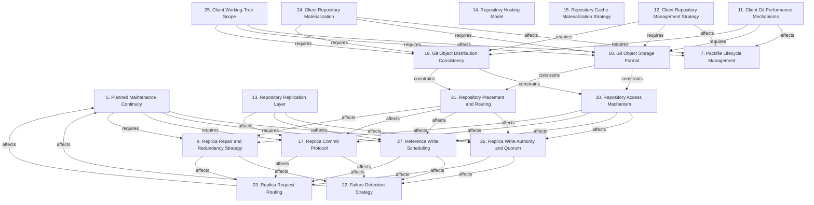

# Grounded Theory Report

## Narrative Summary

This taxonomy examines the architectural design decisions involved in making Git repositories operate at scale: across very many repositories, very large repositories, and very many users, on hosting servers and clients. It organizes the alternatives teams adopted or considered around the forces that shape these choices, including performance, availability, durability, consistency, storage and transfer cost, operational continuity, and the practical limits of clients and servers.

The server-side structure begins with the physical representation and distribution of Git data. Git Object Storage Format and Git Object Distribution Consistency constrain the available choices for Repository Access Mechanism and Repository Placement and Routing. Those decisions, together with the Repository Replication Layer, shape Replica Write Authority and Quorum, Reference Write Scheduling, and Replica Commit Protocol. These dimensions address how writes are accepted, prioritized, committed, synchronized, and recovered across replicas. Replica Repair and Redundancy Strategy, Failure Detection Strategy, and Replica Request Routing then determine how the system responds to dissent, failure, repair, and changing server health. Planned Maintenance Continuity depends on Replica Write Authority and Quorum, Reference Write Scheduling, Replica Commit Protocol, and Replica Repair and Redundancy Strategy, tying routine reboots and retirement to the system’s consistency and availability decisions. Packfile Lifecycle Management addresses the related need to consolidate, index, redirect, and delete packfiles without exhausting file handles or disrupting foreground Git operations.

On the client side, Repository Hosting Model frames the combination of client decentralization with repository service centralization. Client Repository Materialization and Client Working-Tree Scope determine how much repository and working-tree data is obtained and kept locally, while Client Repository Management Strategy governs how large-repository support is configured, maintained, scoped, and transitioned. Client Git Performance Mechanisms provide Git-native optimizations, tracing, and command mechanisms; these client choices depend on Git Object Storage Format and Git Object Distribution Consistency and affect Packfile Lifecycle Management. Repository Cache Materialization Strategy complements them by balancing local responsiveness, storage cost, and the work required to discard and reconstruct cached repository state. Across the taxonomy, the 19 dimensions contain 203 distinct values after consolidating five near-duplicates; the resulting relationship structure shows which decisions constrain or affect later choices without reducing those alternatives to a single universal design.

## Dimension Relationship Diagram

## Dimension Catalog

### 5. Planned Maintenance Continuity

How planned server reboots and retirement preserve active work, replica currency, and availability during controlled transitions.

**Values:**

- **Failure-mechanism reuse for maintenance** — Applies crash and permanent-failure handling mechanisms to planned reboots and server retirement.
- **Quiescing before reboot** — Stops new reads while allowing active operations to complete before a server reboots.
- **Continued write delivery during quiescing** — Continues sending writes to the quiescing replica so it does not fall arbitrarily behind.
- **Immediate reboot** — Reboots without draining activity; rejected because it can interrupt long-running reads and clones.
- **Planned rolling reboot operations** — Use sequential, bounded rolling reboots to test or perform changes while preserving service continuity.
- **Unplanned server reboot testing** — Use random abrupt reboots as the primary test of single-node failure handling.
- **Unplanned server unplugging for retirement** — Retire servers by abruptly unplugging them without quiescing active work.
- **Lost interrupted-clone progress** — An interrupted large clone must restart elsewhere and loses progress already completed.
- **Replica catch-up load** — Withheld writes would make a quiescing replica fall behind and create substantial recovery work.

**Outgoing relations:**

- Planned Maintenance Continuity requires Replica Write Authority and Quorum to be decided first (#26): Quiescing and continued write delivery depend on replicated copies and the system’s ability to keep a maintenance target synchronized.
- Planned Maintenance Continuity requires Reference Write Scheduling to be decided first (#27): Quiescing and continued write delivery depend on replicated copies and the system’s ability to keep a maintenance target synchronized.
- Planned Maintenance Continuity requires Replica Commit Protocol to be decided first (#17): Quiescing and continued write delivery depend on replicated copies and the system’s ability to keep a maintenance target synchronized.
- Planned Maintenance Continuity requires Replica Repair and Redundancy Strategy to be decided first (#9): Quiescing and continued write delivery depend on replicated copies and the system’s ability to keep a maintenance target synchronized.

### 7. Packfile Lifecycle Management

How packfiles are consolidated, indexed, redirected, and deleted without exhausting file handles or disrupting foreground Git operations.

**Values:**

- **Incremental small-batch repacking** — Rewrites bounded batches of small packfiles instead of attempting unlimited or repository-wide repacking.
- **Multi-pack-index object relocation** — Uses the multi-pack-index to redirect objects into newly created packs while avoiding reads from superseded packs.
- **Two-phase consolidation and expiration** — Separates pack creation and reference updates from deletion so cleanup occurs only after old packs are unreferenced.
- **Deferred unreferenced-pack deletion** — Retains old packs until their objects have been redirected and no references remain.
- **Foreground-command continuity** — Designs maintenance so foreground Git commands continue operating during repacking and expiration.
- **Loose-object cleanup** — Maintenance removes accumulated loose objects to reduce storage and lookup overhead.
- **Single-pack full repacking** — All repository data is rewritten into one packfile to reduce lookup overhead.
- **Background incremental repository maintenance** — Perform repository cleanup and rewriting incrementally in background processes rather than blocking foreground commands.
- **Foreground automatic garbage collection** — Run complete automatic garbage collection synchronously at the end of user commands.
- **Primary-only compaction scheduling** — Schedule repository compaction on only the primary replica and propagate its results to peers.
- **WAL-propagated compaction events** — Propagate compaction results through the WAL so replicas apply the same repository maintenance events.
- **S3 distribution of compacted packs** — Distribute already-compacted packs from object storage instead of repacking independently on replicas.
- **Periodic write-ahead-log compaction** — Compact the WAL periodically to bound restoration work as updates accumulate.
- **On-disk layout optimization for compaction** — Optimize repository disk layout to reduce compaction impact on ingestion.
- **Replica-local repository repacking** — Repack repositories independently on each replica.
- **Automatic Git garbage-collection disablement** — Disable foreground automatic garbage collection and shift cleanup to background maintenance.
- **Unbounded packfile growth** — Allows pack counts to grow without bound, creating file-handle scalability problems.
- **Pack-count and storage reduction** — Deployment reduced repositories from thousands of packs and 150–200 GB to fewer than 100 packs and 30–50 GB.
- **Pack-index accumulation lookup cost** — Accumulating packfiles increases the number of indexes Git must inspect and slows object lookup.
- **Foreground garbage-collection blocking** — Foreground garbage collection blocks commands and can exhaust CPU and memory during repository rewrites.
- **Performance decay from disabled automatic collection** — Avoid foreground collection but allow accumulated objects to gradually degrade Git performance.
- **Compaction-limited push throughput** — Push throughput becomes bounded by on-disk compaction speed after WAL latency is reduced.
- **Replica failover from concurrent maintenance** — Concurrent compaction on replicas can trigger repository failover and reduce availability.

**Outgoing relations:**

_No outgoing relations._

### 9. Replica Repair and Redundancy Strategy

How replicas are kept available through dissent handling, reconstruction, repair, and replication factor.

**Values:**

- **Unhealthy dissenting replicas** — Removes replicas that lose a write vote from read and write service until repaired.
- **Automatic replica repair** — Restores unhealthy or missing replicas automatically while a healthy majority continues serving traffic.
- **N-to-N replica reconstruction** — Rebuilds replicas anywhere in the cluster from any surviving replicas rather than from one designated source.
- **Three-way repository replication** — Maintains three repository copies so an available, current replica remains routable after individual server failures.
- **Non-voting geo-replicated hosts** — Geographically replicated hosts receive copies without participating in write votes, preserving push availability during their outages.
- **Mandatory replica floor for every repository** — Every repository retains at least three replicas to preserve consistency and redundancy.
- **Rendezvous-hashed repository placement** — Repository placement is derived from repository identity and the current healthy-node set rather than persistent location records.
- **Elastic per-repository replica allocation** — Adjust repository replica counts to demand rather than enforcing one fixed replication count.
- **Rack-level availability zones** — Place repository replicas on separate racks to survive rack-wide failures.
- **Single-extra-copy redundancy** — Relying on only one additional copy is insufficient for concurrent conflicting writes and stronger failure tolerance.
- **Durable highly available repository access** — Multiple repository copies provide durable and highly available content access through server and network failures.
- **Reduced replication margin after server loss** — A sudden server loss leaves repositories with fewer copies and no tolerance for another failure.
- **Higher write rejection risk after server loss** — Reduced replication capacity increases the likelihood that subsequent writes are refused.
- **Excess idle-replica overhead for small repositories** — A mandatory replica count leaves many lightly used repositories with mostly idle redundant capacity.
- **Insufficient replica capacity for massive monorepos** — The fixed replica arrangement cannot provide enough capacity for traffic from very large repositories and CI.
- **Geographic disaster resilience** — Disperse replicas across regions to survive broad geographic failures.
- **Distributed repository placement across disks and machines** — Repository data is distributed across many disks and machines for parallelism and crash availability.
- **Repository availability during server crashes** — Replicated repository data keeps repositories available when an individual hosting server fails.

**Outgoing relations:**

- Choices on Replica Repair and Redundancy Strategy affect the outcomes of Failure Detection Strategy (#22): Replica health and repair determine which repository copies request routing can safely use after server or network failures.
- Choices on Replica Repair and Redundancy Strategy affect the outcomes of Replica Request Routing (#23): Replica health and repair determine which repository copies request routing can safely use after server or network failures.

### 11. Client Git Performance Mechanisms

Which Git-native optimizations, tracing, and command mechanisms improve large-repository client performance.

**Values:**

- **Custom performance tracing and feedback** — Uses tracing and user feedback to locate client bottlenecks in large-repository workflows.
- **Commit-graph optimization** — Uses commit-graph files to improve large-repository Git performance.
- **Push and sparse-checkout optimization** — Improves push and sparse-checkout behavior for large repositories.
- **Core Git performance investment** — Moves required performance capabilities into Git itself to reduce dependence on management layers.
- **Filesystem change monitoring** — Git uses filesystem event monitoring to identify changed paths instead of scanning every populated path.
- **Modified-path-focused index inspection** — Index inspection is limited to paths identified as modified.
- **Background split reachable commit-graph maintenance** — Update reachable commit graphs incrementally in the background to reduce foreground fetch overhead.
- **Core-command working-directory inspection** — Core Git commands inspect working-directory state against the index and on-disk files.
- **Complete tracked-path index** — The index represents every tracked path at HEAD and is read and written by core commands.
- **Updated compressed index format** — A revised index representation compresses very large indexes and reduces single-file read/write burden.
- **Untracked cache feature** — Git's untracked cache reduces repeated filesystem work in repositories with many files.
- **Ahead-behind status calculation disablement** — Disable ahead-behind comparison when status primarily needs unstaged-change information.
- **Watchman filesystem watcher** — A general-purpose Watchman watcher is used for Git working-tree change detection.
- **Reduced git-status latency** — Filesystem monitoring and focused inspection substantially reduce status latency in large sparse repositories.
- **Foreground fetch commit-graph overhead** — Writing commit-graph data during foreground fetch increases user-visible fetch work.
- **Index-size reduction** — The revised index reduces the reported index size from 400 MB to 250 MB.
- **Low per-entry index processing time** — Per-entry processing remains low because the principal cost is streaming one index file for reading and writing.

**Outgoing relations:**

- Choices on Client Git Performance Mechanisms affect the outcomes of Packfile Lifecycle Management (#7): Client performance depends partly on pack counts, file-handle pressure, delta layout, and background maintenance efficiency.
- Client Git Performance Mechanisms requires Git Object Storage Format to be decided first (#18): Virtualized cloning and client optimizations must accommodate the Git object and packfile representation used by the hosting protocol.
- Client Git Performance Mechanisms requires Git Object Distribution Consistency to be decided first (#19): Virtualized cloning and client optimizations must accommodate the Git object and packfile representation used by the hosting protocol.

### 12. Client Repository Management Strategy

How a management layer configures, maintains, scopes, and transitions large-repository client support.

**Values:**

- **Scalar configuration and maintenance** — Uses Scalar to apply recommended configuration and run background maintenance that accelerates Git workflows.
- **Reduced Scalar scope** — Limits Scalar to currently needed performance capabilities rather than expanding its management role.
- **Transitional Scalar layer** — Uses Scalar temporarily while Git develops capabilities that can eventually replace it.
- **Git-native Scalar replacement** — Contributes Scalar-driven management features to Git so external layers can be removed over time.
- **User-controlled maintenance suspension** — Users can pause or unregister background repository maintenance.
- **Repository-local maintenance logging** — Maintenance activity and durations are recorded in the repository for user visibility.
- **Scalar repository registration** — Repositories are explicitly activated with Scalar before it applies repository-specific configuration and maintenance.
- **Repository-local Git configuration** — Scalar stores client behavior settings in the repository's local Git configuration.
- **Background scheduled fetching** — Fetch remote objects periodically in the background while keeping user-visible remote references unchanged.
- **Hidden remote-reference namespace** — Store background-fetch references outside the visible remote-reference namespace for maintenance use.
- **Foreground-only remote-reference updates** — Require foreground fetches when users need visible remote-reference updates.
- **Background repository configuration updates** — Apply recommended repository configuration changes asynchronously after installation.
- **Custom Git distribution for Scalar** — Scalar is shipped within a custom Git distribution while broader fork compatibility is pursued.
- **Compatibility-driven default-off optimization features** — Advanced performance features remain disabled by default to preserve broad compatibility.

**Outgoing relations:**

- Choices on Client Repository Management Strategy affect the outcomes of Packfile Lifecycle Management (#7): Client performance depends partly on pack counts, file-handle pressure, delta layout, and background maintenance efficiency.
- Client Repository Management Strategy requires Git Object Storage Format to be decided first (#18): Virtualized cloning and client optimizations must accommodate the Git object and packfile representation used by the hosting protocol.
- Client Repository Management Strategy requires Git Object Distribution Consistency to be decided first (#19): Virtualized cloning and client optimizations must accommodate the Git object and packfile representation used by the hosting protocol.

### 13. Repository Replication Layer

Which system layer and mechanism performs repository replication across hosts.

**Values:**

- **DRBD block-level replication** — Replication is performed below the application at the filesystem block level.
- **Co-located replica placement** — Replicas are kept physically close to satisfy block-replication latency constraints. _(consolidated with 1 similar value judged the same decision: "Low-latency replica placement")_
- **Application-level Spokes replication** — An application-level system replicates Git repositories and manages their copies across file servers.
- **Distant replica placement** — Replicas are deliberately distributed across greater geographic distances despite added latency.
- **Git-and-rsync replication** — Replication combines Git-aware operations with rsync for copying, repair, and rebalancing.
- **S3-backed write-ahead-log authority** — Authoritative repository state is retained in durable object storage while hosts serve reconstructible working copies.
- **WAL-based repository provenance and replica rewind** — The authoritative log records repository operations so states can be reconstructed, rewound, and fast-forwarded.
- **Optimistic UDP gossip replication** — Exchange replica catch-up metadata through lossy gossip while retaining authoritative recovery from the WAL.
- **ETag-validated replica freshness** — Validate replica currency against the WAL index before serving reads.
- **WAL-index catch-up before reads** — Catch replicas up from a newer WAL index before serving fetches or clones.
- **S3-backed globally consistent reads** — Use authoritative S3 state checks so replicas expose a consistent repository view despite message loss or topology changes.
- **Arbitrary replica-count scaling** — Scale read-serving capacity by deploying an arbitrary number of consistent replicas.
- **Fully consistent replica cluster** — Maintain full consistency across replicas while adding read and RPC serving capacity.
- **WAL-first storage design** — Use the write-ahead log as the primary durability and replication foundation for repository updates.
- **S3 Express One Zone WAL storage** — Use low-latency S3 Express One Zone as the WAL persistence layer for high push rates.
- **Batched WAL operations** — Batch WAL writes to reduce object-store latency and sustain high push ingestion rates.
- **Single-S3-write-per-push model** — Persist each push with one object-store write.
- **On-disk repository consensus authority** — Repository copies on disk serve as the authoritative state for consensus and correctness.
- **Individually managed repository copies** — Each repository copy is treated as a valuable, individually tracked operational asset.
- **Continuous repository checksum tracking** — Replica checksums are continuously maintained to detect corruption in authoritative repository copies.
- **Per-update replica checksum validation** — Replica logical contents are checked after each update using a checksum over reference-value state.
- **Incremental checksum maintenance** — Replica checksums are updated incrementally instead of recomputed from scratch after every reference update. _(consolidated with 1 similar value judged the same decision: "XOR-based checksum updates")_
- **From-scratch checksum recomputation** — The checksum is fully recomputed for every update, imposing excessive cost in busy repositories.
- **Repository-operation burden at scale** — Per-repository tracking, verification, corruption detection, and urgent repair create operational burden as scale grows.

**Outgoing relations:**

- Choices on Repository Replication Layer affect the outcomes of Replica Write Authority and Quorum (#26): The new documents state that geographic replica distance adds latency and constrains reference-update throughput.
- Choices on Repository Replication Layer affect the outcomes of Reference Write Scheduling (#27): The new documents state that geographic replica distance adds latency and constrains reference-update throughput.
- Choices on Repository Replication Layer affect the outcomes of Replica Commit Protocol (#17): The new documents state that geographic replica distance adds latency and constrains reference-update throughput.

### 14. Repository Hosting Model

Which collaboration and hosting model combines client decentralization with repository service centralization?

**Values:**

- **Distributed version-control model** — Clients retain decentralized version-control capabilities while collaborating through hosted repositories.
- **Centralized repository hosting** — Organizations rely on a central host for shared repository collaboration despite distributed client capabilities.
- **Hybrid distributed-client centralized-host architecture** — Distributed client workflows such as offline work and delayed pushes operate against centralized repository hosting.
- **Distributed Git implementation** — The hosting system itself distributes or modifies Git rather than retaining standard Git as the implementation boundary.
- **Git repository hosting difficulty** — Hosting Git repositories creates substantial scalability and operational complexity.

**Outgoing relations:**

_No outgoing relations._

### 15. Repository Cache Materialization Strategy

How repository state is cached, discarded, and reconstructed to balance local responsiveness, storage cost, and materialization work.

**Values:**

- **Local-disk repository warm cache** — Hosts keep repositories as local working copies for efficient access without making local placement authoritative.
- **On-demand repository materialization** — A missing repository is reconstructed from authoritative log state on the host that needs to serve it.
- **Idle-replica disk garbage collection** — Remove inactive repository replicas from local disk to reduce retained storage.
- **On-demand replica rematerialization** — Reconstruct an evicted repository replica from the WAL when demand returns.

**Outgoing relations:**

_No outgoing relations._

### 17. Replica Commit Protocol

How repository reference transactions are validated, committed atomically, synchronized, and rolled back across replicas.

**Values:**

- **Non-majority write rollback** — Reverts writes that failed to apply identically at a majority, preventing divergent replica state.
- **Three-phase replica commit** — Reference-update transactions use three-phase commit to coordinate synchronization across replicas.
- **Transactional Git reference updates** — Reference changes are exposed as transactions that replicas can validate, commit, or roll back together.
- **Deterministic replica transaction results** — Transactions are designed to produce the same results on every replica.
- **Pre-acquired reference locks** — All required local reference locks are acquired before transaction validation and commitment.
- **Reference-update precondition validation** — Existing reference values and proposed new values are validated before commitment.
- **Atomic reference-update rollback** — A failed validation rolls back the entire tentative reference transaction.
- **Reference-operation performance optimization** — Reference operations are accelerated to reduce per-replica update time.
- **Atomic compare-and-swap WAL updates** — Publish WAL index updates atomically using conditional update semantics.
- **Fully consistent replica synchronization** — All replicated repository copies remain synchronized so pushes and clones immediately observe committed commits.
- **Single-local-copy reference synchronization** — Synchronize reference transactions with one local repository copy rather than coordinating every replica.
- **Majority-exclusive write locking** — Every write locks a replica majority exclusively to serialize updates and prevent conflicting concurrent writes.
- **Concurrent-write elimination** — Majority locking eliminates concurrent writes and prevents divergent conflicting reference results.

**Outgoing relations:**

- Choices on Replica Commit Protocol affect the outcomes of Failure Detection Strategy (#22): Replica health and repair determine which repository copies request routing can safely use after server or network failures.
- Choices on Replica Commit Protocol affect the outcomes of Replica Request Routing (#23): Replica health and repair determine which repository copies request routing can safely use after server or network failures.

### 18. Git Object Storage Format

Which physical format stores Git objects, including packfiles and distributed object-store representations.

**Values:**

- **Packfile-based object representation** — Git objects are stored in packfiles, optionally using delta compression, rather than as separate loose objects.
- **Distributed key-value object storage** — Maps Git objects directly into a distributed key-value store; rejected because DAG traversal requires costly sequential remote lookups.
- **DHT-backed object storage** — Replaces on-disk packfiles with a distributed hash table; rejected because clone performance was unacceptable.
- **Git-compatible native data format** — Repositories remain ordinary Git data so standard Git tooling and client compatibility are preserved.
- **Packfiles in blob storage** — Git packfiles are stored as scalable large-data blobs while operation state remains in the authoritative log.

**Outgoing relations:**

- Choices on Git Object Storage Format limit the options available on Repository Access Mechanism (#20): Packfiles create random physical access patterns, making networked filesystems and whole-file caching unsuitable at very large repository counts.
- Choices on Git Object Storage Format limit the options available on Repository Placement and Routing (#21): Packfiles create random physical access patterns, making networked filesystems and whole-file caching unsuitable at very large repository counts.

### 19. Git Object Distribution Consistency

How Git object data is distributed and synchronized across storage locations, including packfile fan-out and consensus.

**Values:**

- **Distributed-store DAG round trips** — Sequential remote fetches for DAG traversal create escalating latency and cost during ordinary Git operations.
- **Poor clone performance** — Distributed object storage produced clone performance bad enough to invalidate the architecture.
- **Filesystem dependence of packfiles** — Packfiles require filesystem storage for Git access, creating server-side management pressure at scale.
- **Packfile- or Git-level distribution** — Distribute repositories through packfile or Git-level mechanisms instead of filesystem distribution.
- **Unsynchronized packfile fan-out** — Packfiles are sent to all hosts without consensus synchronization because references keep them invisible until commit.
- **Synchronized packfile consensus** — Large packfiles are synchronized through consensus before publication.

**Outgoing relations:**

- Choices on Git Object Distribution Consistency limit the options available on Repository Access Mechanism (#20): Packfiles create random physical access patterns, making networked filesystems and whole-file caching unsuitable at very large repository counts.
- Choices on Git Object Distribution Consistency limit the options available on Repository Placement and Routing (#21): Packfiles create random physical access patterns, making networked filesystems and whole-file caching unsuitable at very large repository counts.

### 20. Repository Access Mechanism

Which local, remote, filesystem, RPC, or protocol mechanism applications use to perform repository operations.

**Values:**

- **RPC-based repository access** — Keeps repositories on dedicated fileservers while exposing repository operations remotely to applications. _(consolidated with 1 similar value judged the same decision: "Remote application repository operations")_
- **Networked filesystem storage** — Uses file- or block-replicating networked filesystems for repositories; rejected because packfile random access performs poorly.
- **Block-level filesystem replication** — Replicates repository storage at block level; rejected as operationally burdensome and insufficiently performant.
- **Whole-file packfile caching** — Caches complete packfiles locally to improve random access; rejected because hundreds of thousands of repositories make it infeasible.
- **Packfile-based protocol transfer** — Git protocol transfers remain packfile-based regardless of server-side object storage, limiting alternative representations.
- **Native Git repositories on local NVMe storage** — Complete ordinary repositories reside on local NVMe disks for random packfile reads and fast cloning.
- **Filesystem-level distribution of Git data** — Distribute repository data through a filesystem while preserving the existing application interface.
- **Single-repository HTTP daemon hosting** — An HTTP daemon fronts one on-disk repository as a simple but low-scalability hosting arrangement.
- **Relational database for repository references** — An external relational database tracks references to blob-stored packfiles.
- **Network-filesystem incompatibility with Git semantics** — Git's local-filesystem assumptions create correctness and performance problems over networked filesystems.
- **Distributed-filesystem performance and correctness failure** — Filesystem-distribution attempts remain slow and buggy at scale.
- **Parallel repository operations** — Distribution across disks and machines enables many Git operations to run concurrently.

**Outgoing relations:**

- Choices on Repository Access Mechanism affect the outcomes of Replica Write Authority and Quorum (#26): Remote repository access enables horizontal application scaling, while storage placement determines how replica availability and repair can be provided.
- Choices on Repository Access Mechanism affect the outcomes of Reference Write Scheduling (#27): Remote repository access enables horizontal application scaling, while storage placement determines how replica availability and repair can be provided.
- Choices on Repository Access Mechanism affect the outcomes of Replica Commit Protocol (#17): Remote repository access enables horizontal application scaling, while storage placement determines how replica availability and repair can be provided.
- Choices on Repository Access Mechanism affect the outcomes of Replica Repair and Redundancy Strategy (#9): Remote repository access enables horizontal application scaling, while storage placement determines how replica availability and repair can be provided.

### 21. Repository Placement and Routing

How repositories are physically placed and how their locations or transfers are selected across machines and sites.

**Values:**

- **Single-machine repository placement** — Leaves each repository on one fileserver, resulting in unresolved availability and hot-repository performance limitations.
- **Faster geographically distributed transfers** — Nearby synchronized replicas improve fetch and clone performance for geographically distant users.
- **Repository-location routing tables** — Persistent tables tracking every repository's exact server location are avoided.
- **External repository-location routing table** — An external database tracks every repository replica location across machines.

**Outgoing relations:**

- Choices on Repository Placement and Routing affect the outcomes of Replica Write Authority and Quorum (#26): Remote repository access enables horizontal application scaling, while storage placement determines how replica availability and repair can be provided.
- Choices on Repository Placement and Routing affect the outcomes of Reference Write Scheduling (#27): Remote repository access enables horizontal application scaling, while storage placement determines how replica availability and repair can be provided.
- Choices on Repository Placement and Routing affect the outcomes of Replica Commit Protocol (#17): Remote repository access enables horizontal application scaling, while storage placement determines how replica availability and repair can be provided.
- Choices on Repository Placement and Routing affect the outcomes of Replica Repair and Redundancy Strategy (#9): Remote repository access enables horizontal application scaling, while storage placement determines how replica availability and repair can be provided.

### 22. Failure Detection Strategy

Which signals and thresholds determine whether a repository server is considered failed or offline.

**Values:**

- **Real-traffic failure detection** — Uses failures encountered during real authenticated Git operations to test application, disk, and execution paths.
- **Heartbeat-only failure detection** — Uses heartbeats as the sole detector; rejected because they react slowly and exercise limited functionality.
- **Three-consecutive-failure threshold** — Marks a node offline only after three consecutive request failures, filtering ordinary application-level errors.
- **Secondary heartbeat monitoring** — Use heartbeats for load polling and recovery confirmation while operation failures remain primary.
- **False offline marking** — The threshold can occasionally remove a healthy node after coincidental consecutive failures.

**Outgoing relations:**

- Choices on Failure Detection Strategy affect the outcomes of Planned Maintenance Continuity (#5): Failure classification and routing behavior determine whether maintenance can drain traffic without interrupting active operations.

### 23. Replica Request Routing

How requests are directed among replicas after considering server health, ordering, geography, and failover.

**Values:**

- **Ordered multi-replica request routing** — Return current replicas in preference order so requests can use the next available copy.
- **Replica failover on clean failures** — Retry an operation on another repository replica after refusal or timeout.
- **Per-application-server failure views** — Maintain failure state separately at each application server to represent asymmetric observations.
- **Cross-server fault-source inference** — Compare failure reports to distinguish file-server faults from application-server or network faults.
- **Failure-aware request routing** — Detects degraded servers and routes requests to available repository replicas.
- **Geo-replica read routing** — Fetches and clones are directed to the closest replica that is sufficiently synchronized.
- **Nearest-replica Git reads** — Route Git reads to the geographically nearest repository replica.

**Outgoing relations:**

- Choices on Replica Request Routing affect the outcomes of Planned Maintenance Continuity (#5): Failure classification and routing behavior determine whether maintenance can drain traffic without interrupting active operations.

### 24. Client Repository Materialization

How clients initially obtain repository objects and working data through virtualization, partial transfer, caching, or demand fetching.

**Values:**

- **Virtualized filesystem** — Uses a virtualized filesystem to hide most of a very large repository from the client working environment. _(consolidated with 1 similar value judged the same decision: "Virtualized filesystem for populated-size scaling")_
- **GVFS-protocol cloning** — Retains virtualization-based cloning through Azure Repos for especially large hosted repositories.
- **Central-server missing-object dependency** — Clients rely on a central server for objects absent from the initial materialization.
- **Commit-and-tree-only initial clone** — Initial clones transfer commits and trees while omitting other object classes.
- **On-demand object downloading** — Objects are fetched when checkout or another client operation requires them.
- **Co-located object cache servers** — Nearby cache servers proxy object transfers to reduce latency, central load, and bandwidth pressure.
- **No cache server for undersized GVFS repositories** — Use GVFS without a co-located cache server when repository and user scale do not justify cache infrastructure.
- **Git protocol with Scalar registration** — Use the Git protocol with Scalar registration when GVFS cache infrastructure is unavailable or unjustified.
- **GVFS under insufficient cache infrastructure** — Adopt GVFS despite lacking the resources needed to operate its cache-server infrastructure.
- **GVFS protocol as standard Git feature** — The GVFS-specific protocol is treated as a service-specific predecessor rather than a standard Git feature.
- **Full local copy of reachable objects** — Clients store every reachable repository object locally rather than retrieving missing objects on demand.
- **Complete object transfer burden** — Traditional cloning transfers all referenced history and objects, imposing substantial network and server cost.
- **Client-side object verification burden** — Hash verification for the very large transferred object set imposes substantial client processing cost.

**Outgoing relations:**

- Choices on Client Repository Materialization affect the outcomes of Packfile Lifecycle Management (#7): Client performance depends partly on pack counts, file-handle pressure, delta layout, and background maintenance efficiency.
- Client Repository Materialization requires Git Object Storage Format to be decided first (#18): Virtualized cloning and client optimizations must accommodate the Git object and packfile representation used by the hosting protocol.
- Client Repository Materialization requires Git Object Distribution Consistency to be decided first (#19): Virtualized cloning and client optimizations must accommodate the Git object and packfile representation used by the hosting protocol.

### 25. Client Working-Tree Scope

How much client working-tree content is populated and organized to limit local files, transfer, and inspection costs.

**Values:**

- **Non-virtualized large-repository support** — Improves Git so very large repositories can be supported without requiring filesystem virtualization.
- **Sparse-checkout demand-fetch integration** — Sparse working trees reduce the objects required through integrated demand fetching.
- **Sparse working-directory default** — Client cloning initially populates only a small selected portion of the repository working directory.
- **Full working-directory materialization** — Clients may explicitly override sparse mode and populate the complete working directory.
- **Populated-file minimization priority** — Materialization minimizes populated files because file data movement and modification detection dominate operational cost.
- **Nested source working-directory layout** — The repository directory contains a focused source working directory with room for sibling non-Git build outputs.
- **Sibling build-output directories** — Build artifacts reside outside the Git-managed working directory to reduce repository-management workload.
- **Populated-file data-transfer cost** — Populating files requires substantially more data movement than changing index entries.
- **Populated-file modification-detection cost** — Detecting user modifications becomes especially expensive as the number of populated files grows.
- **Reduced Git working-directory workload** — Sparse population and separated build outputs reduce the work Git performs over client files.

**Outgoing relations:**

- Choices on Client Working-Tree Scope affect the outcomes of Packfile Lifecycle Management (#7): Client performance depends partly on pack counts, file-handle pressure, delta layout, and background maintenance efficiency.
- Client Working-Tree Scope requires Git Object Storage Format to be decided first (#18): Virtualized cloning and client optimizations must accommodate the Git object and packfile representation used by the hosting protocol.
- Client Working-Tree Scope requires Git Object Distribution Consistency to be decided first (#19): Virtualized cloning and client optimizations must accommodate the Git object and packfile representation used by the hosting protocol.

### 26. Replica Write Authority and Quorum

Which replicas may accept reference writes and what durability, consistency, quorum, and authority rules govern acceptance.

**Values:**

- **Majority-based write quorum** — Accepts writes only after successful durable application on a replica majority.
- **Primaryless per-write voting** — Uses a vote for each write to establish ordering and outcome instead of a permanently elected primary.
- **Single-primary write ordering** — Uses one primary to establish write order for all replicas; explicitly rejected by Spokes.
- **Durability-gated write acceptance** — Accept writes only when replication provides sufficient protection against permanent data loss. _(consolidated with 1 similar value judged the same decision: "Unsafe write acceptance without durable commit")_
- **Synchronous multi-replica write acceptance** — Commit writes synchronously to at least two replicas before reporting success.
- **Consistency-and-partition-tolerant write policy** — Prioritize consistency and partition tolerance over accepting writes without durable replication.
- **Arbitrary-server push acceptance** — Any server may receive a repository push, with correctness independent of fixed primary ownership.
- **Eventually consistent repository replicas** — Replicas may temporarily diverge after pushes or clones.
- **Write unavailability under insufficient replication** — Refuse writes temporarily when the minimum replica count cannot be achieved.
- **Quorum-gated push acceptance** — Pushes stop when a healthy authoritative quorum is unavailable.

**Outgoing relations:**

- Choices on Replica Write Authority and Quorum affect the outcomes of Failure Detection Strategy (#22): Replica health and repair determine which repository copies request routing can safely use after server or network failures.
- Choices on Replica Write Authority and Quorum affect the outcomes of Replica Request Routing (#23): Replica health and repair determine which repository copies request routing can safely use after server or network failures.

### 27. Reference Write Scheduling

How replicated reference writes are prioritized, coalesced, delayed, and bounded for latency and throughput.

**Values:**

- **Reference-update latency budget** — Replica reference updates are required to complete within a few hundred milliseconds to sustain several updates per second.
- **Read-preserving write optimization** — Reference-write scaling must improve write handling without slowing the much larger volume of reads.
- **Coalesced bookkeeping transactions** — Many non-user reference updates are combined into fewer transactions to reduce cascade processing overhead.
- **Priority scheduling for user reference updates** — User-initiated reference updates are scheduled ahead of non-time-critical bookkeeping work.
- **Bookkeeping-cascade processing delay** — Large cascades of bookkeeping updates can keep a repository busy and delay or time out user requests.
- **Replica-consistency complexity cost** — Maintaining fully synchronized replicas imposes substantial implementation and operational complexity.
- **Slowest-replica latency bound** — Consensus-step latency is bounded by the slowest participating replica.
- **Replica-count-driven push-throughput degradation** — Increasing replica count raises coordination cost and reduces push throughput.
- **Horizontal scalability constraint of three-phase commit** — Three-phase commit scales poorly because more replicas reduce performance while coordination remains mandatory.

**Outgoing relations:**

- Choices on Reference Write Scheduling affect the outcomes of Failure Detection Strategy (#22): Replica health and repair determine which repository copies request routing can safely use after server or network failures.
- Choices on Reference Write Scheduling affect the outcomes of Replica Request Routing (#23): Replica health and repair determine which repository copies request routing can safely use after server or network failures.

## Evaluation

_Observe-only LLM-as-judge scoreboard (judge: openai/gpt-5.6-luna). Pass flags are display-only — nothing gates on them._

| Criterion | Score | Pass | Reason |
|---|---|---|---|
| Orthogonality | 0.40 | ✗ | Several dimensions are distinct, such as 26 Replica Write Authority and Quorum versus 17 Replica Commit Protocol, so they should not be merged. However, 21 Repository Placement and Routing combines physical placement with request/location selection and overlaps 9 Replica Repair and Redundancy Strategy (especially 9.7 Rendezvous-hashed repository placement) and 23 Replica Request Routing (23.6 Geo-replica read routing); split 21 into placement and routing questions, moving 9.7 to its placement part and the location-selection values to its routing part. 19 Git Object Distribution Consistency also overlaps 13 Repository Replication Layer because both contain replica distribution and synchronization choices; keep 19 focused on consistency policy and move mechanism choices such as 19.4–19.6 into 13. 24 Client Repository Materialization overlaps 25 Client Working-Tree Scope around virtualization and sparse/on-demand materialization; rename 24 to focus strictly on Git-object acquisition and move the working-environment virtualization choice 24.1 to 25. |
| Clarity | 0.40 | ✗ | Many dimensions have recognizable decision-oriented names and their values are described specifically, with accepted, rejected, mixed, and outcome statuses used consistently. However, several dimensions do not match the alternatives they contain. Dimension 21, "Repository Placement and Routing," includes outcomes such as 21.1 and 21.2 and only one actual routing-table alternative; rename it to reflect the included placement outcomes or reorganize those values under the dimensions whose decisions produce them. Dimension 19, "Git Object Distribution Consistency," similarly mixes failure effects (19.1–19.3) with distribution choices (19.4–19.6); revise its description and value grouping so each label clearly represents distribution/consistency alternatives or their explicit outcomes. Dimension 18, "Git Object Storage Format," does not cover 18.4 "Git-compatible native data format," which is a compatibility boundary rather than a physical format; rename the dimension to include representation and compatibility, or move 18.4 to an existing compatible dimension. Values in dimension 14, "Repository Hosting Model," are difficult to distinguish because 14.1, 14.2, and 14.3 substantially overlap; rewrite their descriptions to make the client/server boundary and hosting arrangement distinct. Dimension 26, "Replica Write Authority and Quorum," has overlapping choices such as majority quorum (26.1), durability-gated acceptance (26.4), synchronous multi-replica acceptance (26.5), and the consistency/partition policy (26.6); clarify each label as a separate alternative or consolidate the overlapping existing values. |
| Completeness | 0.90 | ✓ | The taxonomy represents the main scale-related decision areas with multiple alternatives: server object storage and access (18, 20), placement and replication (21, 26, 27, 17, 9, 13), failure and maintenance handling (22, 23, 5), packfile lifecycle (7), and client materialization and performance (24, 25, 11, 12). Most dimensions contain both adopted and rejected or mixed candidates rather than only one option. A minor gap is that very-many-user request/service scaling is only indirectly represented through replica routing and replication; reorganizing existing values from 20, 23, and 13 into a more explicit user-request serving decision would make that area easier to identify without adding content. |
| Use case alignment | 1.00 | ✓ | All dimensions are within the use case’s scope: they address architectural decisions for scaling Git hosting servers, repository storage and replication, failure and maintenance handling, and client-side materialization and performance. The taxonomy covers very many repositories and users through placement, routing, quorum, repair, caching, and packfile lifecycle decisions, and very large repositories through sparse working trees, partial cloning, demand fetching, and Git performance mechanisms. No dimension is clearly outside the stated server/client scalability and lifecycle context. |
| No catch-alls | 0.50 | ✓ | Several dimensions are catch-all buckets rather than focused decision points. Dimension 11, "Client Git Performance Mechanisms," groups tracing, commit graphs, sparse checkout, filesystem monitoring, index formats, and status behavior; split it into focused existing-content dimensions for repository maintenance/graph decisions and working-tree/index inspection decisions. Dimension 12, "Client Repository Management Strategy," combines Scalar configuration, background fetching, maintenance, logging, and Git-native transition; split those into management-layer and background-maintenance decisions. Dimension 13, "Repository Replication Layer," mixes replication placement, WAL authority, gossip, freshness checks, scaling, and checksum validation; split it into replication mechanism and replica-integrity/authority decisions. Dimension 20, "Repository Access Mechanism," combines RPC, filesystems, protocols, caching, local NVMe, HTTP hosting, and reference databases; split server-side storage/access from client or protocol transfer alternatives. Dimension 9, "Replica Repair and Redundancy Strategy," combines repair, reconstruction, replication factor, placement, rack geography, and elastic allocation; split repair/reconstruction from redundancy and placement decisions. These broad buckets make the taxonomy retain multiple unrelated alternatives under one question. |
| Axis vs. value | 0.20 | ✗ | The taxonomy contains some valid decision dimensions, such as 22 Failure Detection Strategy and 23 Replica Request Routing, but many dimensions combine multiple broader decisions or treat mechanisms and constraints as options. Dimension 18 Git Object Storage Format mixes representation, compatibility, and storage placement; split it into separate existing decision questions and move 18.4 and 18.5 accordingly. Dimension 20 Repository Access Mechanism mixes access protocols, server placement, caching, and reference storage; split those decision points and move 20.6, 20.7, and 20.9 to the relevant placement or reference-storage dimension. Dimension 9 Replica Repair and Redundancy Strategy combines repair, replication factor, placement, and geographic failure domains; move 9.7–9.9 to 21 Repository Placement and Routing and keep repair/redundancy alternatives together. Dimension 17 Replica Commit Protocol contains implementation steps such as 17.5 Pre-acquired reference locks, 17.6 Reference-update precondition validation, and 17.7 Atomic reference-update rollback rather than alternative answers to one decision; reorganize them under the actual commit-protocol alternatives or drop them as non-decision values. Dimension 27 Reference Write Scheduling includes forces or outcomes such as 27.1 Reference-update latency budget and 27.2 Read-preserving write optimization alongside scheduling alternatives; retain 27.3 and 27.4 as the scheduling choices and remove or relocate the non-option entries. |
| One decision point | 0.20 | ✗ | The output correctly uses JSON, distinguishes outcomes from candidate decisions, and grounds many choices in scale concerns such as latency, availability, storage cost, and client performance. However, most dimensions are broad bundles of different decision questions. Dimension 20, "Repository Access Mechanism," mixes RPC interfaces, filesystem replication, local storage, caching, protocol format, and reference databases; split it into interface and storage/replication decisions, moving 20.4 to 15 and 20.5 to 18. Dimension 26, "Replica Write Authority and Quorum," combines leadership, quorum, durability, consistency, and arbitrary-server acceptance; split these into at least a write-authority question (26.2, 26.3, 26.7) and a write-acceptance/quorum question (26.1, 26.4, 26.5, 26.6). Dimension 17, "Replica Commit Protocol," similarly mixes transaction semantics, locking, commit protocol, WAL updates, and replica scope; split the transaction/validation choices from coordination/locking and move WAL-specific content to 13. Dimension 24, "Client Repository Materialization," combines initial object selection, virtualization, on-demand fetching, cache deployment, and Scalar/GVFS adoption; split initial materialization (24.1-24.5, 24.11) from cache strategy (24.6-24.8), moving service-management alternatives toward 12. Dimension 9, "Replica Repair and Redundancy Strategy," mixes repair, replica count, placement, geographic distribution, and elastic allocation; split those groups while retaining at least two candidate values per resulting decision. Dimension 27 also mixes constraints (27.1-27.2) with scheduling mechanisms (27.3-27.4), so it should be split into those two two-valued decision points. |
| Rejected-alternative handling | 0.70 | ✓ | Most values use valid statuses, and many rejected options and outcomes are described consistently. However, Repository Placement and Routing value 21.1 is an alternative placement choice mislabeled as an outcome; rename it to express the resulting availability/performance limitations or reclassify it as a rejected candidate. Replica Request Routing values 23.6 and 23.7 duplicate nearest-replica routing under accepted and outcome statuses; merge 23.7 into 23.6 and retain the candidate decision. Several mixed candidates are described as straightforward adoption: 24.1 Virtualized filesystem, 24.9 GVFS under insufficient cache infrastructure, 26.4 Durability-gated write acceptance, and 26.7 Arbitrary-server push acceptance. Revise those descriptions to explicitly state the sources' disagreement or conditional adoption rather than presenting each as simply used. |
| Dimensional coverage | 1.00 | ✓ | All decision-bearing passages can be placed under at least one taxonomy dimension. Scalar choices in s04_p01, s04_p02, s05_p04, s05_p09, s05_p11, and s05_p12 map to client materialization, working-tree scope, Git performance, management, and packfile lifecycle dimensions. Spokes decisions in s02_p01, s02_p02, s02_p03, s02_p04, s02_p06, s03_p07, s03_p08, s03_p09, and s03_p02 map to replication, quorum, commit protocol, routing, scheduling, repair, and planned maintenance dimensions. Architectural alternatives in s01_p03, s01_p04, s01_p05, and s01_p11 are also represented. No decision-bearing passage is unplaceable, so there are no taxonomy issues to fix. |
| Candidate-decision coverage | 0.90 | ✓ | The taxonomy names nearly all adopted and rejected options across the passages, including background Scalar maintenance, partial working trees, three-phase commit, quorum writes, quiescing, rolling reboots, rack zones, and WAL-based replication. Missing or insufficiently explicit options are: add accepted value 'Git partial clone' to dimension 24 'Client Repository Materialization', supported by s04_p01 and s04_p02; add accepted value 'Cone-mode sparse-checkout' to dimension 25 'Client Working-Tree Scope', supported by s05_p04; add accepted value 'Graceful replica retirement by removing active membership while continuing service' to dimension 5 'Planned Maintenance Continuity', supported by s03_p09; and add accepted value 'Replica-based distributed locking' to dimension 17 'Replica Commit Protocol', supported by s02_p03. |

**Overall score:** 0.62 (mean of evaluated criteria)