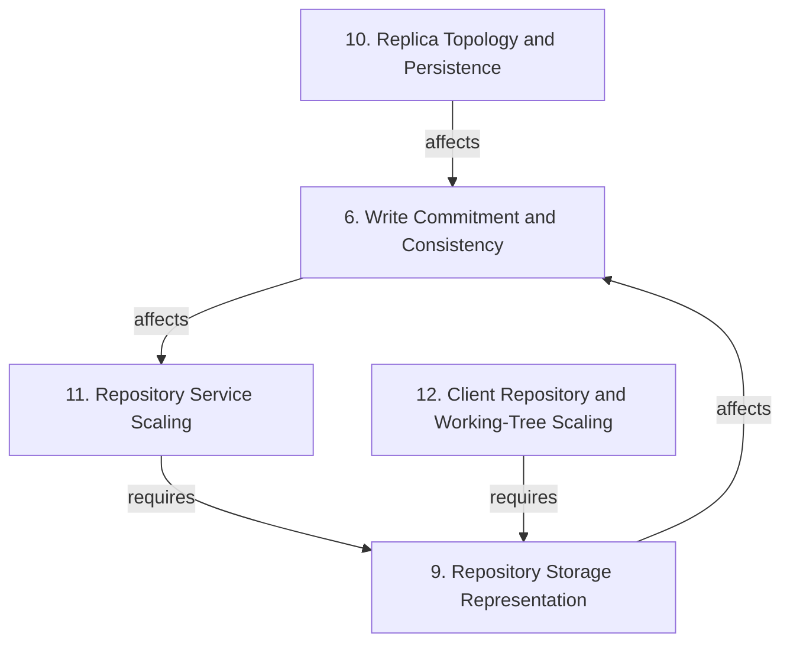

# Grounded Theory Report

## Narrative Summary

This taxonomy describes architectural design decisions for making Git repositories operate at scale: across very many repositories, very large repositories, and very many users, on both hosting servers and clients. It organizes the alternatives teams adopted, considered, or rejected, together with the quality attributes, constraints, and practical concerns that shape those choices.

The view contains five dimensions. Write Commitment and Consistency covers the policies for consistency, acknowledgment, locking, and refusing repository writes. Repository Storage Representation covers the hosting substrate, access form, and Git storage representation. Replica Topology and Persistence covers replica placement and the durable state model used to preserve repository copies across failures. Repository Service Scaling covers server-side routing, transfer, failure detection, maintenance, and platform mechanisms. Client Repository and Working-Tree Scaling covers client-side cloning, indexing, filesystem monitoring, checkout, and local maintenance for large repositories. Within each dimension, the values represent alternative options for its architectural decision.

The dimensions are related rather than independent. Choices on Write Commitment and Consistency affect the outcomes of Repository Service Scaling. Choices on Repository Storage Representation affect the outcomes of Write Commitment and Consistency. Repository Service Scaling requires Repository Storage Representation to be decided first, and Client Repository and Working-Tree Scaling requires Repository Storage Representation to be decided first. The underlying catalog consolidated 200 draft values into 192 distinct values after merging near-duplicates, with evidence linking 319 of 327 open codes to a value and all 48 documents supporting at least one value.

## Dimension Relationship Diagram

## Dimension Catalog

### 6. Write Commitment and Consistency

Which consistency, acknowledgment, locking, and refusal policy governs accepting repository writes?

**Values:**

- **Three-phase commit consensus** — Three-phase commit coordinates repository writes in a way that maps to the Git transaction model.
- **Consistency and partition tolerance priority** — The system prioritizes consistency and partition tolerance over availability when those qualities conflict.
- **Synchronous write commitment** — A write is accepted only after synchronous commitment establishes the durability promise.
- **Permanent data-loss resistance** — Accepted pushes, merges, edits, and repository creations must not be corrupted or reverted.
- **Non-voting geo-replicated hosts** — Geographically replicated hosts do not vote, allowing primary pushes to continue when a replicated host is unreachable.
- **WAL durability before push acknowledgement** — Require durable operation-log persistence before reporting a successful push to the client.
- **Linearized repository operations** — Process pushes and fundamental repository operations in one consistent order.
- **Operation-history replica rewind** — Use recorded repository operations to rewind and fast-forward replicas without synchronizing through an external object or reference database.
- **Replica-based distributed locking** — Replica coordination supplies distributed locks that order repository database updates.
- **Per-write ordering election** — Each write directly elects its winning order and outcome instead of relying on a permanently elected primary.
- **Single-primary replication model** — One elected primary copy determines authoritative write-arrival order for all replicas.
- **Overlapped replica coordination work** — Useful locking, checksum, and database work proceeds while replica network waits are outstanding.
- **Consensus-free arbitrary repository primaries** — Any healthy server may accept a push without election because durable compare-and-swap synchronization makes concurrent updates safe.
- **Rendezvous-ranked primary preference** — The highest-ranked healthy host is preferred to reduce compare-and-swap retries while other hosts remain valid.
- **Minimum two-replica commitment** — An incoming write must be committed to at least two replicas before acceptance.
- **Strict-majority write acknowledgment** — Updates are accepted only after a strict majority applies the change and obtains the same result.
- **Majority-exclusive write locking** — Each write locks a majority exclusively so conflicting writes cannot both acquire a majority simultaneously.
- **Write refusal under insufficient replication** — The system refuses writes when it cannot create the required number of safe copies.
- **Quorum-based replica acceptance** — Accept writes only when the configured healthy replica threshold is available.
- **Continued write replication during quiescing** — Continue sending writes to a server draining reads so its replica does not fall arbitrarily behind.
- **Non-majority write rollback** — Writes not identically applied at a majority are reverted on replicas where they arrived.
- **Unhealthy replica exclusion** — Replicas losing a write vote are removed from read and write service until repaired.
- **Automatic replica repair** — Unhealthy or lagging replicas are repaired automatically to restore redundancy and service capacity.
- **Git reference-update transactions** — Reference changes are coordinated as explicit transactions across replicas.
- **Deterministic replica transaction results** — Replica transaction evaluation produces deterministic reference-update results.
- **Pre-acquired reference locks** — All local reference locks are acquired before transaction validation and commit.
- **Pre-commit reference validation** — Expected old and proposed new reference values are validated before commit.
- **Atomic reference-update rollback** — Failed tentative reference transactions are rolled back in full.
- **WAL-index publication ordering** — Publishing a local reference transaction through an ordered pointer to the durable WAL entry.
- **Quorum-free local publication** — Synchronizing reference publication with one local repository instead of a quorum of replicas.
- **Eventual replica consistency** — Replicas may temporarily expose divergent repository state after a write.
- **Consensus tail-latency growth** — Adding replicas increases the influence of the slowest participant on three-phase-commit latency.
- **Replica-count push-throughput degradation** — Push throughput worsens as more replicas participate in three-phase commit.
- **Replica coordination round-trip cost** — Distributed replica coordination requires multiple network round trips, adding latency to repository operations.
- **Compare-and-swap retry delay** — Competing durable compare-and-swap updates can delay pushes when arbitrary hosts concurrently act as primaries.
- **Per-repository reference-update latency budget** — Targets bounded write completion latency so a repository sustains a required reference-update rate despite replica distance.
- **Availability sacrifice for durability** — Temporary write unavailability results from refusing writes that cannot be safely replicated.
- **Push unavailability without quorum** — Corruption or loss of sufficient healthy copies prevents accepting new pushes.
- **Globally consistent replica reads** — Replica reads remain consistent despite notification loss or topology changes.
- **Degraded-correctness healthy-speed behavior** — The replication design preserves correctness during degradation while retaining fast healthy reads.
- **Replication consistency complexity cost** — Fully consistent replicas impose substantial implementation complexity.

**Outgoing relations:**

- Choices on Write Commitment and Consistency affect the outcomes of Repository Service Scaling (#11): Synchronous commitment, quorum locking, and refusal during insufficient replication can increase write latency or temporary request unavailability.

### 9. Repository Storage Representation

Which repository hosting substrate, access form, and Git storage representation is used?

**Values:**

- **Centralized repository hosting** — A centralized service provides the primary repository access point despite Git's distributed capabilities.
- **Single-machine repository storage** — Application software and repository copies initially coexist on one powerful machine.
- **Filesystem-level repository distribution** — Repositories are distributed through the filesystem layer to scale application instances without changing Rails or Git internals.
- **NFS-based centralized repository storage** — NFS is considered for centralized storage but rejected because Git's local-filesystem assumptions do not work safely or efficiently over it.
- **DHT-backed Git object storage** — Stores individual Git objects in a distributed hash table instead of repository packfiles.
- **Object-level repository distribution** — Distributes individual content-addressed objects across storage nodes rather than preserving repository-level packfile organization.
- **JGit repository-storage abstraction** — Uses replaceable JGit storage interfaces to change repository storage while retaining Git operations.
- **Packfile-based repository storage** — Stores repository code and metadata in compressed Git packfiles.
- **Dedicated fileserver repository hosting** — Keeps repositories on dedicated fileservers and exposes repository operations through remote procedure calls.
- **Whole-file local repository caching** — Caches a complete repository file locally to accelerate random access to repository data.
- **Delta-compressed packfile storage** — Stores most packfile objects as deltas to reduce storage size at the cost of additional read hops.
- **Packfile-based Git networking** — Uses Git packfiles as the client-server transfer representation regardless of internal server storage.
- **Packfile size-minimizing layout** — Places Git objects in packfiles using a compact size-minimization heuristic rather than preserving repository-DAG locality.
- **Git-level distribution** — Repository distribution modifies or distributes Git itself rather than replicating repository data above it.
- **Repository-data transformation** — Repository contents are transformed into a separate client-facing storage format.
- **Application layer over unmodified Git** — Hosting features are built above standard Git repositories without maintaining a Git fork.
- **Plain Git repositories on local NVMe** — Native repositories are stored on local NVMe for random-read performance and client compatibility.
- **Networked-filesystem repository access** — The attempted networked-filesystem approach produces poor performance and buggy behavior because of mismatched filesystem assumptions.

**Outgoing relations:**

- Choices on Repository Storage Representation affect the outcomes of Write Commitment and Consistency (#6): Replica count and placement determine whether quorum or synchronous durability requirements can be met and influence capacity and latency.

### 10. Replica Topology and Persistence

Which replica placement and durable state model maintains repository copies across failures?

**Values:**

- **Cross-rack replica placement** — Replicas are distributed across racks to survive rack-level failures as well as individual node failures.
- **Three-replica repository topology** — Each repository receives at least three copies to provide redundancy and capacity for continued operation after one machine failure.
- **Single-extra-copy topology** — Keeping only one additional copy is considered sufficient for a single-node failure but rejected because concurrent writes still require consistent serialization.
- **Write-ahead-log repository persistence** — Authoritative repository state and provenance persist in a durable write-ahead log rather than fixed host placement.
- **Relational reference database persistence** — Store repository references in an external relational database alongside blob or packfile storage.
- **Incremental replica checksum state** — Maintain logical repository-state checksums incrementally rather than recomputing them from all references. _(consolidated with 1 similar value judged the same decision: "Full checksum recomputation")_
- **Stateless repository placement** — Repository placement is resolved from current healthy hosts without maintaining an external per-repository routing table.
- **Git application-level replication** — Repository replication operates on Git-aware updates rather than filesystem blocks.
- **Proxy-mediated repository replication** — A proxy transparently forwards each Git push to multiple repository replicas.
- **Low-latency replica placement** — Replicas are placed near enough to coordinate updates within acceptable inter-replica communication latency.
- **Disk repository warm cache** — Local disk repositories serve as reconstructible caches rather than fixed authoritative placement.
- **On-demand repository materialization** — A host reconstructs an absent repository locally from durable log state when requests require it.
- **Rendezvous-hash placement hints** — Repository identifiers rank expected healthy hosts without requiring authoritative placement state.
- **N-to-N replica reconstruction** — Replacement replicas are created across the cluster from any surviving repository copies after failures.
- **ETag-validated replica freshness** — Conditional object-store metadata validation confirms replica freshness before serving reads.
- **Read-time replica catch-up** — Replicas apply newer durable log state before serving a read.
- **Elastic per-repository replica allocation** — Replica count expands or contracts according to repository read demand and durable-source availability.
- **WAL-propagated compaction state** — Compaction state is propagated through the authoritative log to keep replicas aligned.
- **Optimistic UDP catch-up gossip** — Replicas exchange catch-up metadata through lossy gossip while durable reads independently validate freshness.
- **Compacted-data replica distribution** — Replicas receive compacted repository data rather than maintaining unrelated storage states.
- **Arbitrary replica-based read scaling** — Read replicas can be deployed in arbitrary numbers to scale read-only operations.
- **File-server content replication** — Replicating repository and gist content stored on file servers across the application’s server fleet.
- **Repository repair and rebalancing** — Repairing and redistributing repository copies as servers and networks fail or topology changes.
- **Disk-backed repository source of truth** — Repository data on local disks is treated as authoritative state rather than merely a reconstructible cache.
- **Filesystem block-level replication** — Repository replicas are synchronized through filesystem block replication below Git's application semantics.
- **Co-located filesystem replica placement** — Keeps filesystem replicas adjacent to control replication latency, rather than separating them across racks or sites.
- **S3 Express object-storage substrate** — A low-latency object-storage tier is selected for high-throughput WAL persistence.
- **Idle-replica overhead** — Maintaining three mostly idle replicas per small or throwaway repository creates substantial overhead as repository counts proliferate.
- **Monorepo traffic capacity shortfall** — Three replicas become insufficient for traffic from massive enterprise monorepos, especially continuous-integration traffic.
- **Pet-repository operational burden** — Continuously tracking repository locations, validity, failures, and repairs creates substantial operational cost at scale.
- **Durable highly available content access** — Maintaining durable, highly available repository and gist access through copies distributed across failures.

**Outgoing relations:**

- Choices on Replica Topology and Persistence affect the outcomes of Write Commitment and Consistency (#6): S3-backed authoritative state, freshness validation, and elastic replica topology change consistency and write-commitment behavior.

### 11. Repository Service Scaling

Which server-side routing, transfer, failure-detection, maintenance, and platform mechanisms scale repository service workloads?

**Values:**

- **Bookkeeping-update transaction coalescing** — Non-user-critical bookkeeping reference updates are combined to reduce transaction cascades.
- **Priority scheduling for user updates** — User-initiated reference updates take priority over maintenance bookkeeping.
- **Sync-aware replica selection** — Reads are routed to nearby replicas known to be sufficiently up to date.
- **Geographically nearby read replicas** — Fetches and clones are served from replicas close to users to reduce transfer distance.
- **Per-application-server failure detectors** — Failure judgments are isolated to application-server and file-server pairs rather than made by one global detector.
- **Hidden remote-reference namespace** — Fetched references are stored under a hidden Scalar namespace, supplying commit-graph inputs without changing normal remote-tracking references.
- **Separated repository and build-artifact directories** — Keep generated build outputs outside the Git-managed source working directory to reduce working-tree management.
- **Centralized missing-object dependency** — Allow clients to depend on a central service to obtain objects absent from the local repository.
- **Co-located transfer cache proxy** — Proxy large-repository object requests through cache servers near users and build machines.
- **Checksum-guided repository repair scheduling** — Detect damaged repository copies quickly and schedule repair work using continuously tracked validity state.
- **Application-traffic failure monitoring** — Use failures observed during real authenticated repository requests, alongside heartbeats, to detect unhealthy servers.
- **Custom Git client dependency** — Scaling features depend on a specialized Git client rather than only the standard Git distribution.
- **Core Git upstreaming** — Performance capabilities are implemented in and contributed to core Git so specialized-client dependencies can eventually be removed.
- **Explicit repository registration** — Users register repositories to activate local configuration and background performance maintenance.
- **Automatic Git performance configuration** — Repository registration applies recommended local Git settings automatically.
- **Thin Git configuration layer** — The specialized client primarily configures capabilities implemented in standard Git rather than owning parallel implementations.
- **Scalar-local performance implementation** — Performance features are implemented only in the specialized Scalar client rather than upstream Git.
- **Foreground automatic garbage collection** — Runs repository garbage collection synchronously at command completion or threshold triggers.
- **Disabled automatic garbage collection** — Disables automatic garbage collection to avoid synchronous command blocking.
- **Repository hosting reliability objective** — Targets repository availability and dependable service so development and CI continue during failures.
- **Repository hosting performance and scale objective** — Targets higher performance and capacity for growing version-control workloads.
- **Migration-friendly repository platform** — Provides a low-friction path for moving repositories onto the hosting platform.
- **Evolvable repository platform** — Continues adapting repository hosting as version-control workloads and engineering requirements change.
- **Quiesced rolling server reboot** — Servers finish in-progress reads, exclude new reads, and restart sequentially within bounded failure domains.
- **Immediate server reboot** — A server restarts without quiescing or completing outstanding reads first.
- **Quiesced read admission** — Withdraw a planned-maintenance server from new reads while allowing existing reads to drain.
- **Rack-scoped maintenance failure domain** — Maintenance treats each rack as an availability zone and reboots racks sequentially.
- **Bounded concurrent reboot count** — Only a limited number of servers reboot concurrently within a maintenance failure domain.
- **Heartbeat load polling** — Heartbeats poll load and signal recovery without serving as the primary failure detector.
- **Three-failure offline threshold** — A node is advisory-offline after approximately three consecutive failed operations.
- **Operation-level replica failover** — Each failed operation tries the next preferred replica without waiting for centralized detection.
- **Preference-ordered replica routing** — Routing returns fresh replicas in preference order for request failover.
- **Advisory replica deprioritization** — Repeatedly failing replicas are tried last but retained as available alternatives.
- **RPC failover-pattern monitoring** — Patterns of cross-server RPC failover identify unavailable or misbehaving servers.
- **Primary-only repository compaction** — Only the primary performs repository compaction to avoid concurrent replica maintenance.
- **S3-distributed compacted packs** — Replicas download compacted packs rather than repacking locally.
- **Unified repository and WAL compaction** — Compaction updates both the on-disk repository and authoritative log state.
- **Replica-side repository repacking** — Each replica independently performs CPU-intensive repository repacking.
- **Replica removal after repeated failures** — Repeatedly failing replicas are removed from routing and replica sets.
- **Periodic repository compaction** — Repository compaction runs periodically to bound packfile growth and lookup cost.
- **Reference-operation speedups** — Reference operations are optimized to reduce per-replica update time.
- **Batched object-storage write processing** — Batching durable object-storage writes rather than imposing independent object-store latency on every push. _(consolidated with 1 similar value judged the same decision: "Single object-storage write per push")_
- **Transitional Scalar performance layer** — Using Scalar as an interim performance layer while equivalent scalability capabilities move into core Git.
- **External repository-placement routing table** — A maintained external table records which hosts contain each repository and supports placement-directed routing.
- **Reference-update processing delay** — Large bookkeeping cascades can keep a repository busy and delay or time out user requests.
- **Reduced Git transfer time** — Nearby synchronized replicas reduce Git fetch and clone transfer time.
- **Localized failure-detection false positive** — A DNS failure causes one application server to make an incorrect offline determination without affecting other servers.
- **No production traffic impact** — The localized detector failure is exposed operationally without affecting production traffic.
- **False-positive server removal** — Failure thresholds can temporarily withdraw a healthy server after coincidental consecutive request failures.
- **Horizontal repository-service scalability** — Improves the ability to scale repository-serving capacity across machines and disks.
- **Hot-repository availability and performance gaps** — Leaves busy repositories exposed to single-machine availability limits and concentrated performance bottlenecks.
- **Foreground maintenance command blocking** — Causes ordinary Git commands to wait while large repository data is rewritten and compressed.
- **System-wide maintenance resource exhaustion** — Consumes system CPU and memory during large repository rewrites, potentially halting the machine.
- **Repository performance decay** — Gradually degrades Git performance as new objects accumulate without maintenance.
- **Read-performance protection during write optimization** — Preserves read responsiveness while optimizing repository writes in read-dominant workloads.
- **Packfile transfer burden** — Requires network transfer of Git packfiles even when server-side storage uses another representation.
- **Agent-driven repository workload growth** — Increases repository, pull-request, and CI demand generated by software agents.
- **Development productivity impact of repository downtime** — Makes repository or CI unavailability capable of severely reducing or stopping development productivity.
- **Temporary reduced-copy state** — A failed or rebooting host temporarily leaves repositories with fewer available copies and reduced failure tolerance.
- **Compaction bottleneck** — Git compaction becomes the throughput limit after object-storage latency is reduced.
- **Bandwidth-for-CPU compaction tradeoff** — Replica CPU work is reduced by increasing compacted-pack download bandwidth.

**Outgoing relations:**

- Repository Service Scaling requires Repository Storage Representation to be decided first (#9): Synchronized read routing, replica health decisions, and geo-distributed serving depend on knowing replica locations and topology.

### 12. Client Repository and Working-Tree Scaling

Which client-side clone, index, filesystem-monitoring, checkout, and local maintenance mechanisms scale large repositories?

**Values:**

- **Partial clone** — Only objects needed for the current checkout are initially transferred to the client.
- **Sparse-checkout working tree** — Materialize only selected repository paths, including cone-mode patterns and later selective expansion, to reduce client working-tree scope.
- **Compressed Git index** — Index compression reduces client-side repository metadata size.
- **Built-in filesystem monitor** — Git's filesystem monitor accelerates status and add operations in repositories with many working-tree files.
- **Rails monolith** — The application begins and largely remains a Rails monolith around repository access.
- **On-demand object retrieval** — Fetch repository objects dynamically when clients need them instead of transferring the complete object history initially.
- **Single-file index management** — Represent and process the complete tracked-path index as one file for core working-directory commands.
- **Git untracked cache** — Cache information about untracked paths to reduce repeated working-directory inspection for repositories with many files.
- **Default sparse clone initialization** — Client clones initially populate only a minimal directory set, with user-controlled expansion or a full-clone override.
- **GVFS protocol integration** — Scalar supports the ecosystem-specific GVFS protocol alongside standard Git performance mechanisms.
- **GVFS protocol standardization** — The GVFS protocol is made a standard feature of the core Git client.
- **Git-aware custom filesystem watcher** — Uses a Git-specific watcher that respects repository exclusions instead of a general-purpose filesystem watcher.
- **Watchman-based filesystem watching** — Uses the general-purpose Watchman tool to detect working-tree changes. _(consolidated with 1 similar value judged the same decision: "Watchman filesystem monitoring")_
- **Virtualized filesystem working-tree scaling** — Uses a virtualized filesystem to defer populated working-tree costs and accelerate checkout presentation. _(consolidated with 1 similar value judged the same decision: "Virtualized filesystem working-tree scaling")_
- **Local Git configuration setup** — Initializes repository-local performance settings as part of enabling the scaling client experience.
- **Hourly background fetch** — Remote objects are fetched periodically outside foreground commands while ordinary local and remote-tracking branches remain unchanged.
- **Background commit-graph maintenance** — Commit graphs and multi-pack indexes are updated asynchronously to keep large-history operations efficient.
- **Incremental reachable-commit graph** — Split incremental commit-graph files include reachable commits while limiting repeated update cost.
- **User-suspendable background maintenance** — Automated repository maintenance can be paused or stopped by the user.
- **Incremental bounded pack repacking** — Small pack batches are rewritten incrementally to control client repository maintenance cost.
- **Multi-pack-index pack migration** — A multi-pack index redirects objects to replacement packs before obsolete packs expire.
- **Two-phase repack and expire** — Pack rewriting and obsolete-pack deletion run as separate maintenance operations.
- **Background Git object-database maintenance** — Expensive object-database cleanup runs in the background instead of blocking routine commands.
- **Ahead/behind calculation suppression** — Interactive status omits expensive ahead/behind comparison.
- **Small-pack batch selection** — Each incremental repack selects a bounded set of small packfiles.
- **Deferred obsolete-pack deletion** — Old packs are deleted only after index references are safely migrated.
- **GVFS deployment without cache infrastructure** — Whether GVFS is deployed without the cache-server infrastructure required for sufficiently large repositories.
- **Git-protocol Scalar registration** — Using ordinary Git protocol access with Scalar registration when GVFS infrastructure is unavailable.
- **Non-virtualized large-repository support** — Scaling very large repositories with Git and client optimizations without requiring a virtualized filesystem.
- **Trace-driven bottleneck identification** — Using tracing and user feedback to identify repository performance bottlenecks for targeted improvements.
- **Single-pack full repacking** — Rewriting all repository objects into one consolidated pack-file during maintenance.
- **Interrupted clone progress loss** — Immediate server reboot can discard progress from a long-running clone that must restart elsewhere.
- **Reduced initial clone footprint** — Filtered object transfer substantially reduces the client download compared with transferring complete repository history.
- **Reduced index storage footprint** — An updated index representation lowers storage and I/O burden for repositories with millions of tracked paths.
- **Low per-entry index processing cost** — Single-file index processing can retain low average cost per tracked entry despite a very large repository.
- **Populated-file modification detection cost** — Detecting modifications among populated working-directory files imposes additional client-side processing cost.
- **Compatibility-limited advanced-feature defaults** — Advanced performance features remain disabled by default when enabling them broadly could reduce compatibility.
- **Linux support** — The specialized client provides supported Linux operation.
- **Pack-file handle pressure** — Unbounded pack counts create file-handle pressure during Git operations.
- **Improved delta-encoding efficiency** — Pack rewriting can improve delta encoding and reduce repository storage.
- **Insufficient scale for GVFS** — Repository and user scale too small to justify GVFS protocol and cache infrastructure.
- **Selective modified-path inspection** — Restricting index and cache work to paths reported as changed instead of scanning every populated path.
- **Git status latency reduction** — Lowering status latency by avoiding full working-directory inspection in very large repositories.
- **Per-pack index scanning overhead** — Lookup degradation caused by scanning an increasingly large collection of pack indexes.
- **Single-pack-equivalent object lookup** — Preserving object lookup performance comparable to a repository consolidated into one pack-file.

**Outgoing relations:**

- Client Repository and Working-Tree Scaling requires Repository Storage Representation to be decided first (#9): Client clone, index, and maintenance mechanisms depend on the repository representation exposed to clients.

## Evaluation

_Observe-only LLM-as-judge scoreboard (judge: openai/gpt-5.6-luna). Pass flags are display-only — nothing gates on them._

| Criterion | Score | Pass | Reason |
|---|---|---|---|
| Orthogonality | 0.20 | ✗ | The five dimensions are not cleanly one-question decision points and contain substantial overlap. Dimension 9, "Repository Storage Representation," combines hosting location, distribution mechanism, Git storage format, and network transfer (for example 9.3, 9.7, 9.8, 9.12, and 9.16); split these into separate existing decision questions and keep each value with the question it answers. Dimensions 10, "Replica Topology and Persistence," and 6, "Write Commitment and Consistency," overlap on replication and durability mechanisms: values such as 10.4, 10.8, 10.9, 10.15, and 10.16 answer the commitment/replication-protocol question represented by 6.1, 6.3, 6.6, and 6.15-6.23, so move them to that decision while retaining placement and durable-state alternatives in 10. Dimension 11, "Repository Service Scaling," bundles routing, failure detection, maintenance, compaction, and client-platform choices; split those questions and move replica-routing/failover values such as 11.3 and 11.31-11.34 to the topology/service-routing question. It also overlaps dimension 12, "Client Repository and Working-Tree Scaling," through client choices such as 11.12-11.17 and 11.43; move those values to 12. These changes would preserve distinct consistency, topology, storage-representation, server-service, and client-scaling questions without merging different concerns. |
| Clarity | 0.30 | ✗ | Many individual values have specific, distinguishable descriptions, but the dimensions do not consistently represent one decision question. Dimension 9, "Repository Storage Representation," combines hosting topology, filesystem access, Git object/packfile representation, networking, and application layering; split it into storage representation and hosting/access decisions, moving existing values accordingly. Dimension 10, "Replica Topology and Persistence," combines replica placement, replication protocol, caching/materialization, and durable-log persistence; split placement/topology from persistence and reconstruction. Dimension 6, "Write Commitment and Consistency," combines consistency model, acknowledgment/quorum policy, locking, transaction mechanics, and repair behavior; split commitment/acceptance policy from transaction coordination. Dimensions 11, "Repository Service Scaling," and 12, "Client Repository and Working-Tree Scaling," each cover several unrelated decision questions, so split their existing values into narrower questions such as routing/failure handling, maintenance/compaction, and client transfer, working-tree, and local-maintenance mechanisms. |
| Completeness | 1.00 | ✓ | All major areas inferred from the use case have decision points with multiple alternatives: repository representation and hosting in dimension 9, replica topology and persistence in 10, write consistency and commitment in 6, server-side scaling and maintenance in 11, and client-side repository and working-tree scaling in 12. Each includes several accepted, rejected, or mixed candidates—for example NFS versus local storage in 9, three replicas versus a single extra copy in 10, quorum-based versus single-primary approaches in 6, and partial clone versus full transfer mechanisms in 12. No major area lacks a multi-option decision point, so no reorganization is required under this criterion. |
| Use case alignment | 1.00 | ✓ | All five dimensions are directly within the use case: repository storage representation (9) addresses hosting substrates and Git storage, replica topology and persistence (10) addresses many repositories and failure scale, write commitment and consistency (6) addresses server-side repository writes, repository service scaling (11) addresses many users and server workloads, and client repository and working-tree scaling (12) addresses very large repositories on clients. Their values cover relevant alternatives and outcomes, including NFS rejection, replica/quorum strategies, failover and maintenance, partial clone, sparse checkout, and background client maintenance. No dimension is outside the stated server/client Git-at-scale scope. |
| No catch-alls | 1.00 | ✓ | No dimension or value is an explicit catch-all bucket such as “Other,” “Miscellaneous,” or “General considerations.” The dimensions and values use specific decision labels, including “Repository Storage Representation,” “Replica Topology and Persistence,” and concrete alternatives such as “NFS-based centralized repository storage,” “Partial clone,” and “Quiesced rolling server reboot.” No revision is needed for this criterion. |
| Axis vs. value | 0.30 | ✗ | The output has recognizable decision-oriented dimensions, but many contain several distinct decisions and values that are subtopics rather than answers. Split dimension 9, "Repository Storage Representation," into existing choices for hosting/access/distribution and Git storage representation, moving values such as 9.1, 9.3, 9.9, 9.8, and 9.11-9.13 accordingly. Split dimension 10, "Replica Topology and Persistence," into topology/placement, durable-authority/materialization, and replica synchronization decisions; values such as 10.1-10.3, 10.4, 10.7/10.12, and 10.15-10.20 currently mix those questions. Similarly reorganize dimension 6 into write protocol/ordering and transaction or quorum policy, since 6.1, 6.10, 6.13, 6.15-6.19, and 6.24-6.30 are separate decision topics. Dimension 11 mixes service routing, maintenance, platform architecture, and client implementation; move 11.12-11.17 to dimension 12 and separate the remaining mechanisms into their corresponding existing decision questions. Dimension 12 also contains the unrelated architectural choice 12.5, "Rails monolith," which should be moved to the server/application architecture decision rather than treated as a client-scaling option. Values such as 11.20-11.23 and 6.4 are objectives or requirements, not candidate answers, and should be reorganized under the decisions they influence rather than left as values. |
| One decision point | 0.20 | ✗ | The taxonomy contains many relevant accepted, rejected, mixed, and outcome values for scaling Git across repositories, users, servers, and clients, and several choices are grounded in durability, latency, availability, or storage trade-offs. However, nearly every dimension combines multiple decision questions. Dimension 9, "Repository Storage Representation," mixes hosting topology (9.1-9.4, 9.9), object/pack representation (9.5, 9.6, 9.8, 9.11, 9.13, 9.17), Git integration strategy (9.7, 9.14, 9.16), and networking or client-facing transformation (9.12, 9.15); split these into decision points only where each resulting group retains at least two candidates, and move the remaining values to the question they answer. Dimension 10, "Replica Topology and Persistence," similarly mixes replica placement and count (10.1-10.3), authority and durable persistence (10.4, 10.5, 10.7, 10.11), replication and freshness protocols (10.6, 10.8, 10.9, 10.15, 10.16, 10.18-10.20), and allocation or repair (10.12-10.14, 10.17, 10.21-10.23); split or move these groups while preserving at least two candidates per resulting dimension. Dimension 6, "Write Commitment and Consistency," combines consistency models, quorum/acknowledgment policy, primary election, locking, and Git reference-transaction mechanics; separate those existing candidate groups into coherent questions. Dimension 11, "Repository Service Scaling," combines routing, failure detection, maintenance/compaction, client dependencies, reboot policy, and platform objectives, so split or move those values into their respective decision questions. Dimension 12, "Client Repository and Working-Tree Scaling," combines clone/working-tree mechanisms, index and filesystem monitoring, background maintenance, protocol choice, and even the server-side "Rails monolith" value (12.5); reorganize these into coherent questions, moving 12.5 out of the client dimension. These cross-question groupings are pervasive despite each dimension having multiple values, so the taxonomy currently provides weak decision-point alignment. |
| Rejected-alternative handling | 0.40 | ✗ | The taxonomy uses valid status labels and generally distinguishes outcomes such as 10.28 Idle-replica overhead and 11.46 Reduced Git transfer time from decision candidates. However, many mixed candidates are described as if unambiguously adopted: 10.6 Incremental replica checksum state, 10.24 Disk-backed repository source of truth, 11.17 Scalar-local performance implementation, 11.39 Replica removal after repeated failures, and 12.11–12.14 describe a definite implementation rather than disagreement or consideration. Rewrite those descriptions to state the competing or disputed adoption, or change the status to accepted where adoption is intended. Also reclassify effect-like accepted values such as 6.4 Permanent data-loss resistance and 11.20 Repository hosting reliability objective as outcomes, rather than accepted alternatives. |
| Dimensional coverage | 1.00 | ✓ | All decision-bearing passages can be placed under at least one taxonomy dimension. Examples include Scalar's partial clone, GVFS, automatic configuration, and background maintenance under dimensions 11 and 12; Spokes' replica placement, quorum writes, three-phase commit, and repair under dimensions 6 and 10; and quiesced rolling reboots under dimension 11. Background or introductory material such as the Spokes renaming does not count against coverage. No unplaced decision-bearing passage was identified, so no taxonomy change is required. |
| Candidate-decision coverage | 0.90 | ✓ | The taxonomy names nearly all explicit adopted and rejected options, including Scalar's partial clone, sparse checkout, background maintenance, Git upstreaming, Spokes quorum replication, three-phase commit, quiesced reboots, and rack-scoped maintenance. Missing options are: add rejected value 'Chaos-monkey server testing' to dimension 11, supported by s03_p08; add rejected value 'Unplanned server unplugging for retirement' to dimension 11, supported by s03_p08 and s03_p09; and add accepted value 'Loose-object cleanup' to dimension 12, supported by s05_p12. |

**Overall score:** 0.63 (mean of evaluated criteria)