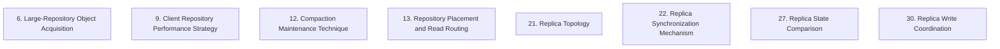

# Grounded Theory Report

## Narrative Summary

This taxonomy captures the architectural design decisions involved in making Git repositories operate at scale: supporting very many repositories, very large repositories, and very many users on both hosting servers and client machines. It covers client approaches for obtaining data from large repositories and improving client-side performance, alongside server-side choices for compacting repository storage, placing repositories, routing reads, maintaining replicas, synchronizing their state, comparing replica contents, and coordinating replicated writes. For each dimension, the alternatives represent different ways to address the relevant performance, scalability, consistency, latency, and operational concerns.

The client dimensions contrast complete data transfer with demand-driven, server-assisted acquisition, and integrated configuration and tooling with native Git scalability changes. The hosting dimensions cover alternative compaction techniques; repository placement and read-routing strategies; replica-count structures; synchronization mechanisms; checksum or state-comparison techniques; and approaches for ordering, committing, and accepting writes across replicas. Together, these dimensions provide the structural overview shown in the relationship diagram and the detailed per-dimension catalog.

The taxonomy consolidated 160 draft values across 24 dimensions, merging one near-duplicate and retaining 159 distinct values. Evidence linking assigned 325 of 338 open codes to values, with all 48 documents supporting at least one value.

## Dimension Relationship Diagram

## Dimension Catalog

### 6. Large-Repository Object Acquisition

How clients obtain Git data for very large repositories, contrasting complete transfer with demand-driven, server-assisted acquisition.

**Values:**

- **Complete object transfer** — Transfers and verifies the full repository object graph during a conventional clone, creating substantial network, server, client, and latency costs.
- **Packfile transfer availability limitation** — Packfile-based transfer and filesystem dependence reduce availability when large storage or servers fail.
- **Repository-size threshold for GVFS deployment** — Repository size and user population determine whether GVFS and cache-server infrastructure are warranted.
- **GVFS demand-driven transfer** — Initially transfers commits and trees, retrieves missing objects on demand, and can use nearby cache servers to reduce central-server load.
- **GVFS-style object-download cache servers** — Separate fetch-object endpoints deliver packfiles while branch-update authority remains on central repository services.
- **Packfile-based Git networking** — Push and fetch operations transfer Git packfiles over the network.
- **Partial clone transfer** — Clients use partial clone to reduce large-repository transfer time and local storage when the hosting service supports it.
- **Standard-Git GVFS protocol support** — The GVFS protocol is not incorporated into the standard Git client.
- **GVFS without cache infrastructure** — GVFS deployment proceeds without the cache-server infrastructure required for scalable large-repository access.

**Outgoing relations:**

- Choices on Large-Repository Object Acquisition affect the outcomes of #15 _(target excluded from this view)_: The DHT design was undermined by Git’s packfile-based clone protocol, while GVFS changes which objects are transferred and when rather than merely changing server storage.

### 9. Client Repository Performance Strategy

How client-side Git performance is improved, contrasting integrated configuration and tooling with native Git scalability changes.

**Values:**

- **Integrated client optimization configuration** — A managed client setup combines configuration, metadata acceleration, filesystem monitoring, fetching, and background maintenance for large repositories.
- **Native Git scalability improvements** — Large-repository performance is improved in Git itself through features such as commit graphs and sparse-checkout enhancements.
- **Repository performance tracing** — Client and repository performance bottlenecks are identified through custom tracing and analysis of user feedback.
- **Custom Git client extensions** — Require a specialized Git client version to deliver repository-scale client performance features.
- **Background client maintenance** — Run repository maintenance asynchronously and incrementally so interactive Git commands avoid expensive foreground work.
- **Git-integrated filesystem watching** — Git uses a watcher that understands repository semantics such as ignore rules to avoid unnecessary scans.
- **Parallel checkout processing** — Checkout work is processed in parallel to address checkout becoming a bottleneck after virtualization removal.
- **Core Git capability consolidation** — Capabilities formerly supplied by Scalar or management layers are incorporated into core Git, reducing specialized client-layer dependence.
- **Virtualized filesystem client** — A virtualized filesystem defers populated-size costs to improve large-repository client performance.
- **Foreground garbage collection** — The client periodically performs garbage collection in the foreground during ordinary user work.
- **Scalar interim performance layer** — Scalar supplies needed client performance temporarily while equivalent capabilities move into core Git.
- **Persistent Scalar dependency** — Scalar remains a required long-term layer above Git for repository-scale client performance.
- **Working-directory inspection by core commands** — Core Git commands inspect on-disk working-directory state as part of repository operations.
- **Complete tracked-path index** — The client index records every tracked path to support core command state inspection.
- **Updated large-index file format** — An updated index representation reduces I/O and storage for millions of tracked entries.
- **Untracked cache** — Git caches untracked-directory information to reduce large-repository inspection work.
- **Single-file index stream I/O** — Index data is streamed through one file with cost dominated by sequential file I/O.
- **Hourly background repository fetch** — Background fetches keep local objects current without placing download work in foreground commands.
- **Hidden remote-reference namespace** — Fetched remote refs are kept under a hidden namespace for maintenance without changing visible refs.
- **Background split commit-graph maintenance** — Reachable commits are maintained asynchronously in incremental split commit-graph layers.
- **Preserved visible branch references during background fetch** — Background fetching updates objects while leaving local and visible remote-tracking branches unchanged.
- **Reachability-based commit-graph coverage** — Background graph generation includes every commit reachable through visible and hidden references.
- **Consolidated client maintenance command** — A single foreground command runs the repository maintenance steps together.
- **Automatic repository registration** — Newly cloned repositories are automatically registered for recommended configuration and ongoing maintenance.
- **Foreground maintenance command blocking** — Synchronous garbage collection delays ordinary interactive Git commands.
- **System-wide rewrite resource exhaustion** — Large synchronous repository rewrites can consume CPU and memory and stall the entire client system.
- **Performance decay from deferred cleanup** — Disabling automatic cleanup without effective background maintenance causes object accumulation and gradual performance deterioration.
- **Checkout slowdown after virtualization removal** — Sparse-checkout introduces slower checkout than virtualization because populated-size costs are no longer deferred.
- **Multi-million-entry index** — The client supports an index containing more than three million tracked entries.
- **Index compression from 400 MB to 250 MB** — The updated index format reduces the stored index size and corresponding command I/O.
- **Foreground-fetch overhead** — Generating commit-graph data during foreground fetch adds user-visible fetch work.
- **Low average index-entry processing time** — Large-index commands retain low per-entry processing cost because streaming I/O dominates.
- **Compatibility-driven default-off performance features** — Advanced performance features remain disabled by default to preserve broad compatibility.

**Outgoing relations:**

_No outgoing relations._

### 12. Compaction Maintenance Technique

Which repacking and object-cleanup techniques maintain compact repository storage?

**Values:**

- **Background incremental maintenance** — Repository maintenance runs incrementally in the background rather than blocking interactive operations.
- **Single-pack full repacking** — Maintenance consolidates all accumulated packfiles into one packfile through a full rewrite.
- **Loose-object cleanup** — Maintenance removes accumulated loose-object storage to reduce disk and lookup overhead.
- **Pack-count and storage reduction** — Incremental repacking reduces pack-file count, storage footprint, and pack-management pressure.
- **Pack-index scan growth** — Accumulating separate pack indexes makes object lookup progressively slower.
- **Loose-object storage overhead** — Accumulated loose objects consume extra disk space and impose performance costs.

**Outgoing relations:**

_No outgoing relations._

### 13. Repository Placement and Read Routing

How are repositories placed and requests routed to suitable hosting replicas?

**Values:**

- **Stateless repository placement** — Any healthy server can materialize repository state without authoritative per-repository placement records.
- **Explicit repository-location tracking** — An external routing table records the machines holding each repository copy and supports locating and validating those copies.
- **Per-server repository location tracking** — The system tracks repository placement on every server as authoritative routing state.
- **Rendezvous-hashed repository routing** — Repository IDs are mapped to expected healthy servers using rendezvous hashing, with placement adjusted as membership changes.
- **Stale-routing recovery** — Routing may be stale after failures, and the system restores service by materializing repository state on a newly selected server.
- **External routing-database placement** — Depend on an external routing database to locate repositories across hosting servers.
- **Closest sufficiently fresh replica routing** — Reads route to the geographically closest replica that meets freshness requirements.
- **Single-replica read routing** — After synchronized publication, each fetch or clone is routed to one repository replica rather than coordinated reads across replicas.
- **Single on-disk repository behind HTTP** — An HTTP frontend serves one conventional on-disk repository from a single host.

**Outgoing relations:**

_No outgoing relations._

### 21. Replica Topology

How many repository replicas are maintained, and what replica-count structure is used?

**Values:**

- **Single-extra-copy replication** — Keeps only one additional copy, sufficient for a single-node failure but insufficient for majority-based coordination of concurrent writes.
- **Three-replica repository replication** — Each repository maintains a fixed floor of three replicas for consistency, redundancy, and continued push acceptance after one failure.
- **Idle-replica resource overhead** — A fixed replica floor consumes substantial resources on numerous small or inactive repositories.

**Outgoing relations:**

_No outgoing relations._

### 22. Replica Synchronization Mechanism

Which mechanism distributes or applies repository state across replicas?

**Values:**

- **Spokes repository replication** — Repository replicas are coordinated through the Spokes architecture to support geographically separated copies.
- **DRBD block-level replication** — Repository filesystems are replicated at the block level through DRBD, requiring latency-close replicas.
- **Git-and-rsync replication** — Repository content is replicated using complementary Git and rsync mechanisms.
- **Packfile-level application replication** — Git data is replicated at the packfile and reference-transaction layer without distributing the Git implementation itself.
- **Git-level distribution** — The architecture distributes or modifies Git itself to provide repository replication.

**Outgoing relations:**

_No outgoing relations._

### 27. Replica State Comparison

Which checksum or state-comparison technique verifies equivalence between replica contents?

**Values:**

- **Checksum-based replica state comparison** — A checksum summarizes logical replica state for equality checking after updates.
- **Incremental XOR checksum maintenance** — Reference changes update the logical-state checksum incrementally by removing the old pair hash and adding the new one.
- **Full checksum recomputation** — Replica consistency checks recompute the checksum from all references for every update.
- **Checksum equality as logical-content equivalence** — Equal replica checksums indicate equivalent logical repository contents.

**Outgoing relations:**

_No outgoing relations._

### 30. Replica Write Coordination

How are replicated repository writes ordered, committed, and accepted?

**Values:**

- **Strict-majority coordinated writes** — Uses three replicas, majority-held exclusive locks, strict-majority acceptance, and replica-wide serialization to prevent conflicting divergent writes.
- **Three-phase commit coordination** — Replicas synchronize reference updates through coordinator-directed prepare, commit, and rollback phases.
- **Transactional Git reference updates** — Git reference mutations use atomic, validated transactions that produce deterministic results and roll back completely on failure.
- **Consensus-free write acceptance** — Any repository instance may accept writes, using storage-level atomic updates instead of elected consensus primaries.
- **Per-write voting without a primary** — Each write directly determines its winning order and outcome rather than following a primary's global ordering.
- **Rollback of non-majority writes** — Writes failing majority agreement are reverted where applied to preserve surviving replica agreement.
- **Consistency-and-partition-tolerance priority** — Replica write coordination prioritizes consistency and partition tolerance over write availability.
- **Replica-based distributed locking** — Replicas provide distributed locks that order coordinated database updates.
- **Overlapped replica-coordination work** — The coordinator performs database, checksum, and lock work concurrently while replica communication is in flight.
- **Durability-gated write acceptance** — Writes are accepted only after the required number of replicas have synchronously committed them.
- **Orchestrated push fan-out** — An orchestrator distributes pushed packfiles and reference transactions to repository instances.
- **Unsynchronized packfile distribution** — Pushed packfiles fan out without consensus because they are unreachable until references commit.
- **Single-local-repository synchronization** — Reference transactions synchronize with one local repository rather than a replica quorum.
- **Read-preserving replicated-write optimization** — Replication write acceleration is designed without degrading the much more frequent repository reads.
- **Replica-distance reference-update limit** — Geographic replica latency bounds sustainable per-repository reference-update throughput. _(consolidated with 1 similar value judged the same decision: "Per-repository reference-update latency budget")_
- **Reference-update amplification** — Pull-request bookkeeping can multiply one user push into many additional replicated reference updates.
- **Slowest-replica consensus latency** — Coordinated replication latency is bounded by the slowest participating replica.
- **Replica-count push-throughput degradation** — Adding replicas reduces push throughput because consensus waits on more participants and their tail latency.
- **Replica round-trip coordination latency** — Multiple distant-replica round trips consume the write-coordination latency budget.
- **Write unavailability during replication shortfall** — Writes become temporarily unavailable when the required replica count cannot be synchronously achieved.

**Outgoing relations:**

- Choices on Replica Write Coordination limit the options available on #5 _(target excluded from this view)_: The system can reboot one server while writes continue because the remaining replicas can form the required majority; a weaker replication design would provide different maintenance guarantees.

## Discarded Dimensions

Dimensions considered during taxonomy generation but excluded from this view during dimension selection, judged not relevant to the stated use case:

- **5. Planned Maintenance Availability** — Outside the cap of 8 dimensions (taxonomy.max_num_clusters): ranked 15 of 23 selected.
- **7. Working-Directory Population Strategy** — Outside the cap of 8 dimensions (taxonomy.max_num_clusters): ranked 16 of 23 selected.
- **10. Repository Hosting Model** — Outside the cap of 8 dimensions (taxonomy.max_num_clusters): ranked 9 of 23 selected.
- **11. Compaction Execution Locus** — Outside the cap of 8 dimensions (taxonomy.max_num_clusters): ranked 14 of 23 selected.
- **14. Hosting Failure Detection and Failover** — Outside the cap of 8 dimensions (taxonomy.max_num_clusters): ranked 23 of 23 selected.
- **15. Git Object Storage Backend** — Outside the cap of 8 dimensions (taxonomy.max_num_clusters): ranked 17 of 23 selected.
- **16. Packfile Organization Strategy** — Outside the cap of 8 dimensions (taxonomy.max_num_clusters): ranked 10 of 23 selected.
- **17. Physical Repository Storage Distribution** — Not a decision point: 1 candidate decision(s) (accepted/rejected/mixed values) besides outcomes; at least 2 required.
- **23. Replica Consistency Model** — Outside the cap of 8 dimensions (taxonomy.max_num_clusters): ranked 22 of 23 selected.
- **24. Replica Placement** — Outside the cap of 8 dimensions (taxonomy.max_num_clusters): ranked 11 of 23 selected.
- **25. Replica Reconstruction and Lifecycle** — Outside the cap of 8 dimensions (taxonomy.max_num_clusters): ranked 12 of 23 selected.
- **26. Replica Freshness Verification** — Outside the cap of 8 dimensions (taxonomy.max_num_clusters): ranked 13 of 23 selected.
- **28. Repository Persistence Architecture** — Outside the cap of 8 dimensions (taxonomy.max_num_clusters): ranked 18 of 23 selected.
- **31. Replica Bookkeeping Scheduling** — Outside the cap of 8 dimensions (taxonomy.max_num_clusters): ranked 21 of 23 selected.
- **32. Durable Write Acknowledgment and Publication** — Outside the cap of 8 dimensions (taxonomy.max_num_clusters): ranked 19 of 23 selected.
- **33. Object-Storage Write Batching** — Outside the cap of 8 dimensions (taxonomy.max_num_clusters): ranked 20 of 23 selected.

## Evaluation

_Observe-only LLM-as-judge scoreboard (judge: openai/gpt-5.6-luna). Pass flags are display-only — nothing gates on them._

| Criterion | Score | Pass | Reason |
|---|---|---|---|
| Orthogonality | 0.50 | ✓ | Most dimensions ask distinct questions, such as repository placement (13), client acquisition (6), compaction (12), and replica-state comparison (27). However, Replica Topology (21) overlaps Replica Write Coordination (30): the three-replica choice in 30.1 answers 21's replica-count question and should be kept under 21, while 30 should focus on ordering, quorum, and commit acceptance. Replica Synchronization Mechanism (22) also overlaps 30 through fan-out and replication-application values 30.11 and 30.12; move those values to 22 and retain coordination guarantees in 30. The GVFS/cache choices in 6 and the integrated client strategy in 9 are adjacent but can remain separate if 6 retains transfer-acquisition alternatives and 9 retains local performance techniques. |
| Clarity | 0.70 | ✓ | Most dimensions have decision-oriented names and detailed descriptions, and many values are clearly differentiated, such as 21.1 versus 21.2 and 12.2 versus 12.1. However, several values overlap or rely on jargon: merge 13.2 "Explicit repository-location tracking" with 13.6 "External routing-database placement" or make their distinction explicit; merge 30.4 "Consensus-free write acceptance" with near-synonymous 30.5 "Per-write voting without a primary"; clarify or rename 27.1 "Checksum-based replica state comparison" so it is clearly distinct from the more specific 27.2 "Incremental XOR checksum maintenance"; and replace the jargon-only description of 22.1 "Spokes repository replication" with a concrete contrast to 22.3 and 22.4. Dimension 6 also contains broad, overlapping labels such as 6.1 "Complete object transfer" and 6.6 "Packfile-based Git networking," which should be renamed or consolidated to make their scopes unambiguous. |
| Completeness | 0.90 | ✓ | The taxonomy covers the main decision areas implied by the use case with multiple candidates: server redundancy and failure tolerance in 21 Replica Topology, replication mechanisms in 22 Replica Synchronization Mechanism, write coordination in 30 Replica Write Coordination, placement and read scaling in 13 Repository Placement and Read Routing, storage maintenance in 12 Compaction Maintenance Technique, large-repository transfer in 6 Large-Repository Object Acquisition, and client scalability in 9 Client Repository Performance Strategy. Verification choices are also represented in 27 Replica State Comparison. No major use-case area lacks a decision point with several candidate decisions; the main revision opportunity is only to reorganize the crowded alternatives in 30, not to add coverage. |
| Use case alignment | 1.00 | ✓ | All eight dimensions are within the use case's scope: replica topology, synchronization, write coordination, placement and read routing address hosting-server scalability for many repositories and users; compaction and replica-state comparison address large-scale repository storage and reliability; large-repository object acquisition and client repository performance address client-side scalability. No dimension is unrelated to Git architecture, the stated lifecycle, or the server/client focus. |
| No catch-alls | 1.00 | ✓ | No catch-all dimensions or values were found. The taxonomy uses specific decision points such as Replica Topology, Compaction Maintenance Technique, Large-Repository Object Acquisition, and Replica State Comparison, with concrete alternatives and outcomes rather than labels like “Other,” “Miscellaneous,” or “General considerations.” No reorganization is needed for this criterion. |
| Axis vs. value | 0.30 | ✗ | Several dimensions are genuine decision points, such as 21 Replica Topology and 22 Replica Synchronization Mechanism, but major dimensions bundle multiple decisions. Split 30 Replica Write Coordination into separate dimensions for write-acceptance/ordering, commit and transaction protocol, replication fan-out, and coordination optimizations, moving values such as 30.2, 30.3, 30.8, and 30.11 accordingly. Split 9 Client Repository Performance Strategy into client architecture, maintenance scheduling, filesystem/index handling, and background fetch/commit-graph decisions; its values 9.6, 9.15, 9.18, and 9.23 are sub-decisions rather than alternatives to one strategy question. Split 13 Repository Placement and Read Routing into placement and read-routing dimensions. Also separate 6 Large-Repository Object Acquisition's transfer method from cache-server topology and deployment conditions, and refine 27 Replica State Comparison so checksum choice is distinct from incremental-versus-full checksum maintenance. |
| One decision point | 0.20 | ✗ | Several dimensions are valid decision points, such as 21 Replica Topology, 12 Compaction Maintenance Technique, 22 Replica Synchronization Mechanism, and 27 Replica State Comparison, each with at least two candidate decisions. However, major dimensions mix different questions. Split 30 Replica Write Coordination into separate coordination protocol, reference-update atomicity, push fan-out, and locking decisions, moving existing values so each resulting dimension retains at least two candidates. Split 9 Client Repository Performance Strategy into client delivery approach, working-tree/index mechanisms, and maintenance scheduling; its values currently mix architecture choices, individual features, implementation techniques, and outcomes. Split 6 Large-Repository Object Acquisition into object-transfer strategy/protocol and cache-server deployment, moving 6.5 and 6.9 to the latter. Split 13 Repository Placement and Read Routing into placement/state-location decisions and read-routing decisions. These broad mixed-question dimensions substantially violate the requirement that every dimension's candidates answer one question. |
| Rejected-alternative handling | 0.60 | ✓ | All values use valid statuses, and most rejected, accepted, and outcome descriptions are consistent. However, several mixed candidates are stated as adopted: 22.1 'Spokes repository replication', 6.6 'Packfile-based Git networking', and 9.12 'Persistent Scalar dependency' should explicitly reflect source disagreement or be given a stance consistent with their descriptions. Value 6.1 'Complete object transfer' is phrased as an alternative acquisition strategy but marked as an outcome; reclassify it as a candidate decision. Value 6.3 'Repository-size threshold for GVFS deployment' describes a deployment decision or criterion rather than an effect, so reclassify it as a candidate decision or move it under an existing decision where it is an outcome. |
| Dimensional coverage | 0.90 | ✓ | Most decision-bearing passages map to the taxonomy, including client optimization in dimension 9, replication mechanisms in dimension 22, placement and routing in dimension 13, and write coordination in dimension 30. The main gaps are s03_p07 and s03_p08, which decide to quiesce servers, preserve long-running reads, and use controlled rolling reboots or retirement instead of abrupt shutdowns; add a dimension such as “Planned Server Maintenance Strategy” with values for quiescing and rolling retirement. s01_p04 discusses rejecting distributed filesystems such as NFS because of filesystem-semantic and performance problems, which is not represented by 22.2 “DRBD block-level replication”; add a rejected “Distributed filesystem replication” value to dimension 22, supported by s01_p03 and s01_p04. |
| Candidate-decision coverage | 0.70 | ✓ | The taxonomy covers many adopted or rejected options, including DRBD rejection and Git-and-rsync replication (22.2, 22.3), three replicas and majority coordination (21.2, 30.1), background maintenance and fetches (9.5, 9.18), partial clone (6.7), and rendezvous-hashed placement (13.4). Important specific options are missing: add a sparse-checkout/cone-mode value and the /src working-directory layout to dimension 9, supported by s04_p02 and s05_p04; add a multi-pack-index maintenance value to dimension 12, supported by s04_p02 and s05_p12; add a WAL-in-S3 source-of-truth/CAS replication value to dimension 22, supported by s01_p11; add bookkeeping-update coalescing and user-update prioritization to dimension 30, supported by s02_p06; and add a planned-maintenance dimension covering quiescing, rolling rack reboots, and graceful retirement/repair, supported by s03_p07, s03_p08, and s03_p09. |
| Value exclusivity (computed, no judge) | 0.35 | ✗ | - Dimension 9 'Client Repository Performance Strategy': 3 of 3 sources adopt several of its values. Values 9.2 'Native Git scalability improvements' and 9.8 'Core Git capability consolidation' are adopted together by s01, s04, s05 (passages s01_p10, s01_p16, s04_p01). - Dimension 13 'Repository Placement and Read Routing': 3 of 3 sources adopt several of its values. Values 13.4 'Rendezvous-hashed repository routing' and 13.5 'Stale-routing recovery' are adopted together by s01, s03 (passages s01_p11, s03_p04). - Dimension 30 'Replica Write Coordination': 3 of 3 sources adopt several of its values. Values 30.1 'Strict-majority coordinated writes' and 30.2 'Three-phase commit coordination' are adopted together by s01, s02 (passages s01_p07, s01_p08, s01_p09). - Dimension 6 'Large-Repository Object Acquisition': 2 of 3 sources adopt several of its values. Values 6.4 'GVFS demand-driven transfer' and 6.7 'Partial clone transfer' are adopted together by s04, s05 (passages s04_p01, s04_p02, s05_p01). Values one source uses together are not alternatives. Split such a dimension into the questions its values answer (every part keeps at least two candidate decisions), move a value to the existing dimension whose question it answers, or merge two values that are the same option. |

**Overall score:** 0.65 (mean of evaluated criteria)